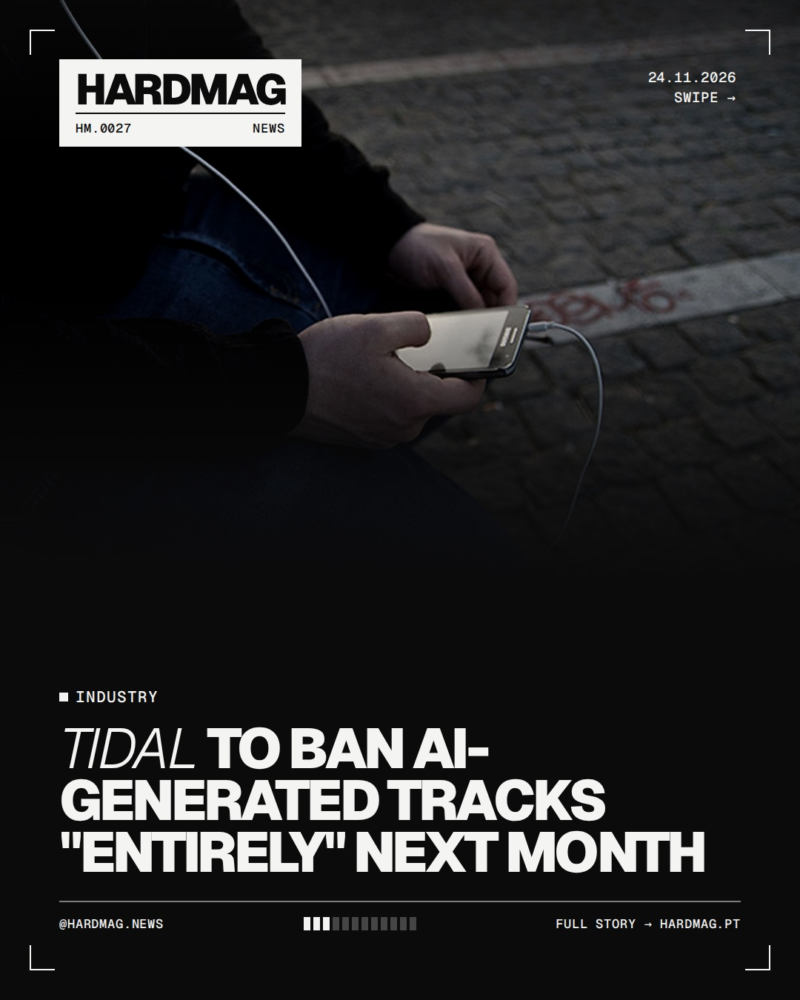
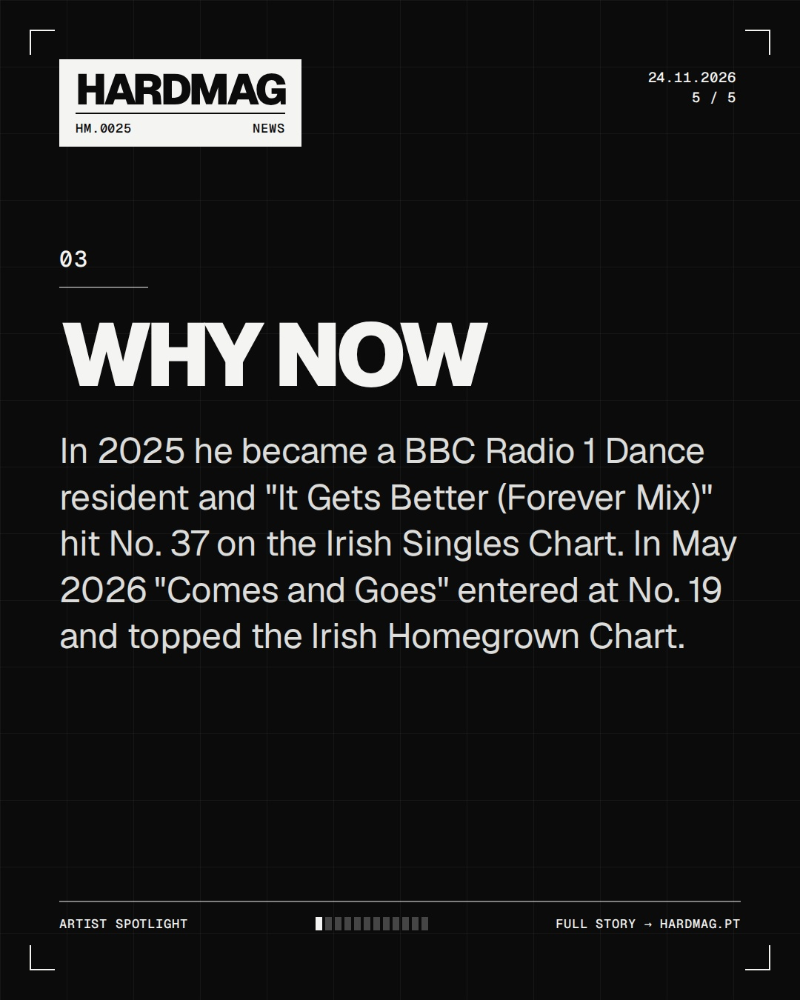
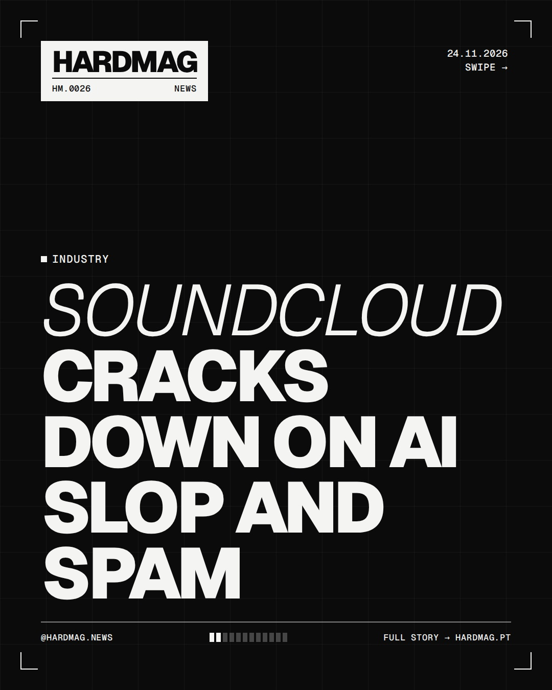
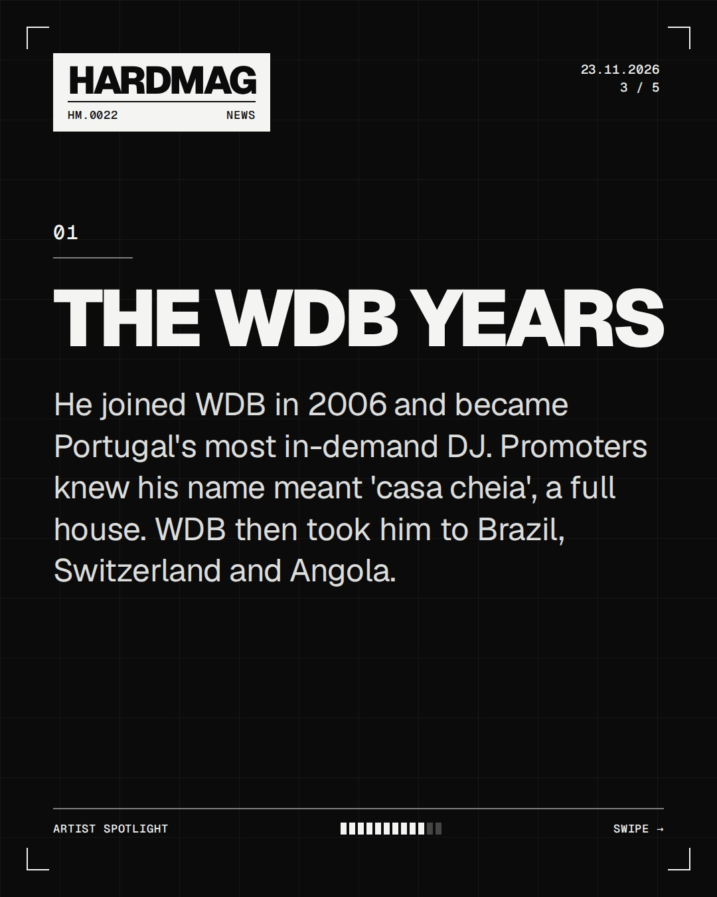
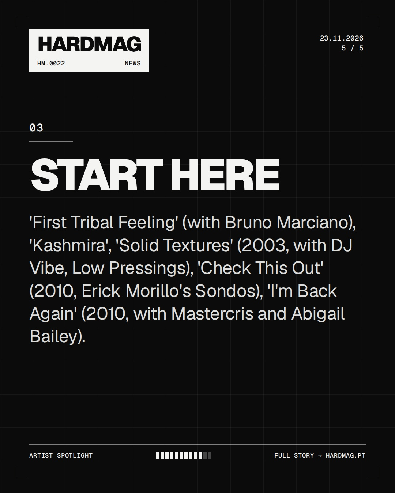
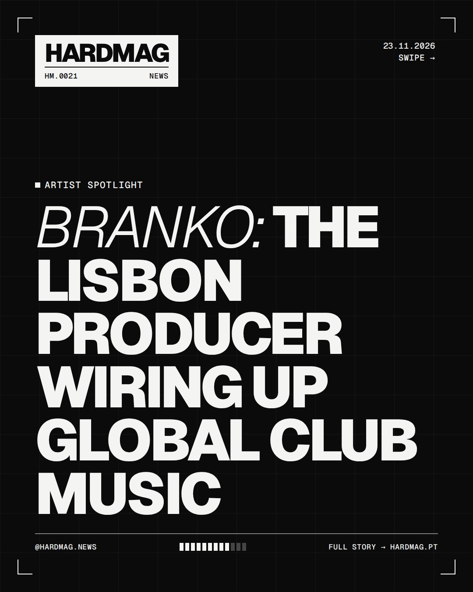
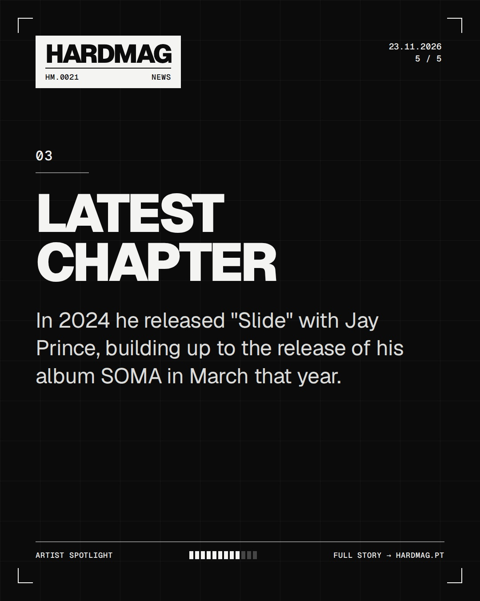
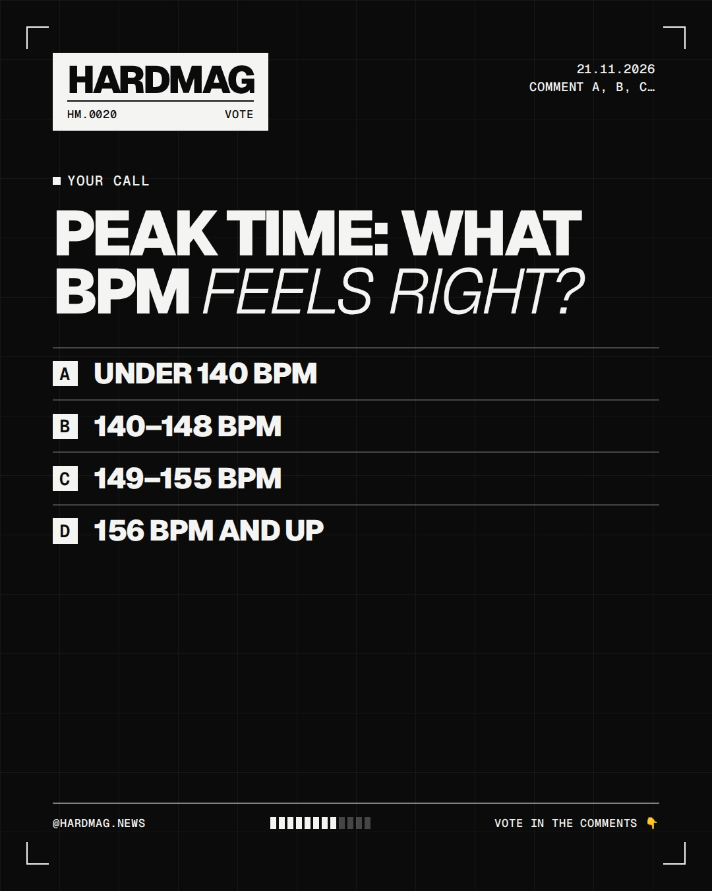
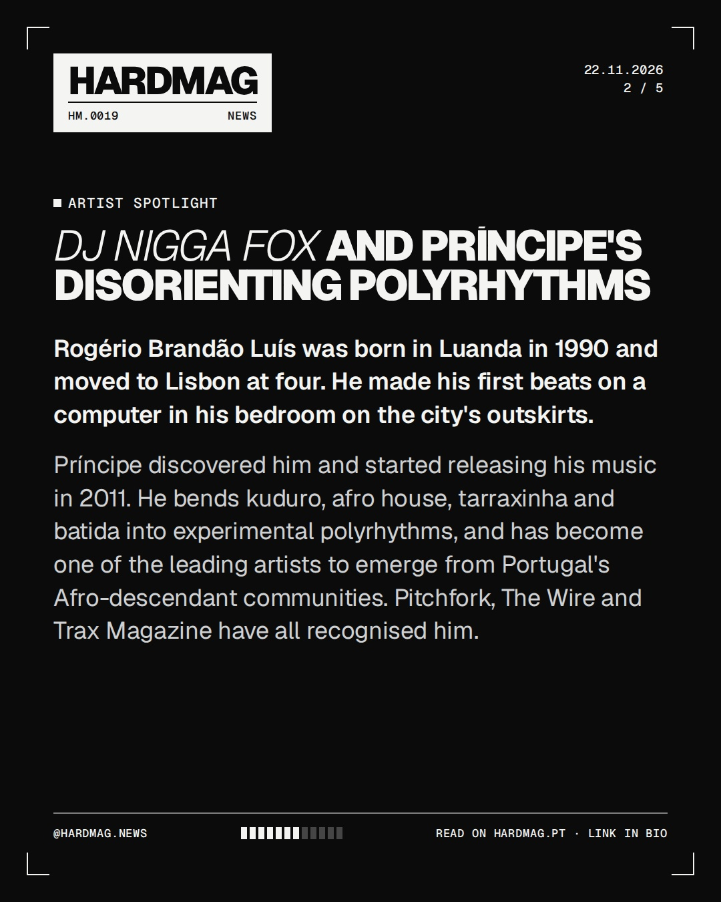
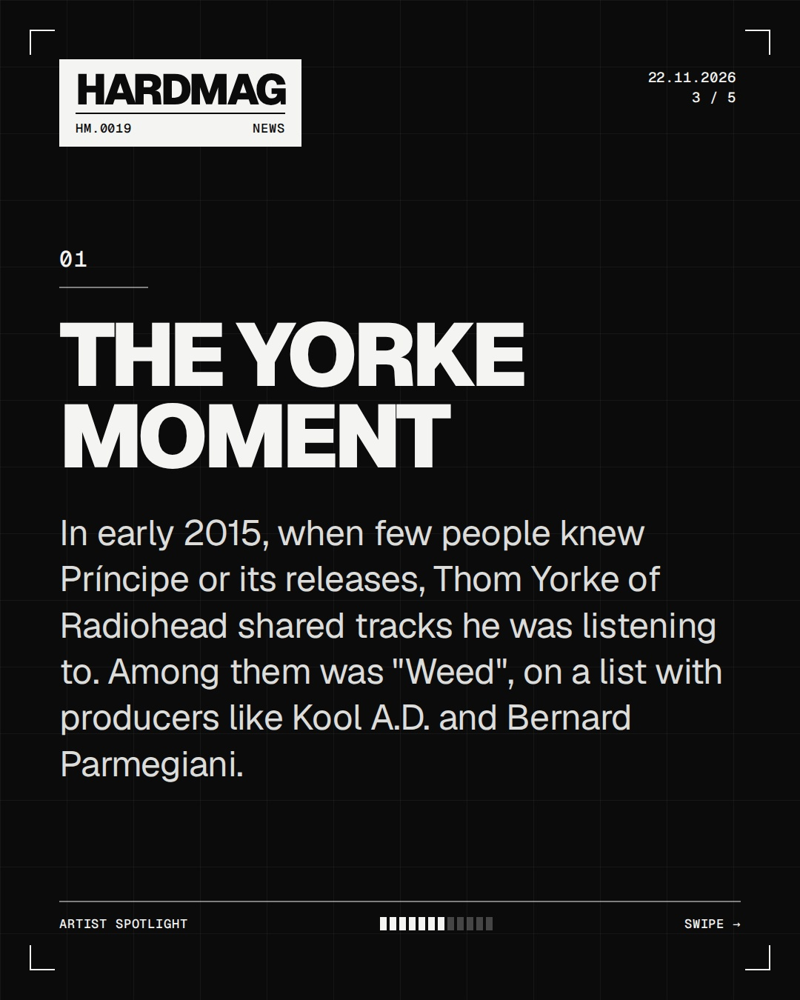

# HARDMAG: fila de posts

Atualizado terça, 24/11, 19:51 (hora de Lisboa). Cada post é escrito, revisado pelo editor-chefe, renderizado e testado na API do Instagram até 2 dias antes do horário. No horário, só é publicado.

**Prontos:** 1 · **Horários ainda sem post (próximas 24 h):** quarta, 25/11, 08:44 Notícias PT, quarta, 25/11, 12:05 Almoço, quarta, 25/11, 14:44 Artistas, quarta, 25/11, 19:40 Cena, quarta, 25/11, 22:41 Noite

## Próximos
### terça, 24/11, 22:47 · Noite · ✅ pronto
**TIDAL to ban AI-generated tracks "entirely" next month** (news)

 

<details><summary>Legenda</summary>

```
Tagging them wasn't enough. TIDAL says AI-generated tracks get banned "entirely" next month.

Per Mixmag, the streaming service says it has labelled and demonetised 100% of AI tracks on its platform since July. What the ban means in practice, whether it hits tracks already up or only new uploads, isn't spelled out yet.

HARDMAG's take: one major streamer is now treating AI tracks as something to ban, not just label. For the malta releasing tunes from a bedroom in Lisbon or Porto, the real question is whether Spotify and Beatport follow.

Where do you draw the line on AI in the music you dance to and play? 👇

Full story → hardmag.pt/news/2026-11-24-tidal-to-ban-ai-generated-tracks-entirely-next-mon/ (link in bio)

Source: @mixmag
📸 via @mixmag

#tidal #aimusic #streaming #musicindustry #musicproduction
```
</details>

Verificado: caption ok (814 chars, 5 hashtags, 2 mentions) · 2 slide(s) online · video online · story online · website article ok · Instagram accepted the post (with motion cover) · Instagram accepted the story


## Recentes
### terça, 24/11, 19:46 · Cena · 📤 publicado
**Best hard techno DJ in Portugal right now?** (poll)


<details><summary>Legenda</summary>

```
Hard techno in Portugal keeps growing, from Lisbon to Porto and everywhere in between, and we want to hear from the people on the dancefloor every weekend. Which hard techno DJ in Portugal would you travel for right now? Tag them in the comments and tell us why: a set that floored you, their selection, how they work a room. Then tag a friend who'd pick someone else. Residents, headliners and newer names all count.

Tag your pick in the comments and tell us why 👇

📸 photochino, CC BY 2.0, via Wikimedia Commons

#hardtechno #hardtechnoportugal #techno #lisboa #porto #portugal
```
</details>

Verificado: caption ok (582 chars, 6 hashtags, 0 mentions) · 1 slide(s) online · story online · website article ok · Instagram accepted the post · Instagram accepted the story · [ver no Instagram](https://www.instagram.com/hardmag.news/)

### terça, 24/11, 13:35 · Artistas · 📤 publicado
**Kettama: from a Galway Launchpad to Radio 1** (spotlight)

    

<details><summary>Legenda</summary>

```
He taught himself to produce by remaking a Tyga piano line on an Ableton trial. By 2024 he was at Glastonbury.

@kettama, born Evan Campbell in Galway, was playing clubs at 17, and plays from Mall Grab and Annie Mac then took his music beyond Ireland. Since then he has co-founded G-Town Records with Shampain, formed KETBOI69 with @partiboi69 and taken a BBC Radio 1 Dance residency. Swipe for the route from SoundCloud uploads to the Irish Singles Chart.

Which Kettama track or set hit you hardest, and where did you hear it? 👇

Full story → hardmag.pt/news/2026-11-24-kettama-from-a-galway-launchpad-to-radio-1/ (link in bio)

📸 Ricardo Liberato, CC BY-SA 2.0, via Wikimedia Commons

#kettama #housemusic #galway #irishmusic #bbcradio1dance #ketboi69
```
</details>

Verificado: caption ok (756 chars, 6 hashtags, 2 mentions) · 5 slide(s) online · video online · story online · website article ok · Instagram accepted the post (with motion cover) · Instagram accepted the story · [ver no Instagram](https://www.instagram.com/hardmag.news/)

### terça, 24/11, 08:56 · Notícias PT · 📤 publicado
**SoundCloud cracks down on AI slop and spam** (news)

 

<details><summary>Legenda</summary>

```
SoundCloud can now withhold or claw back payouts from users who use AI to game its systems.

The platform is cracking down on "AI slop, spam, and excessive uploads" under new terms. The move comes weeks after SoundCloud struck AI deals with Moises and ElevenLabs.

Where should a platform draw the line between using AI as a tool and gaming the system? 👇

Full story → hardmag.pt/news/2026-11-24-soundcloud-cracks-down-on-ai-slop-and-spam/ (link in bio)

Source: @musicbizworldwide
📸 via @musicbizworldwide

#soundcloud #aimusic #musicindustry #musicproducer #streaming
```
</details>

Verificado: caption ok (571 chars, 5 hashtags, 2 mentions) · 2 slide(s) online · story online · website article ok · Instagram accepted the post · Instagram accepted the story · [ver no Instagram](https://www.instagram.com/hardmag.news/)

### segunda, 23/11, 19:52 · Cena · 📤 publicado
**Fast groove, bouncy or hard techno?** (poll)


<details><summary>Legenda</summary>

```
Peak time in Portugal: fast groove, bouncy or hard techno? 👇

One letter in the comments:
A: Fast groove
B: Bouncy
C: Hard techno
D: All of it, mixed

Bonus points: name the track that converted you.

#hardmag #fastgroove #bouncy #hardtechno #hardgroove #hardhouse
```
</details>

Verificado: caption ok (483 chars, 6 hashtags, 0 mentions) · 1 slide(s) online · story online · website article ok · Instagram accepted the post · Instagram accepted the story · [ver no Instagram](https://www.instagram.com/hardmag.news/)

### segunda, 23/11, 13:15 · Artistas · 📤 publicado
**Pete Tha Zouk: Locomia to DJ Mag's No. 37** (spotlight)

    

<details><summary>Legenda</summary>

```
Before DJ Mag's No. 37, @petethazouk learned the job watching the world's top DJs at Locomia.

When Chus heard his early track 'First Tribal Feeling', Pete went to Madrid to master it at the Chus & Ceballos studio. In 2003 he released 'Solid Textures' with DJ Vibe on Low Pressings, and in 2010 'Check This Out' came out on Sondos, Erick Morillo's label. In October 2011 he jumped from 81 to 37 in the DJ Mag Top 100, the highest any Portuguese DJ had ever placed.

Which Pete Tha Zouk track takes you straight back to a Portuguese dancefloor? 👇

Full story → hardmag.pt/news/2026-11-23-pete-tha-zouk-locomia-to-dj-mags-no-37/ (link in bio)

#petethazouk #portugal #olhao #djmag #housemusic
```
</details>

Verificado: caption ok (691 chars, 5 hashtags, 1 mentions) · 5 slide(s) online · story online · website article ok · Instagram accepted the post · Instagram accepted the story · [ver no Instagram](https://www.instagram.com/hardmag.news/)

### segunda, 23/11, 08:37 · Notícias PT · 📤 publicado
**Branko: the Lisbon producer wiring up global club music** (spotlight)

    

<details><summary>Legenda</summary>

```
Lisbon as a switchboard for global club music: that's the @brankoofficial story.

João Barbosa first became known as part of Buraka Som Sistema before going solo as Branko. Swipe for the albums, a network of collaborators that includes M.I.A., and the Enchufada show on NTS broadcast from Lisbon.

Which Portuguese artist or label do you think does the most to connect Lisbon with club scenes abroad? 👇

Full story → hardmag.pt/news/2026-11-23-branko-the-lisbon-producer-wiring-up-global-club-m/ (link in bio)

#branko #enchufada #lisbon #portugal #ntsradio #clubmusic
```
</details>

Verificado: caption ok (569 chars, 6 hashtags, 1 mentions) · 5 slide(s) online · story online · website article ok · Instagram accepted the post · Instagram accepted the story · [ver no Instagram](https://www.instagram.com/hardmag.news/)

### domingo, 22/11, 19:48 · Cena · 📤 publicado
**Peak time: what BPM feels right?** (poll)



<details><summary>Legenda</summary>

```
Tempos keep climbing on dancefloors from Lisbon to Porto. Fast groove, bouncy and hard techno all hit a different spot, and some ravers still say slower hits harder. So when the room is full and the night is at its peak, what tempo does it for you? Vote, then tell us in the comments where the line is between groove and too fast, and which Portuguese dancefloor got the tempo just right for you.

A: Under 140 BPM
B: 140–148 BPM
C: 149–155 BPM
D: 156 BPM and up

Vote with the letter in the comments 👇

#hardmag #fastgroove #bouncy #hardtechno #techno #bpm
```
</details>

Verificado: caption ok (558 chars, 6 hashtags, 0 mentions) · 1 slide(s) online · story online · website article ok · Instagram accepted the post · Instagram accepted the story · [ver no Instagram](https://www.instagram.com/hardmag.news/)

### domingo, 22/11, 13:36 · Artistas · 📤 publicado
**DJ Nigga Fox and Príncipe's disorienting polyrhythms** (spotlight)

    

<details><summary>Legenda</summary>

```
In 2015 Thom Yorke put @djnigga.fox's "Weed" on his listening list next to Bernard Parmegiani.

Since Príncipe started releasing his music in 2011, Rogério Brandão Luís has bent kuduro, batida and tarraxinha into experimental polyrhythms, playing from @luxfragil, @musicboxlisboa and Porto's Hard Club to Berghain and WWW in Tokyo. He has also released on Warp Records, from "LUMI" on CARGAA 1 (2014) to Crânio (2018). Swipe for "Sons do Gueto", the Pedro Costa soundtrack and where to start.

Which DJ Nigga Fox record would you hand to someone new to Príncipe? 👇

Full story → hardmag.pt/news/2026-11-22-dj-nigga-fox-and-principes-disorienting-polyrhythm/ (link in bio)

#djniggafox #principediscos #batida #kuduro #lisbonclubculture #afrohouse
```
</details>

Verificado: caption ok (747 chars, 6 hashtags, 3 mentions) · 5 slide(s) online · story online · website article ok · Instagram accepted the post · Instagram accepted the story · [ver no Instagram](https://www.instagram.com/hardmag.news/)

