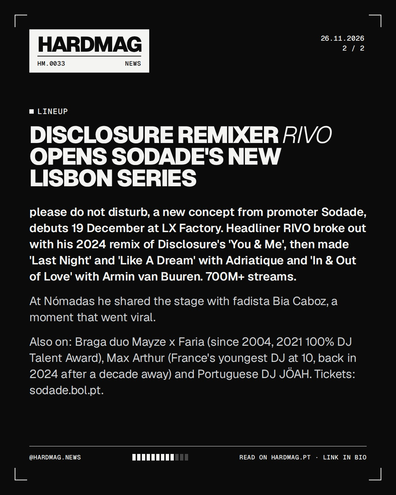
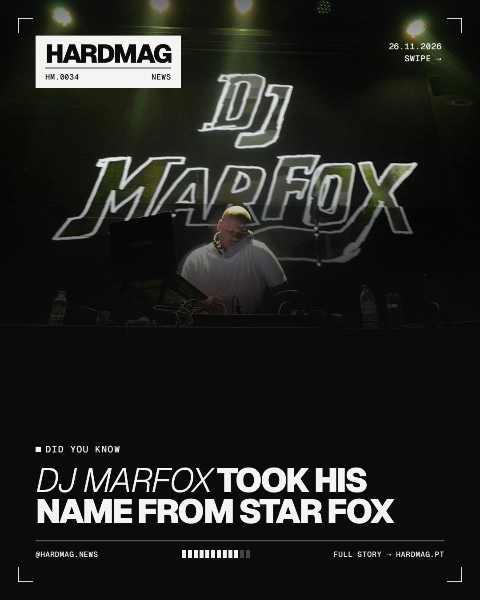
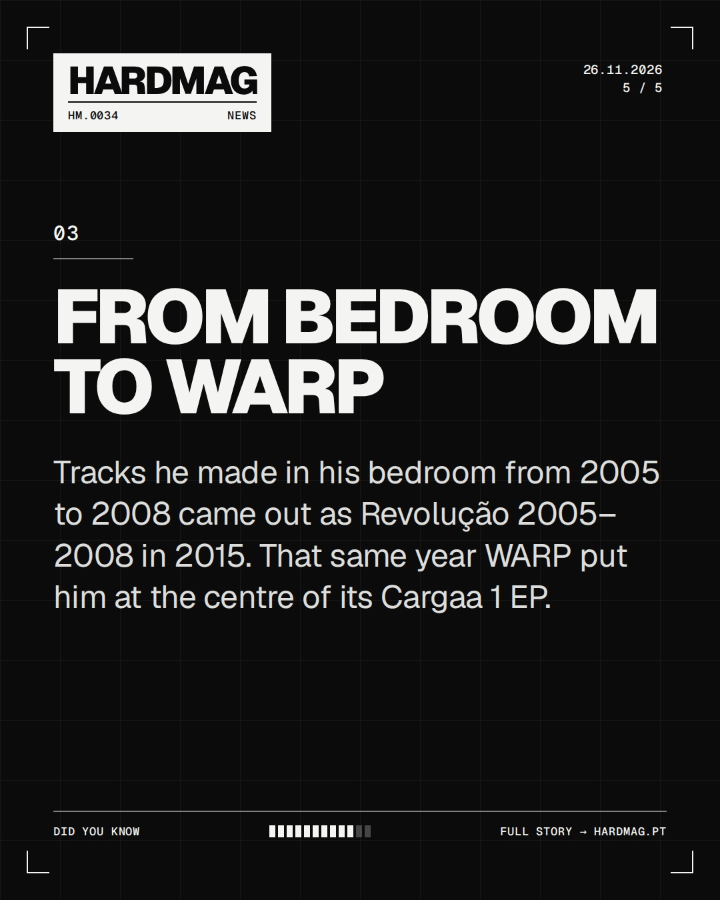
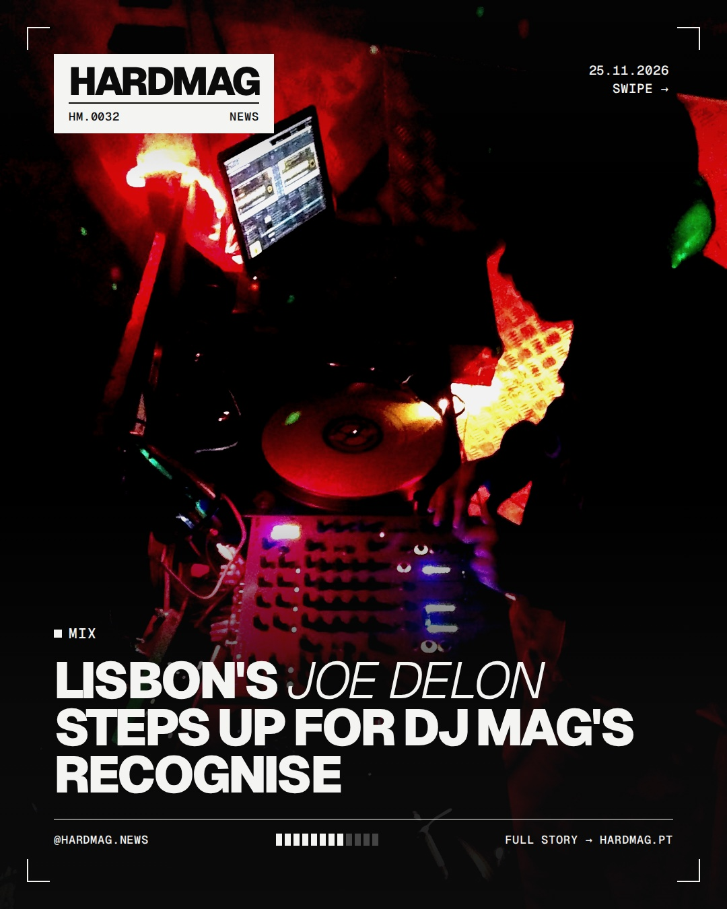
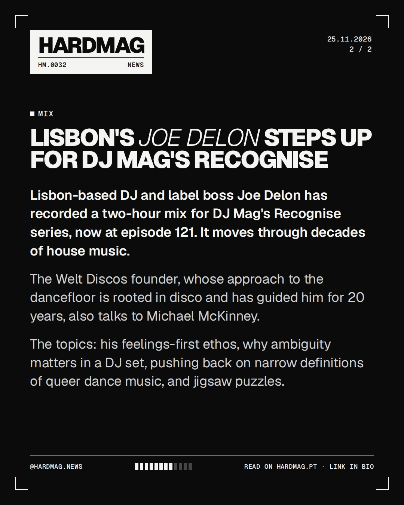
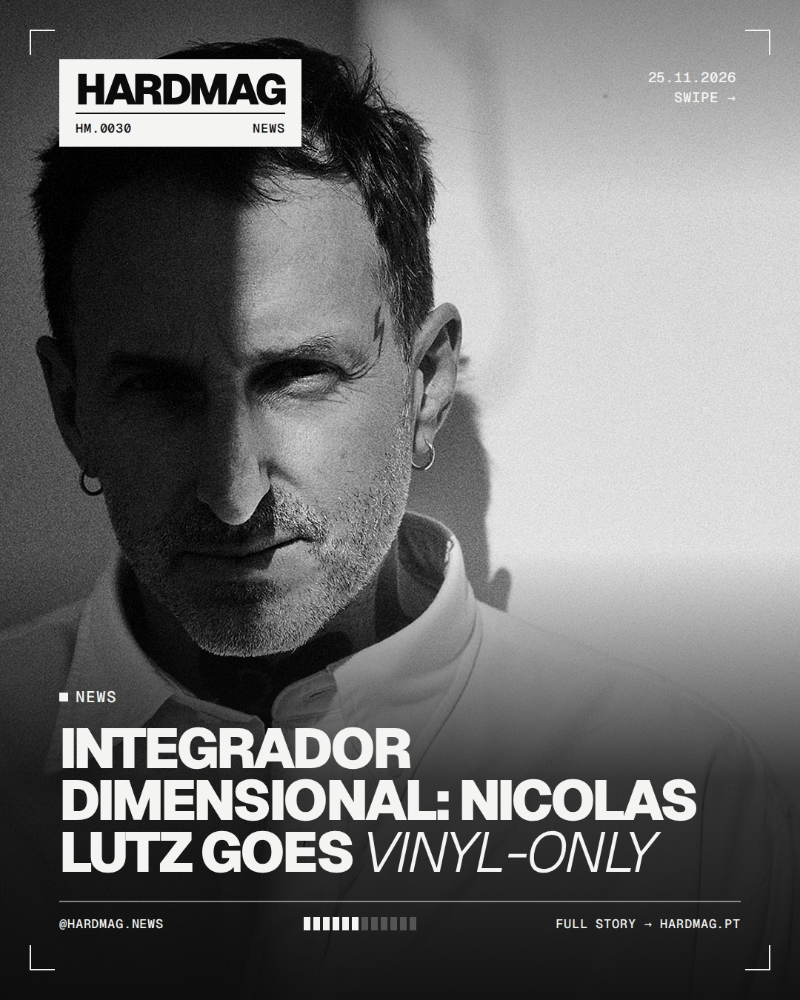
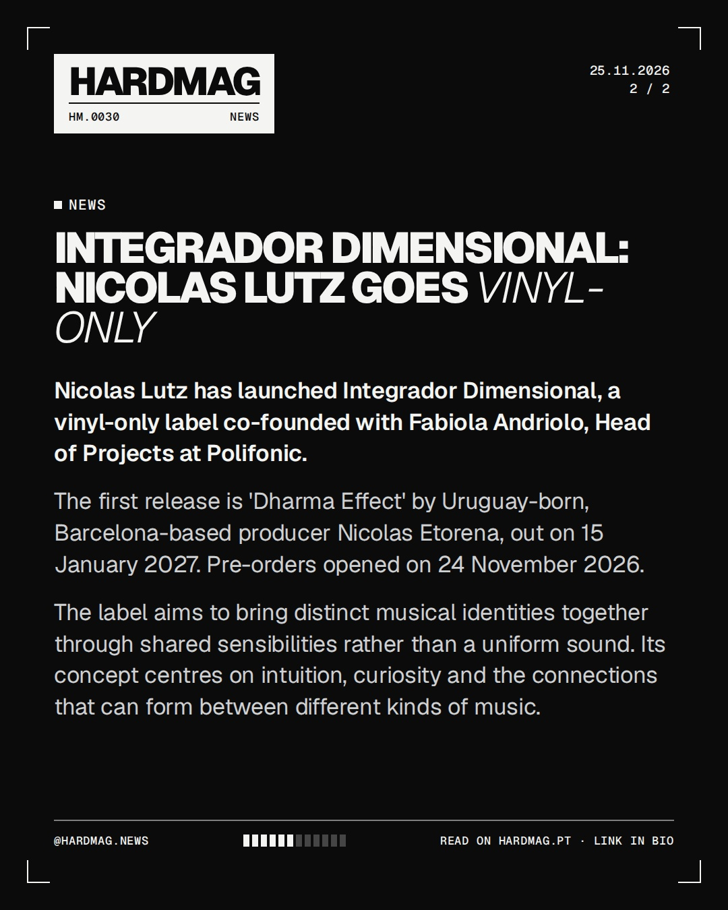
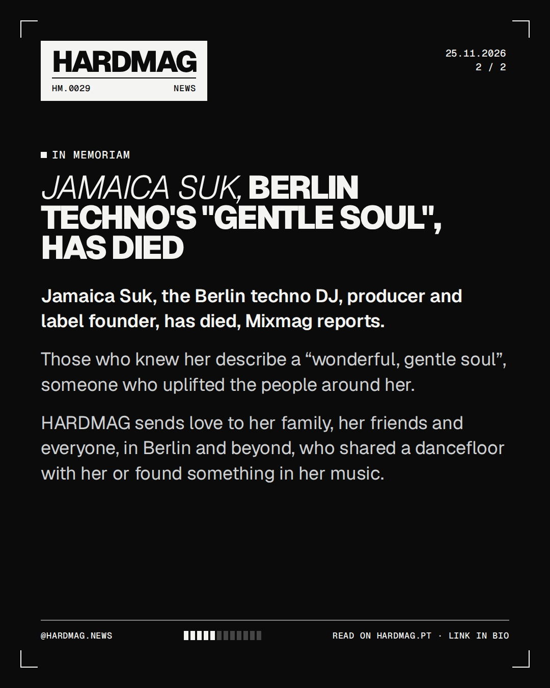
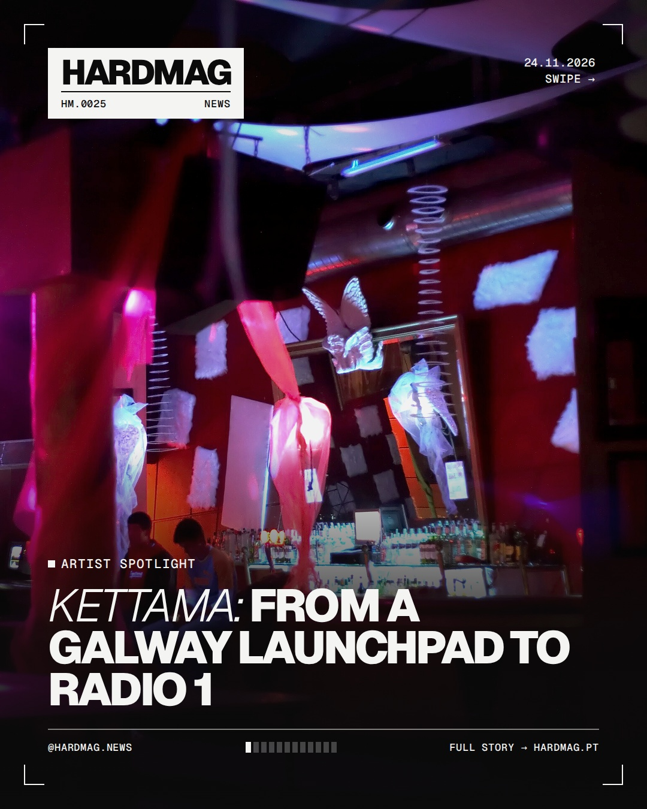
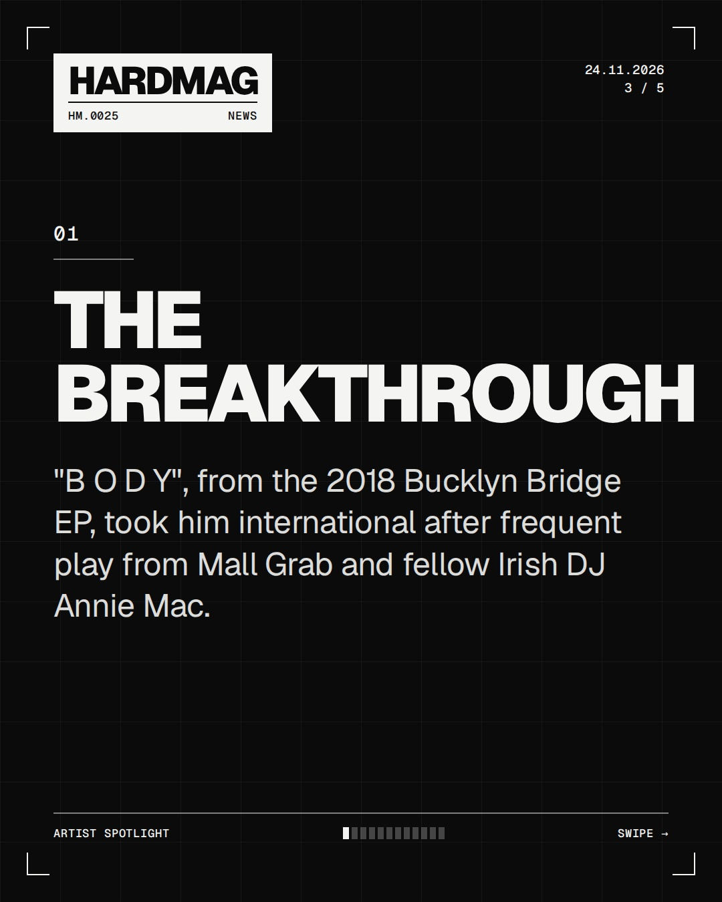

# HARDMAG: fila de posts

Atualizado quinta, 26/11, 04:44 (hora de Lisboa). Cada post é escrito, revisado pelo editor-chefe, renderizado e testado na API do Instagram até 2 dias antes do horário. No horário, só é publicado.

**Prontos:** 2 · **Horários ainda sem post (próximas 24 h):** quinta, 26/11, 15:04 Artistas, quinta, 26/11, 19:34 Cena, quinta, 26/11, 22:35 Noite, sexta, 27/11, 08:41 Notícias PT, sexta, 27/11, 12:19 Almoço, sexta, 27/11, 15:14 Artistas, sexta, 27/11, 19:38 Cena, sexta, 27/11, 22:29 Noite

## Próximos
### quinta, 26/11, 09:03 · Notícias PT · ✅ pronto
**Disclosure remixer RIVO opens Sodade's new Lisbon series** (news)

 

<details><summary>Legenda</summary>

```
He remixed Disclosure's 'You & Me' and went viral with a fadista. Now RIVO opens a new Lisbon series.

Sodade launches please do not disturb on 19 December at LX Factory. RIVO, who shared the stage with fadista Bia Caboz at Nómadas, headlines alongside Braga duo Mayze x Faria, France's Max Arthur and Portuguese DJ JÖAH. The motto is "disconnect to connect", and each edition is built around its venue, from the lighting to the visuals.

Our take: any night that asks you to put the phone away and watch the booth gets a nod from us.

Which Lisbon night got you so locked into the music that you forgot to check your phone? 👇

Full story → hardmag.pt/news/2026-11-26-disclosure-remixer-rivo-opens-sodades-new-lisbon-s/ (link in bio)

Source: musicfest.pt
📸 via musicfest.pt

#lisbon #lxfactory #housemusic #portugalnightlife #rivo
```
</details>

Verificado: caption ok (833 chars, 5 hashtags, 0 mentions) · 2 slide(s) online · video online · story online · website article ok · Instagram accepted the post (with motion cover) · Instagram accepted the story

### quinta, 26/11, 12:12 · Almoço · ✅ pronto
**DJ Marfox took his name from Star Fox** (spotlight)

    

<details><summary>Legenda</summary>

```
The man who pioneered Lisbon's batida took his name from a Nintendo game.

@djmarfox, born Marlon Silva, joined "Marl" with Star Fox, the character he played as a teenager. In 2006 his crew with DJ Pausas and DJ Fofuxo put 37 tracks on eMule, and that compilation is now seen as the foundational release of the ghetto sound of Lisbon. Later came Príncipe Discos, Lit City Trax, WARP and MoMA PS1.

Our take: if anyone tells you batida is a niche, remind them it started as a file-sharing download and ended up in New York.

Which of these three surprised you most, or when did a DJ Marfox set first get you? 👇

Full story → hardmag.pt/news/2026-11-26-dj-marfox-took-his-name-from-star-fox/ (link in bio)

📸 DJ Marfox, CC BY-SA 4.0, via Wikimedia Commons

#djmarfox #batida #principediscos #lisbon #ghettosoundoflisbon #kuduro
```
</details>

Verificado: caption ok (827 chars, 6 hashtags, 1 mentions) · 5 slide(s) online · video online · story online · website article ok · Instagram accepted the post (with motion cover) · Instagram accepted the story


## Recentes
### quarta, 25/11, 22:41 · Noite · 📤 publicado
**Lisbon's Joe Delon steps up for DJ Mag's Recognise** (news)

 

<details><summary>Legenda</summary>

```
Two hours, decades of house, 20 years behind the decks, and it's all coming out of Lisbon.

Joe Delon, the Lisbon-based DJ who founded Welt Discos, has recorded episode 121 of @djmagofficial's Recognise series. In the interview that comes with it, he talks to Michael McKinney about putting feelings first, why ambiguity matters in a set, pushing back on narrow definitions of queer dance music, and jigsaw puzzles.

Our take: a Lisbon selector getting two full hours on a global platform is good news for the whole pista.

Which Lisbon DJ would you put forward for the next big international mix series? 👇

Full story → hardmag.pt/news/2026-11-25-lisbons-joe-delon-steps-up-for-dj-mags-recognise/ (link in bio)

Source: @djmagofficial
📸 WILL POWER, CC BY 2.0, via Wikimedia Commons

#joedelon #weltdiscos #housemusic #lisbon #djmix #recognise
```
</details>

Verificado: caption ok (845 chars, 6 hashtags, 2 mentions) · 2 slide(s) online · video online · story online · website article ok · Instagram accepted the post (with motion cover) · Instagram accepted the story · [ver no Instagram](https://www.instagram.com/hardmag.news/)

### quarta, 25/11, 19:40 · Cena · 📤 publicado
**Who's the best fast groove DJ in Portugal?** (poll)


<details><summary>Legenda</summary>

```
Fast, percussive, groovy, and somehow still pulling you onto the floor at 6am. Fast groove is the sound we live for, and Portugal has DJs playing it every weekend from Lisbon to Porto. Some are already headlining, and some are still on warm-up duty and quietly killing it. So, malta, it's your call: who's the best fast groove DJ in Portugal right now? Tag your pick in the comments and tell us why. Was it the set that won you over, the track they always save for the end, or the moment the whole pista lost it? Then tag the friend who'll swear you're wrong. Big names, residents and the local hero from your city's Thursday night all count.

Tag your pick in the comments and tell us why 👇

📸 Ricardo Liberato, CC BY-SA 2.0, via Wikimedia Commons

#fastgroove #hardgroove #technoportugal #lisboa #porto #clubculture
```
</details>

Verificado: caption ok (819 chars, 6 hashtags, 0 mentions) · 1 slide(s) online · story online · website article ok · Instagram accepted the post · Instagram accepted the story · [ver no Instagram](https://www.instagram.com/hardmag.news/)

### quarta, 25/11, 14:44 · Artistas · 📤 publicado
**Integrador Dimensional: Nicolas Lutz goes vinyl-only** (news)

 

<details><summary>Legenda</summary>

```
Nicolas Lutz's new label is on vinyl only. Not vinyl first. Only vinyl.

Integrador Dimensional, co-founded with Fabiola Andriolo of Polifonic, opens with Nicolas Etorena's 'Dharma Effect' on 15 January 2027, and pre-orders are open now. The idea is intuition and curiosity, not a uniform sound.

HARDMAG's take: no genre template and no download button, so the crate-digging malta now have a date to circle in January.

Do you still pre-order vinyl, or wait for it to turn up in the crates? 👇

Full story → hardmag.pt/news/2026-11-25-integrador-dimensional-nicolas-lutz-goes-vinyl-onl/ (link in bio)

Source: @electronicgroove
📸 via @electronicgroove

#nicolaslutz #integradordimensional #vinylonly #recordlabel #vinyl
```
</details>

Verificado: caption ok (721 chars, 5 hashtags, 2 mentions) · 2 slide(s) online · video online · story online · website article ok · Instagram accepted the post (with motion cover) · Instagram accepted the story · [ver no Instagram](https://www.instagram.com/hardmag.news/)

### quarta, 25/11, 12:05 · Almoço · 📤 publicado
**Jamaica Suk, Berlin techno's "gentle soul", has died** (news)

 

<details><summary>Legenda</summary>

```
Berlin techno has lost a “wonderful, gentle soul”.

Jamaica Suk, the DJ, producer and label founder, has died, Mixmag reports. The people who knew her remember someone who uplifted everyone around her.

Rest in peace, Jamaica.

Did you ever catch Jamaica Suk behind the decks? Share your memories below 👇

Full story → hardmag.pt/news/2026-11-25-jamaica-suk-berlin-technos-gentle-soul-has-died/ (link in bio)

Source: @mixmag
📸 via @mixmag

#techno #berlintechno #inmemoriam #jamaicasuk #berlin
```
</details>

Verificado: caption ok (496 chars, 5 hashtags, 2 mentions) · 2 slide(s) online · video online · story online · website article ok · Instagram accepted the post (with motion cover) · Instagram accepted the story · [ver no Instagram](https://www.instagram.com/hardmag.news/)

### quarta, 25/11, 08:44 · Notícias PT · 📤 publicado
**GTA VI soundtrack goes clubbier with surprise deluxe** (news)

 

<details><summary>Legenda</summary>

```
The GTA VI album didn't stop at 34 tracks.

'Grand Theft Auto VI: The Album' now has a surprise deluxe edition, with Overmono and CHRIS STASSY & @kettama among the new names. The original release featured Arca and @etjusticepourtous.

Our take: Overmono and KETTAMA on a GTA soundtrack is a sentence we didn't expect to type.

Which club producer should've made the cut? 👇

Full story → hardmag.pt/news/2026-11-25-gta-vi-soundtrack-goes-clubbier-with-surprise-delu/ (link in bio)

Source: @djmagofficial
📸 Ricardo Liberato, CC BY-SA 2.0, via Wikimedia Commons

#gtavi #overmono #kettama #chrisstassy #soundtrack #electronicmusic
```
</details>

Verificado: caption ok (630 chars, 6 hashtags, 3 mentions) · 2 slide(s) online · video online · story online · website article ok · Instagram accepted the post (with motion cover) · Instagram accepted the story · [ver no Instagram](https://www.instagram.com/hardmag.news/)

### terça, 24/11, 22:47 · Noite · 📤 publicado
**TIDAL to ban AI-generated tracks "entirely" next month** (news)

 

<details><summary>Legenda</summary>

```
Tagging them wasn't enough. TIDAL says AI-generated tracks get banned "entirely" next month.

Per Mixmag, the streaming service says it has labelled and demonetised 100% of AI tracks on its platform since July. What the ban means in practice, whether it hits tracks already up or only new uploads, isn't spelled out yet.

HARDMAG's take: one major streamer is now treating AI tracks as something to ban, not just label. For the malta releasing tunes from a bedroom in Lisbon or Porto, the real question is whether Spotify and Beatport follow.

Where do you draw the line on AI in the music you dance to and play? 👇

Full story → hardmag.pt/news/2026-11-24-tidal-to-ban-ai-generated-tracks-entirely-next-mon/ (link in bio)

Source: @mixmag
📸 via @mixmag

#tidal #aimusic #streaming #musicindustry #musicproduction
```
</details>

Verificado: caption ok (814 chars, 5 hashtags, 2 mentions) · 2 slide(s) online · video online · story online · website article ok · Instagram accepted the post (with motion cover) · Instagram accepted the story · [ver no Instagram](https://www.instagram.com/hardmag.news/)

### terça, 24/11, 19:46 · Cena · 📤 publicado
**Best hard techno DJ in Portugal right now?** (poll)


<details><summary>Legenda</summary>

```
Hard techno in Portugal keeps growing, from Lisbon to Porto and everywhere in between, and we want to hear from the people on the dancefloor every weekend. Which hard techno DJ in Portugal would you travel for right now? Tag them in the comments and tell us why: a set that floored you, their selection, how they work a room. Then tag a friend who'd pick someone else. Residents, headliners and newer names all count.

Tag your pick in the comments and tell us why 👇

📸 photochino, CC BY 2.0, via Wikimedia Commons

#hardtechno #hardtechnoportugal #techno #lisboa #porto #portugal
```
</details>

Verificado: caption ok (582 chars, 6 hashtags, 0 mentions) · 1 slide(s) online · story online · website article ok · Instagram accepted the post · Instagram accepted the story · [ver no Instagram](https://www.instagram.com/hardmag.news/)

### terça, 24/11, 13:35 · Artistas · 📤 publicado
**Kettama: from a Galway Launchpad to Radio 1** (spotlight)

    

<details><summary>Legenda</summary>

```
He taught himself to produce by remaking a Tyga piano line on an Ableton trial. By 2024 he was at Glastonbury.

@kettama, born Evan Campbell in Galway, was playing clubs at 17, and plays from Mall Grab and Annie Mac then took his music beyond Ireland. Since then he has co-founded G-Town Records with Shampain, formed KETBOI69 with @partiboi69 and taken a BBC Radio 1 Dance residency. Swipe for the route from SoundCloud uploads to the Irish Singles Chart.

Which Kettama track or set hit you hardest, and where did you hear it? 👇

Full story → hardmag.pt/news/2026-11-24-kettama-from-a-galway-launchpad-to-radio-1/ (link in bio)

📸 Ricardo Liberato, CC BY-SA 2.0, via Wikimedia Commons

#kettama #housemusic #galway #irishmusic #bbcradio1dance #ketboi69
```
</details>

Verificado: caption ok (756 chars, 6 hashtags, 2 mentions) · 5 slide(s) online · video online · story online · website article ok · Instagram accepted the post (with motion cover) · Instagram accepted the story · [ver no Instagram](https://www.instagram.com/hardmag.news/)

