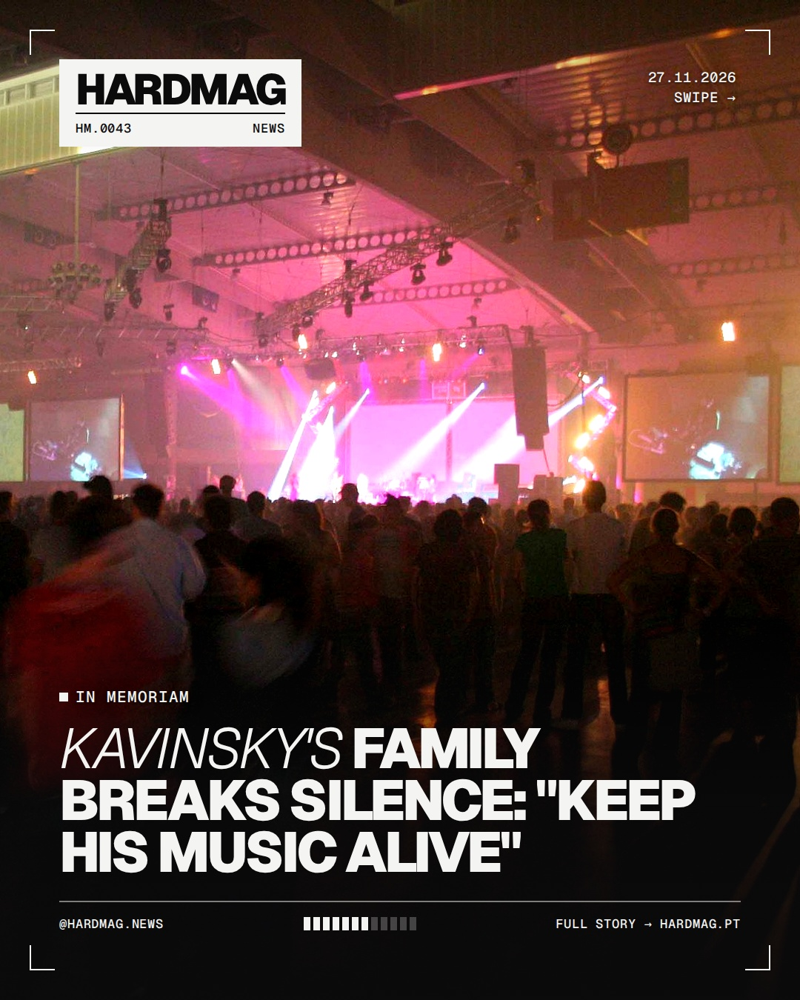
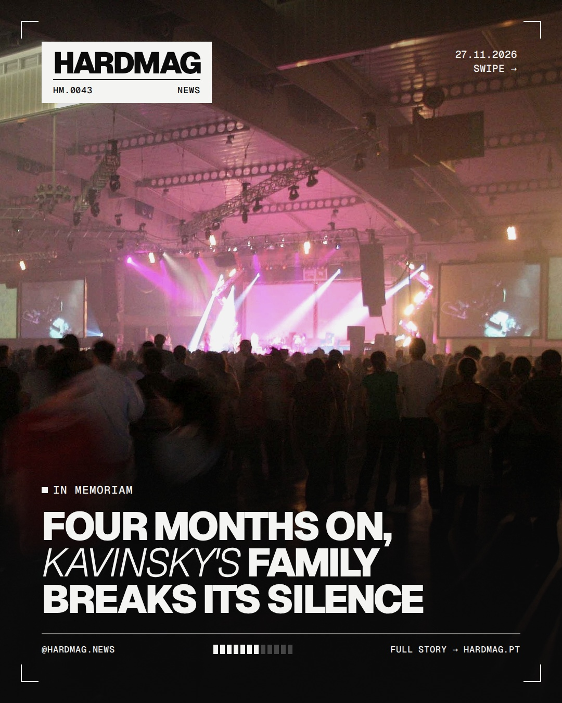
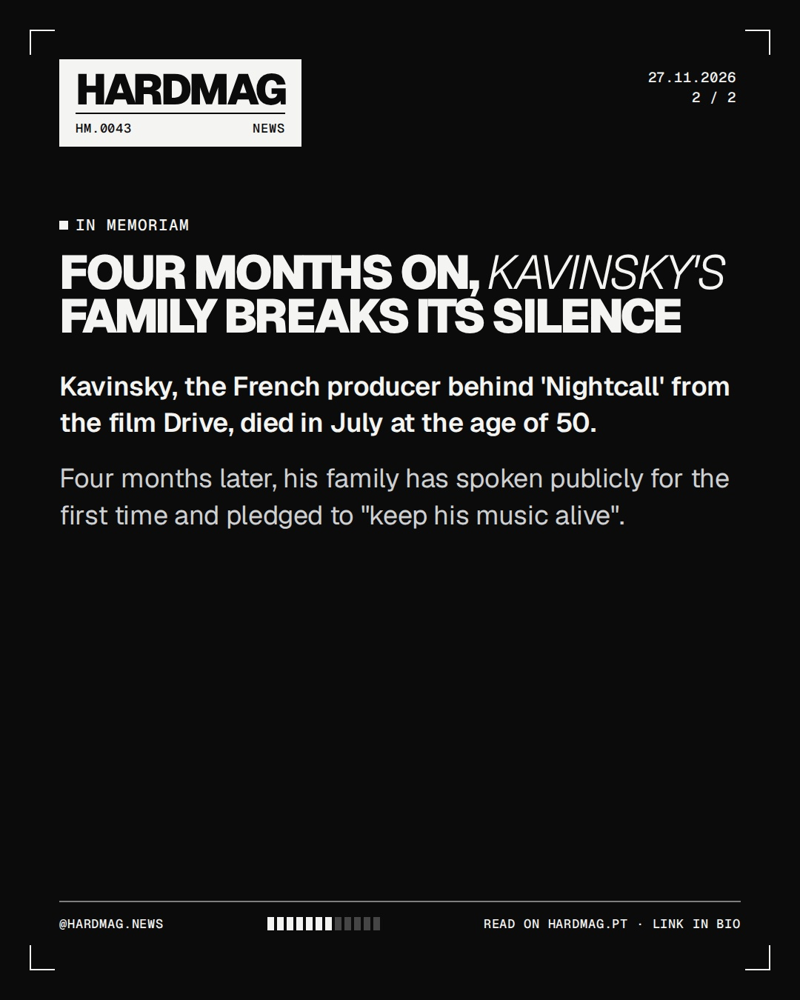
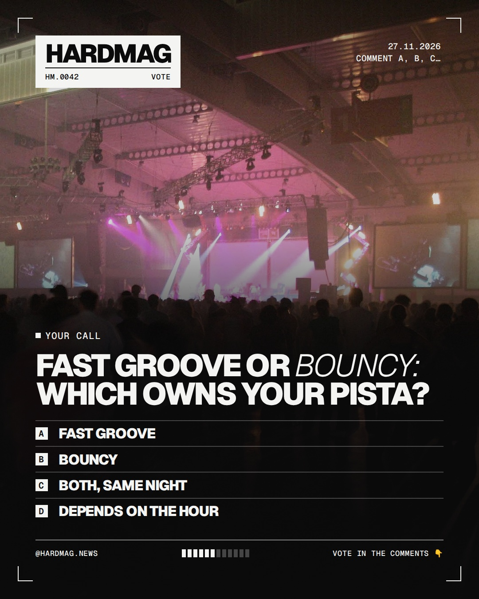
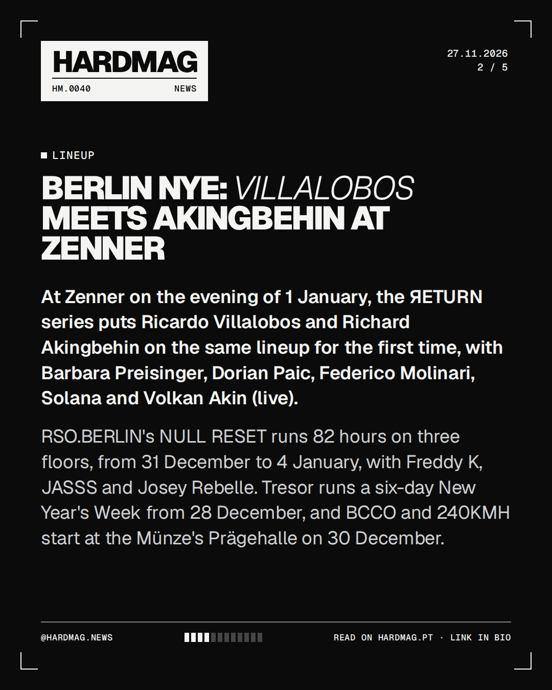
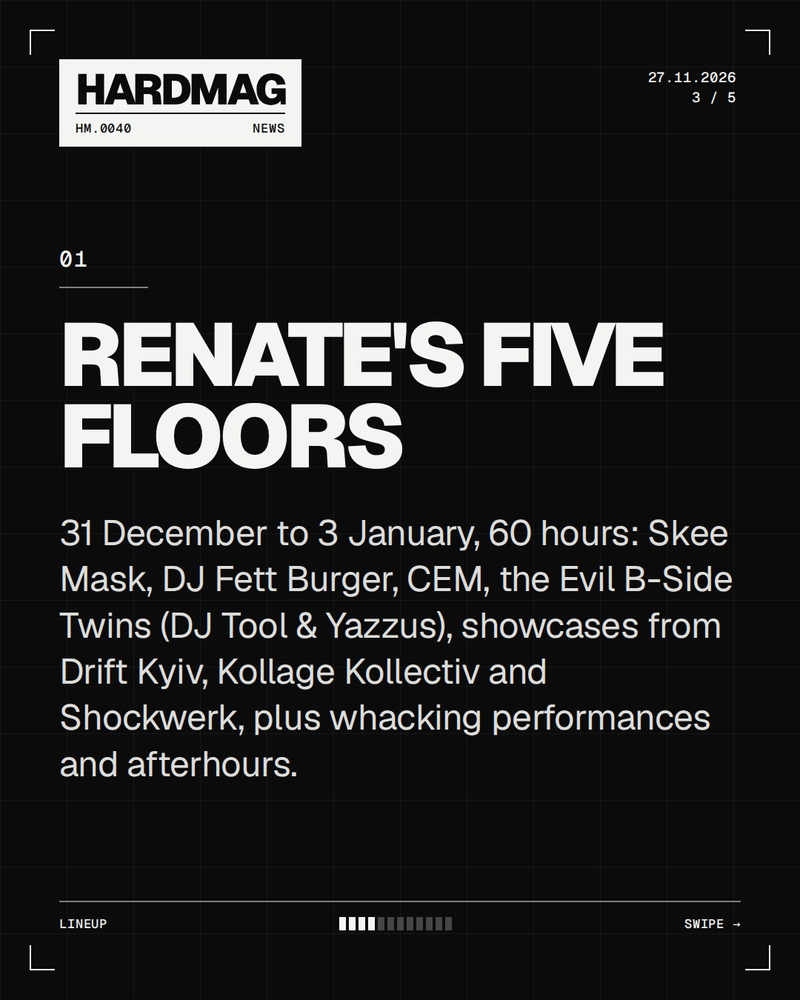
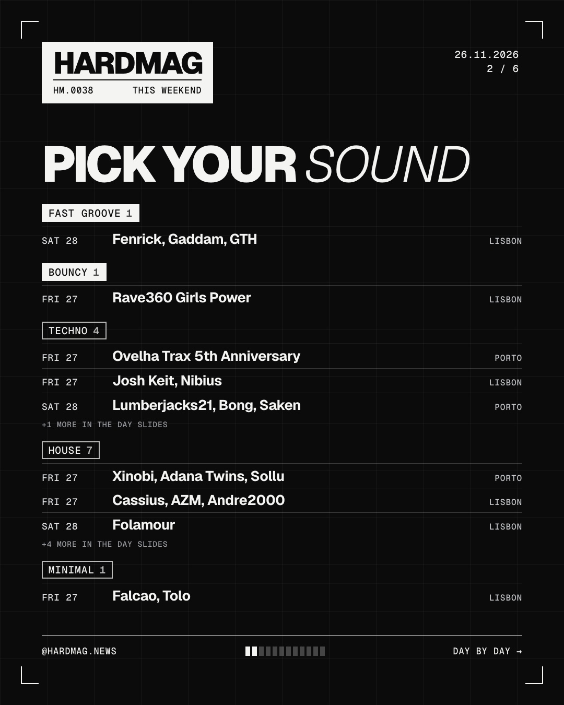
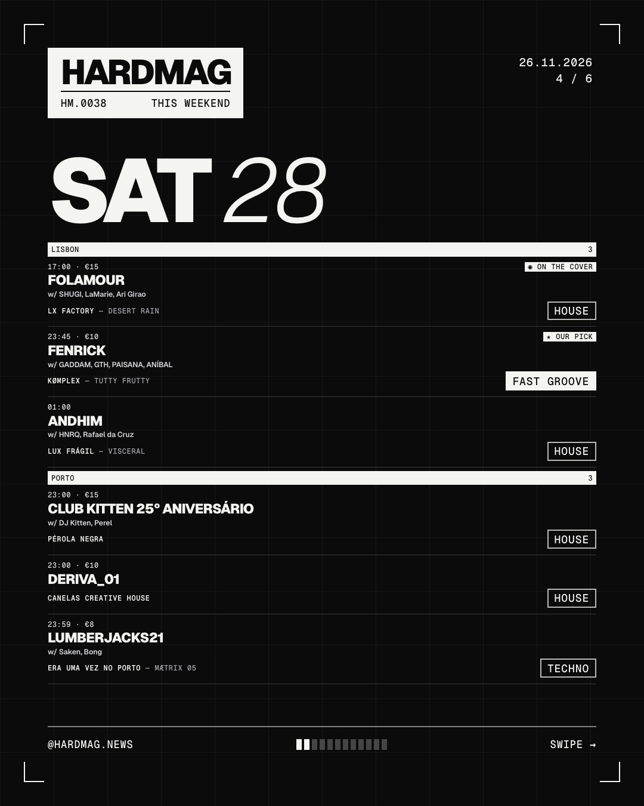
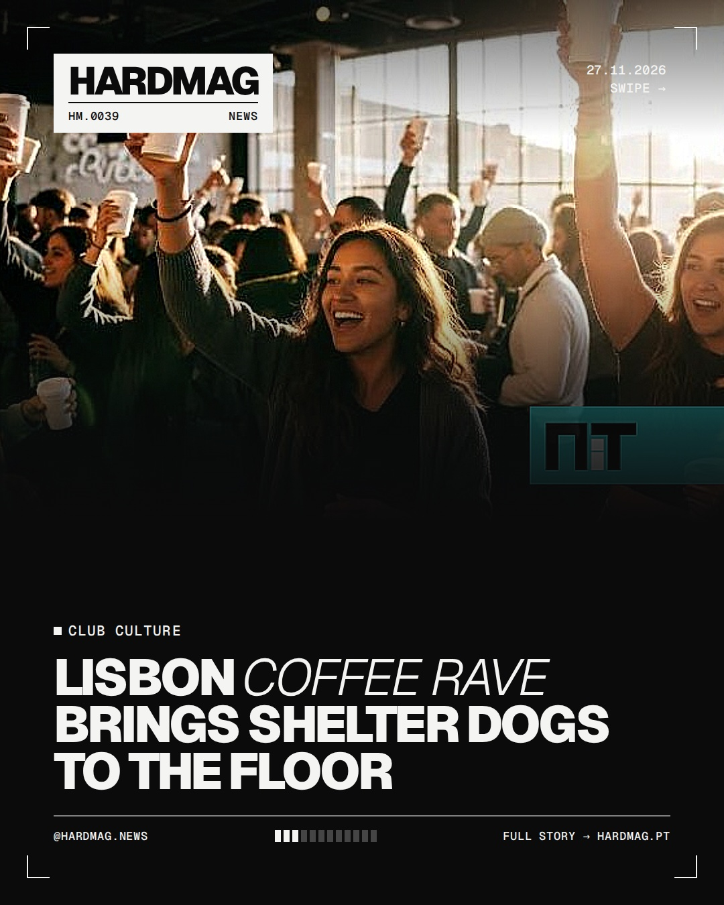

# HARDMAG: fila de posts

Atualizado sábado, 28/11, 00:48 (hora de Lisboa). Cada post é escrito, revisado pelo editor-chefe, renderizado e testado na API do Instagram até 2 dias antes do horário. No horário, só é publicado.

**Prontos:** 0 · **Horários ainda sem post (próximas 24 h):** sábado, 28/11, 09:00 Notícias PT, sábado, 28/11, 11:55 Almoço, sábado, 28/11, 14:53 Artistas, sábado, 28/11, 19:32 Cena, sábado, 28/11, 22:33 Noite, domingo, 29/11, 08:38 Notícias PT, domingo, 29/11, 12:02 Almoço, domingo, 29/11, 15:13 Artistas, domingo, 29/11, 19:26 Cena, domingo, 29/11, 22:27 Noite

## Próximos
_Nada na fila agora._

## Recentes
### sexta, 27/11, 22:29 · Noite · 📤 publicado
**Kavinsky's family breaks silence: "keep his music alive"** (news)

 

<details><summary>Legenda</summary>

```
Four months of silence, then one promise: "keep his music alive".

Kavinsky's family has broken its silence, DJ Mag reports. The French producer died in July aged 50. For most people his name means one track: 'Nightcall', the hit that soundtracked Drive and made him known well beyond the clubs.

HARDMAG's take (opinion): 'Nightcall' was never a peak-time record. It's the slow drive home with the windows down, that late-night synth sound that crossed over from the cinema to the pista, and it doesn't need anyone's help to stay alive.

Where were you the first time 'Nightcall' stopped you in your tracks? 👇

Full story → hardmag.pt/news/2026-11-27-kavinskys-family-breaks-silence-keep-his-music-ali/ (link in bio)

Source: @djmagofficial
📸 photochino, CC BY 2.0, via Wikimedia Commons

#kavinsky #nightcall #drive #electronicmusic #inmemoriam
```
</details>

Verificado: caption ok (848 chars, 5 hashtags, 1 mentions) · 2 slide(s) online · video online · story online · website article ok · Instagram accepted the post (with motion cover) · Instagram accepted the story · [ver no Instagram](https://www.instagram.com/hardmag.news/)

### sexta, 27/11, 22:29 · Noite · ❌ falhou
**Four months on, Kavinsky's family breaks its silence** (news)

> Erro: rejected on Telegram

 

<details><summary>Legenda</summary>

```
Four months after Kavinsky's death, his family has finally spoken.

The French producer died in July at 50, and his family's first public words are a promise to "keep his music alive".

Our take: a slow, brooding synth record that reached far beyond the pista, carried by a film, into the lives of people who never set foot in a club. Music like that has a way of staying alive on its own.

Where were you the first time you heard 'Nightcall'? 👇

Full story → hardmag.pt/news/2026-11-27-four-months-on-kavinskys-family-breaks-its-silence/ (link in bio)

Source: @djmagofficial
📸 photochino, CC BY 2.0, via Wikimedia Commons

#kavinsky #nightcall #drive #synthwave #inmemoriam
```
</details>

Verificado: caption ok (677 chars, 5 hashtags, 1 mentions) · 2 slide(s) online · video online · story online · website article ok · Instagram accepted the post (with motion cover) · Instagram accepted the story

### sexta, 27/11, 19:38 · Cena · 📤 publicado
**Fast groove or hard techno: what wins your night?** (poll)


<details><summary>Legenda</summary>

```
It's 4am and the DJ has two ways to go. One keeps the percussion rolling, swinging and groovy so your hips do the work. The other goes heavy, all kicks, and your whole body does the work. Same BPM territory, two very different nights.

We're asking because the malta in Portugal splits on this all the time, at the bar, in the smoking area and in the group chat the day after. We want to know where the pista really stands.

Vote, then tell us in the comments: which set made you pick a side? Bonus points if you name the city and the club where it happened.

A: Fast groove
B: Hard techno
C: Both, one night
D: Depends on the room

Vote with the letter in the comments 👇

📸 photochino, CC BY 2.0, via Wikimedia Commons

#fastgroove #hardtechno #techno #lisbon #porto #portugal
```
</details>

Verificado: caption ok (779 chars, 6 hashtags, 0 mentions) · 1 slide(s) online · story online · website article ok · Instagram accepted the post · Instagram accepted the story · [ver no Instagram](https://www.instagram.com/hardmag.news/)

### sexta, 27/11, 19:38 · Cena · ❌ falhou
**Fast groove or bouncy: which owns your pista?** (poll)

> Erro: rejected on Telegram



<details><summary>Legenda</summary>

```
Two sounds, one dancefloor, and a lot of opinions in the smoking area. On one side you've got the rolling, percussive fast groove that keeps you locked in for hours. On the other, the bouncy hard house and hard groove wave that turns the whole room into one big jump. We cover both every day, so we want to know where the malta in Portugal actually stands. Vote, then tell us in the comments: which track or set sold you on your side, and where in Lisbon, Porto or beyond did you hear it? Tag the friend who always argues for the other one.

A: Fast groove
B: Bouncy
C: Both, same night
D: Depends on the hour

Vote with the letter in the comments 👇

📸 photochino, CC BY 2.0, via Wikimedia Commons

#fastgroove #bouncy #hardgroove #hardhouse #techno #lisboa
```
</details>

Verificado: caption ok (759 chars, 6 hashtags, 0 mentions) · 1 slide(s) online · story online · website article ok · Instagram accepted the post · Instagram accepted the story

### sexta, 27/11, 15:14 · Artistas · 📤 publicado
**What BPM actually feels right on the floor?** (poll)


<details><summary>Legenda</summary>

```
The BPM arms race isn't slowing down, but your legs at 6am might have other ideas. Every crowd has a tempo where it stops thinking and just moves. Some of you want the groove to breathe, some of you only wake up once the kicks start racing. No wrong answers here, just the number where the pista clicks for you. Vote, then tell us in the comments: which set in Portugal this year hit your perfect tempo, and did the DJ push it too far or keep it right where it should be?

A: Under 140
B: 140 to 150
C: 150 to 160
D: 160 and up

Vote with the letter in the comments 👇

📸 photochino, CC BY 2.0, via Wikimedia Commons

#hardmag #fastgroove #bouncy #hardtechno #techno #house
```
</details>

Verificado: caption ok (674 chars, 6 hashtags, 0 mentions) · 1 slide(s) online · story online · website article ok · Instagram accepted the post · Instagram accepted the story · [ver no Instagram](https://www.instagram.com/hardmag.news/)

### sexta, 27/11, 15:14 · Artistas · ❌ falhou
**Berlin NYE: Villalobos meets Akingbehin at Zenner** (news)

> Erro: caption contains a template error

    

<details><summary>Legenda</summary>

```
Berghain still won't say who's playing at New Year. Most of Berlin has already shown its hand.

Ricardo Villalobos and Richard Akingbehin share a lineup for the first time at Zenner on 1 January. RSO.BERLIN says more names are coming for its 82-hour NULL RESET, Renate has filled five floors with Skee Mask and DJ Fett Burger, and out in Spandau Climate of Fear, an official RA Pick, runs 27 hours at Backsteinboot on 1 and 2 January.

HARDMAG's take: with this many parties starting on 1 January, midnight looks more like the warm-up than the main event.

Which Berlin New Year marathon would you fly in for, and why that one? 👇

Full story → hardmag.pt/news/2026-11-27-berlin-nye-villalobos-meets-akingbehin-at-zenner/ (link in bio)

Source: GROOVE
📸 via GROOVE

#berlintechno #newyearseve #ricardovillalobos #rsoberlin #tresor #clubculture
```
</details>

Verificado: –

### sexta, 27/11, 13:30 · Noite · 📤 publicado
**This weekend in Lisbon & Porto, 27–29 Nov** (agenda)

     

<details><summary>Legenda</summary>

```
Cassius at Lux, hard groove at KØMPLEX and Xinobi in Porto, all in one weekend. Your legs won't get much rest. Friday, Cassius plays with AZM and Andre2000 at Superb, the most famous name on the board. Saturday, Fenrick brings the hard groove to Tutty Frutty with Gaddam and GTH, €10 plus an after party. Up north, Xinobi and Adana Twins take over Switch on Friday, the safest bet in Porto for a pista that stays full until close.

On the cover: Folamour, SAT 28 at LX Factory (Folamour).

FRI 27
LISBON
23:45 · Rave360 Girls Power @ KØMPLEX · bouncy (€10) @disturbtechno @komplexlisbon
23:59 · Josh Keit w/ Nibius @ Ministerium Club · techno (€10) @ministeriumclub
★ 01:00 · Cassius w/ AZM, Andre2000 (Superb) @ Lux Frágil · house @luxfragil
05:00 · Falcao w/ Tolo (Harbour) @ Harbour Music Shelter · minimal (€10) @harbourlisboa
PORTO
★ 23:00 · Xinobi w/ Adana Twins, Sollu @ Switch · house (€15) @xinobi @adanatwins
23:00 · Ovelha Trax 5th Anniversary w/ Catarina Silva, System Sophie, Banditst4r, Mingote @ Gare Porto · techno (Free) @gareporto @___catarinasilva

SAT 28
LISBON
17:00 · Folamour w/ SHUGI, LaMarie, Ari Girao (Desert Rain) @ LX Factory · house (€15) @desert.rain.agency
★ 23:45 · Fenrick w/ GADDAM, GTH, PAISANA, ANÍBAL (Tutty Frutty) @ KØMPLEX · fast groove (€10) @komplexlisbon @gaddam.mode
01:00 · Andhim w/ HNRQ, Rafael da Cruz (Visceral) @ Lux Frágil · house
PORTO
23:00 · Club Kitten 25º Aniversário w/ DJ Kitten, Perel @ Pérola Negra · house (€15)
23:00 · Deriva_01 @ Canelas Creative House · house (€10)
23:59 · Lumberjacks21 w/ Saken, Bong (Mætrix 05) @ Era Uma Vez no Porto · techno (€8)

SUN 29
LISBON
16:00 · Simonee w/ Slim J, Rui Alves @ Carmo Rooftop · techno (€2.50)
23:59 · Larannec w/ JOHN-E-DJ, Jonh-E (Harbour Sundaze) @ Harbour Music Shelter · house (€10)

★ = our picks. Save this and send it to whoever you're going with 📌

Lux, KØMPLEX or Porto: where are you ending up at 6am this weekend? 👇

Tickets on Shotgun.
📸 Originalcat, CC BY-SA 4.0, via Wikimedia Commons

@luxfragil @komplexlisbon

#hardmag #lisbon #porto #lisbonnightlife #portonightlife #hardgroove
```
</details>

Verificado: caption ok (2122 chars, 6 hashtags, 15 mentions) · 6 slide(s) online · video online · story online · 4 animated stories online · website article ok · re-queued for Friday 13:30 after the night trigger was missed; videos without the old loop · [ver no Instagram](https://www.instagram.com/hardmag.news/)

### sexta, 27/11, 12:19 · Almoço · 📤 publicado
**Lisbon coffee rave brings shelter dogs to the floor** (news)

 

<details><summary>Legenda</summary>

```
Three hours of house, home in time for lunch, and the dancefloor has a few extra paws this time.

Sundaze Morning Social is back this Sunday, 29 November, at Connection Studio in Lisbon (11:00–14:00), with Ønawa and DJ Breadbox playing together through deep, afro and tech house. From 13:00, shelter dogs from União Zoófila join the pista, all looking for a family. It's co-organised with LivFest Portugal, and you can bring pet food or donate on the day. Tickets from €10.

HARDMAG's take: this is the one rave where it's fine if you leave with a new best friend who isn't from the smoking area.

What's the best daytime party you've been to in Lisbon, and who was behind the decks? 👇

Full story → hardmag.pt/news/2026-11-27-lisbon-coffee-rave-brings-shelter-dogs-to-the-floo/ (link in bio)

Source: NiT
📸 via NiT

#lisbon #coffeerave #daytimeparty #deephouse #afrohouse #lisboa
```
</details>

Verificado: caption ok (882 chars, 6 hashtags, 0 mentions) · 2 slide(s) online · video online · story online · website article ok · Instagram accepted the post (with motion cover) · Instagram accepted the story · [ver no Instagram](https://www.instagram.com/hardmag.news/)

