# HARDMAG: fila de posts

Atualizado segunda, 23/11, 21:10 (hora de Lisboa). Cada post é escrito, revisado pelo editor-chefe, renderizado e testado na API do Instagram até 2 dias antes do horário. No horário, só é publicado.

**Prontos:** 6 · **Horários ainda sem post (próximas 24 h):** nenhum

## Próximos
### terça, 24/11, 08:56 · Notícias PT · ✅ pronto
**SoundCloud cracks down on AI slop and spam** (news)

 

<details><summary>Legenda</summary>

```
SoundCloud can now withhold or claw back payouts from users who use AI to game its systems.

The platform is cracking down on "AI slop, spam, and excessive uploads" under new terms. The move comes weeks after SoundCloud struck AI deals with Moises and ElevenLabs.

Where should a platform draw the line between using AI as a tool and gaming the system? 👇

Full story → hardmag.pt/news/2026-11-24-soundcloud-cracks-down-on-ai-slop-and-spam/ (link in bio)

Source: @musicbizworldwide
📸 via @musicbizworldwide

#soundcloud #aimusic #musicindustry #musicproducer #streaming
```
</details>

Verificado: caption ok (571 chars, 5 hashtags, 2 mentions) · 2 slide(s) online · story online · website article ok · Instagram accepted the post · Instagram accepted the story

### terça, 24/11, 13:35 · Artistas · ✅ pronto
**Kettama: from a Galway Launchpad to Radio 1** (spotlight)

   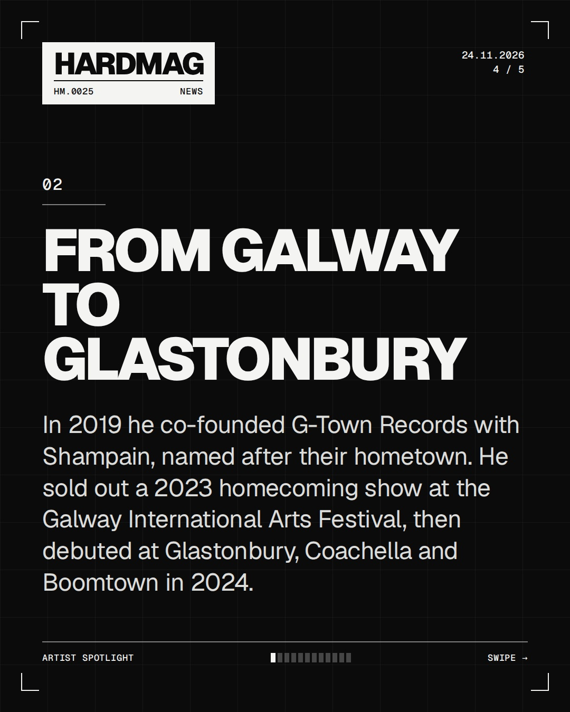 

<details><summary>Legenda</summary>

```
He taught himself to produce by remaking a Tyga piano line on an Ableton trial. By 2024 he was at Glastonbury.

@kettama, born Evan Campbell in Galway, was playing clubs at 17, and plays from Mall Grab and Annie Mac then took his music beyond Ireland. Since then he has co-founded G-Town Records with Shampain, formed KETBOI69 with @partiboi69 and taken a BBC Radio 1 Dance residency. Swipe for the route from SoundCloud uploads to the Irish Singles Chart.

Which Kettama track or set hit you hardest, and where did you hear it? 👇

Full story → hardmag.pt/news/2026-11-24-kettama-from-a-galway-launchpad-to-radio-1/ (link in bio)

📸 Ricardo Liberato, CC BY-SA 2.0, via Wikimedia Commons

#kettama #housemusic #galway #irishmusic #bbcradio1dance #ketboi69
```
</details>

Verificado: caption ok (756 chars, 6 hashtags, 2 mentions) · 5 slide(s) online · video online · story online · website article ok · Instagram accepted the post (with motion cover) · Instagram accepted the story

### terça, 24/11, 19:46 · Cena · ✅ pronto
**Best hard techno DJ in Portugal right now?** (poll)


<details><summary>Legenda</summary>

```
Portugal's hard techno scene keeps growing, from Lisbon to Porto and everywhere in between, and we want to know who's carrying it right now. Residents, headliners, the openers who pack the room early: everyone counts. Tag your pick in the comments and tell us why: the set that won you over, the track selection, the energy. Then tag the friends who'd pick someone else and let them argue their case. Most-tagged names make our follow-up.

Tag your pick in the comments and tell us why 👇

📸 Ricardo Liberato, CC BY-SA 2.0, via Wikimedia Commons

#hardtechno #hardtechnoportugal #techno #lisboa #porto #portugal
```
</details>

Verificado: caption ok (612 chars, 6 hashtags, 0 mentions) · 1 slide(s) online · story online · website article ok · Instagram accepted the post · Instagram accepted the story

### quarta, 25/11, 08:44 · Notícias PT · ✅ pronto
**Who's the best fast groove DJ in Portugal?** (poll)


<details><summary>Legenda</summary>

```
Fast groove is the sound we cover most, and Portugal has its own crop of selectors playing quick, percussive, groovy sets every weekend in Lisbon, Porto and beyond. We want to know who's doing it best right now. Tag your pick in the comments and tell us why: the set that won you over, the track selection, how they work a room. Then tag a friend who'd pick someone else. Residents, rising names and established DJs all count.

Tag your pick in the comments and tell us why 👇

📸 Ricardo Liberato, CC BY-SA 2.0, via Wikimedia Commons

#fastgroove #groovytechno #portugal #lisboa #porto #techno
```
</details>

Verificado: caption ok (594 chars, 6 hashtags, 0 mentions) · 1 slide(s) online · story online · website article ok · Instagram accepted the post · Instagram accepted the story

### quarta, 25/11, 13:14 · Artistas · ✅ pronto
**Most underrated DJ in Portugal right now?** (poll)


<details><summary>Legenda</summary>

```
Every scene has them: the DJ who keeps the floor locked from the first hour, carries the warm-up or the 6am slot week after week, and still isn't on the posters they deserve. Fast groove, bouncy, hard techno, techno, house, any sound counts. Tag the Portuguese DJ you think deserves more recognition and tell us why: a set, a track, a night you won't forget. Then tag a friend who'd pick someone else.

Tag your pick in the comments and tell us why 👇

📸 Ricardo Liberato, CC BY-SA 2.0, via Wikimedia Commons

#hardmag #underrateddj #portugaltechno #lisbontechno #portotechno #fastgroove
```
</details>

Verificado: caption ok (588 chars, 6 hashtags, 0 mentions) · 1 slide(s) online · story online · website article ok · Instagram accepted the post · Instagram accepted the story

### quarta, 25/11, 19:40 · Cena · ✅ pronto
**What time should the night end?** (poll)

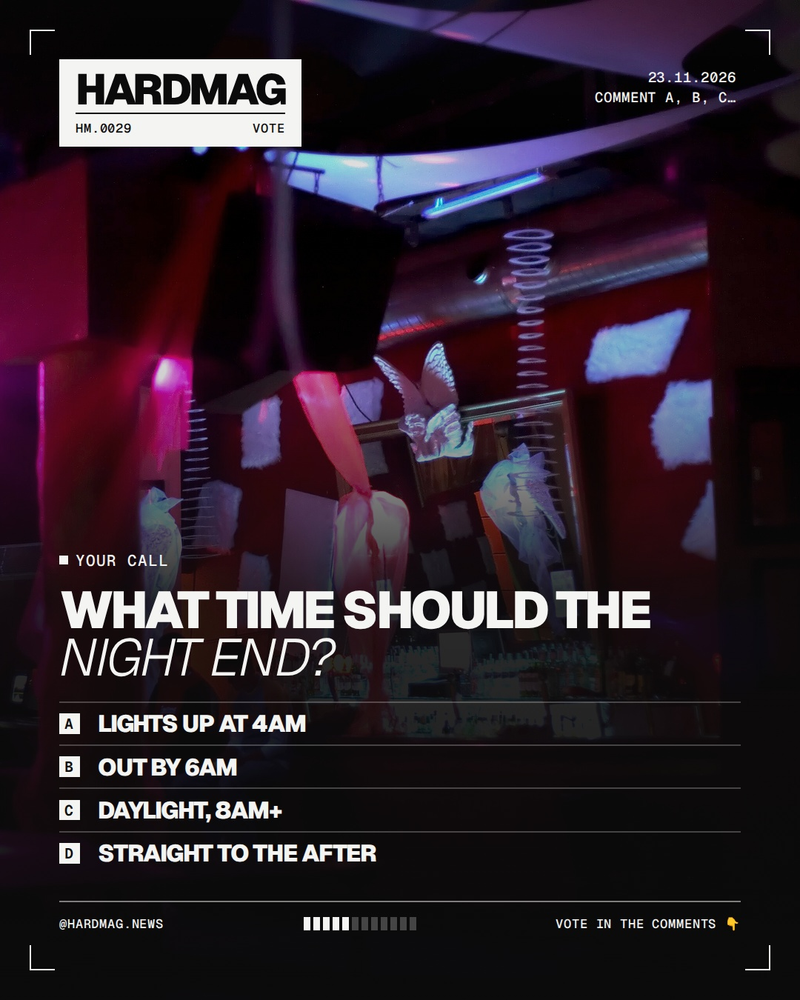

<details><summary>Legenda</summary>

```
Some ravers want a hard stop with energy left for the next day. Others think the best part only starts once the sun is up. From Lisbon to Porto, closing times shape how we go out: when we arrive, how the DJ builds the set and how we get home. So when does a night feel complete to you? Vote, then tell us why in the comments, and tag the friend who never wants to leave.

A: Lights up at 4am
B: Out by 6am
C: Daylight, 8am+
D: Straight to the after

Vote with the letter in the comments 👇

📸 Ricardo Liberato, CC BY-SA 2.0, via Wikimedia Commons

#hardmag #clubculture #lisbonnightlife #portonightlife #techno #hardtechno
```
</details>

Verificado: caption ok (623 chars, 6 hashtags, 0 mentions) · 1 slide(s) online · story online · website article ok · Instagram accepted the post · Instagram accepted the story


## Recentes
### segunda, 23/11, 19:52 · Cena · 📤 publicado
**Fast groove, bouncy or hard techno?** (poll)

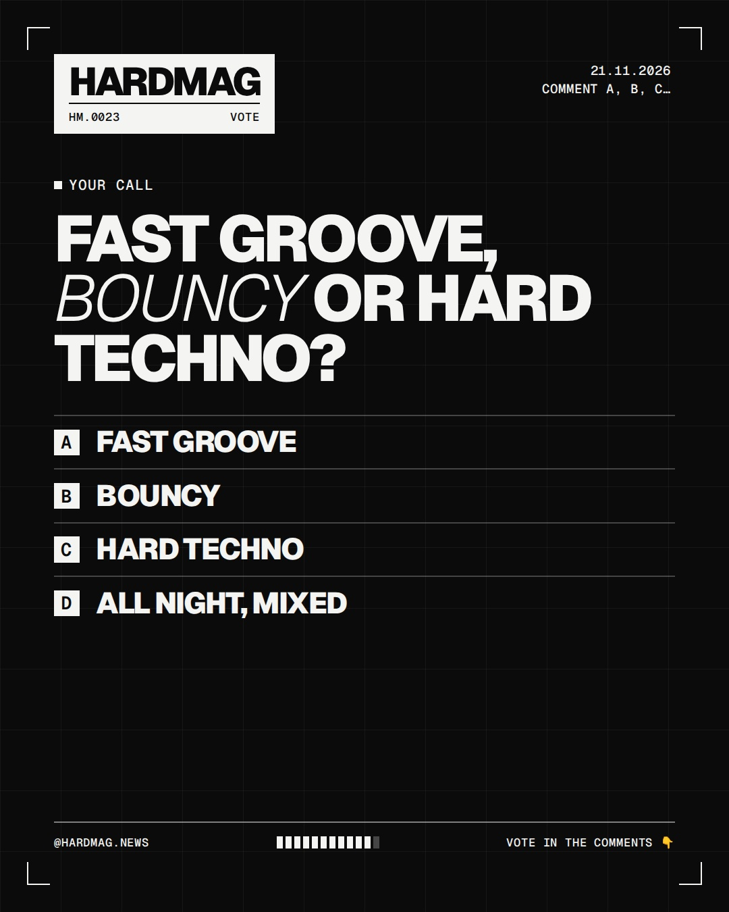

<details><summary>Legenda</summary>

```
Peak time in Portugal: fast groove, bouncy or hard techno? 👇

One letter in the comments:
A: Fast groove
B: Bouncy
C: Hard techno
D: All of it, mixed

Bonus points: name the track that converted you.

#hardmag #fastgroove #bouncy #hardtechno #hardgroove #hardhouse
```
</details>

Verificado: caption ok (483 chars, 6 hashtags, 0 mentions) · 1 slide(s) online · story online · website article ok · Instagram accepted the post · Instagram accepted the story · [ver no Instagram](https://www.instagram.com/hardmag.news/)

### segunda, 23/11, 13:15 · Artistas · 📤 publicado
**Pete Tha Zouk: Locomia to DJ Mag's No. 37** (spotlight)

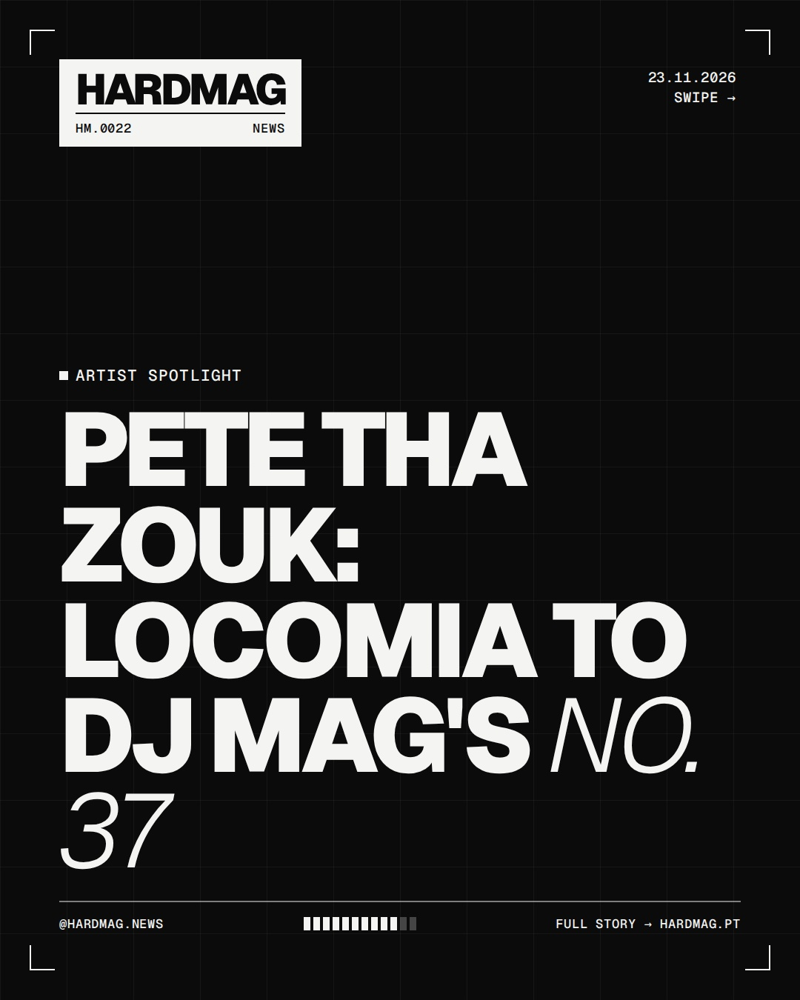 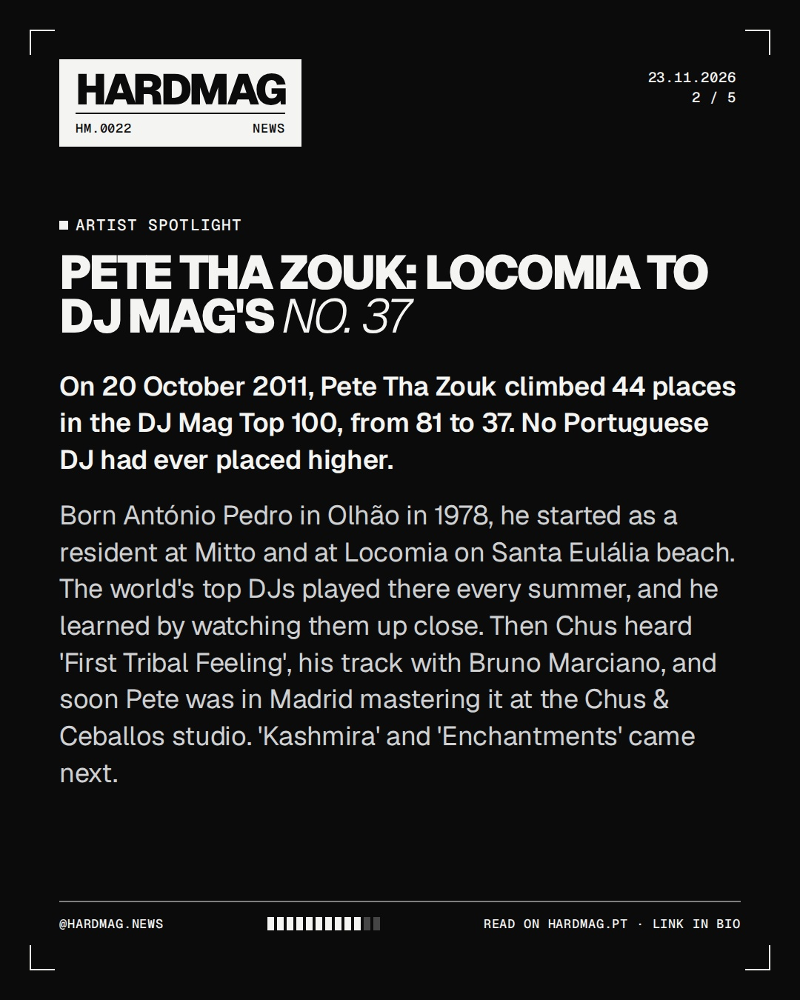   

<details><summary>Legenda</summary>

```
Before DJ Mag's No. 37, @petethazouk learned the job watching the world's top DJs at Locomia.

When Chus heard his early track 'First Tribal Feeling', Pete went to Madrid to master it at the Chus & Ceballos studio. In 2003 he released 'Solid Textures' with DJ Vibe on Low Pressings, and in 2010 'Check This Out' came out on Sondos, Erick Morillo's label. In October 2011 he jumped from 81 to 37 in the DJ Mag Top 100, the highest any Portuguese DJ had ever placed.

Which Pete Tha Zouk track takes you straight back to a Portuguese dancefloor? 👇

Full story → hardmag.pt/news/2026-11-23-pete-tha-zouk-locomia-to-dj-mags-no-37/ (link in bio)

#petethazouk #portugal #olhao #djmag #housemusic
```
</details>

Verificado: caption ok (691 chars, 5 hashtags, 1 mentions) · 5 slide(s) online · story online · website article ok · Instagram accepted the post · Instagram accepted the story · [ver no Instagram](https://www.instagram.com/hardmag.news/)

### segunda, 23/11, 08:37 · Notícias PT · 📤 publicado
**Branko: the Lisbon producer wiring up global club music** (spotlight)

 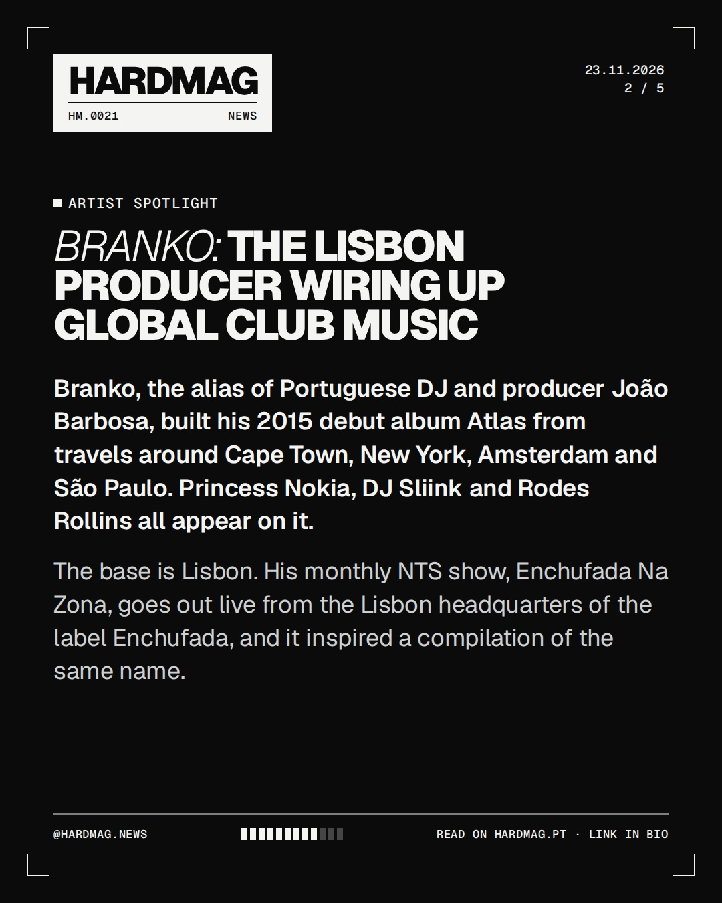 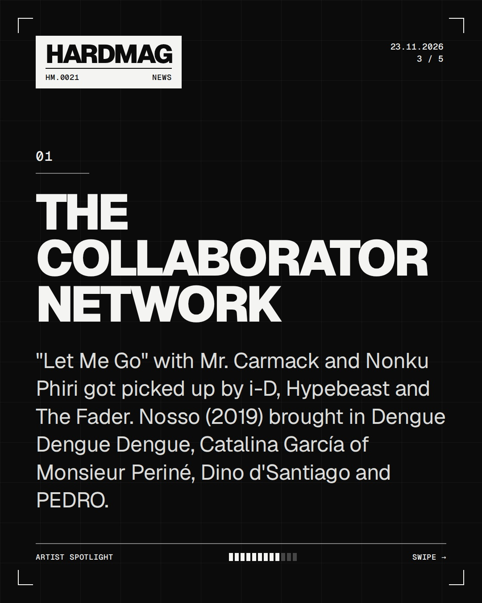 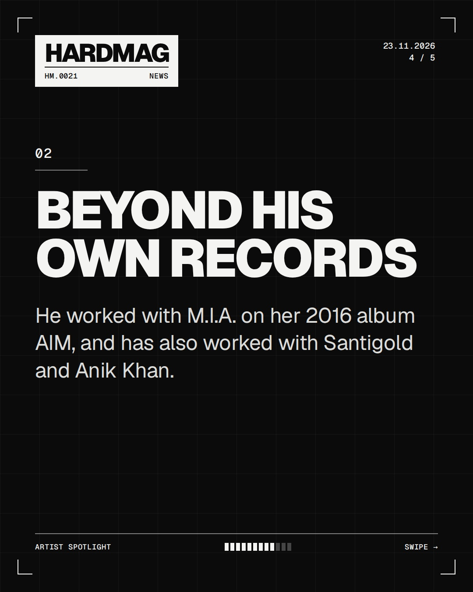 

<details><summary>Legenda</summary>

```
Lisbon as a switchboard for global club music: that's the @brankoofficial story.

João Barbosa first became known as part of Buraka Som Sistema before going solo as Branko. Swipe for the albums, a network of collaborators that includes M.I.A., and the Enchufada show on NTS broadcast from Lisbon.

Which Portuguese artist or label do you think does the most to connect Lisbon with club scenes abroad? 👇

Full story → hardmag.pt/news/2026-11-23-branko-the-lisbon-producer-wiring-up-global-club-m/ (link in bio)

#branko #enchufada #lisbon #portugal #ntsradio #clubmusic
```
</details>

Verificado: caption ok (569 chars, 6 hashtags, 1 mentions) · 5 slide(s) online · story online · website article ok · Instagram accepted the post · Instagram accepted the story · [ver no Instagram](https://www.instagram.com/hardmag.news/)

### domingo, 22/11, 19:48 · Cena · 📤 publicado
**Peak time: what BPM feels right?** (poll)


<details><summary>Legenda</summary>

```
Tempos keep climbing on dancefloors from Lisbon to Porto. Fast groove, bouncy and hard techno all hit a different spot, and some ravers still say slower hits harder. So when the room is full and the night is at its peak, what tempo does it for you? Vote, then tell us in the comments where the line is between groove and too fast, and which Portuguese dancefloor got the tempo just right for you.

A: Under 140 BPM
B: 140–148 BPM
C: 149–155 BPM
D: 156 BPM and up

Vote with the letter in the comments 👇

#hardmag #fastgroove #bouncy #hardtechno #techno #bpm
```
</details>

Verificado: caption ok (558 chars, 6 hashtags, 0 mentions) · 1 slide(s) online · story online · website article ok · Instagram accepted the post · Instagram accepted the story · [ver no Instagram](https://www.instagram.com/hardmag.news/)

### domingo, 22/11, 13:36 · Artistas · 📤 publicado
**DJ Nigga Fox and Príncipe's disorienting polyrhythms** (spotlight)

    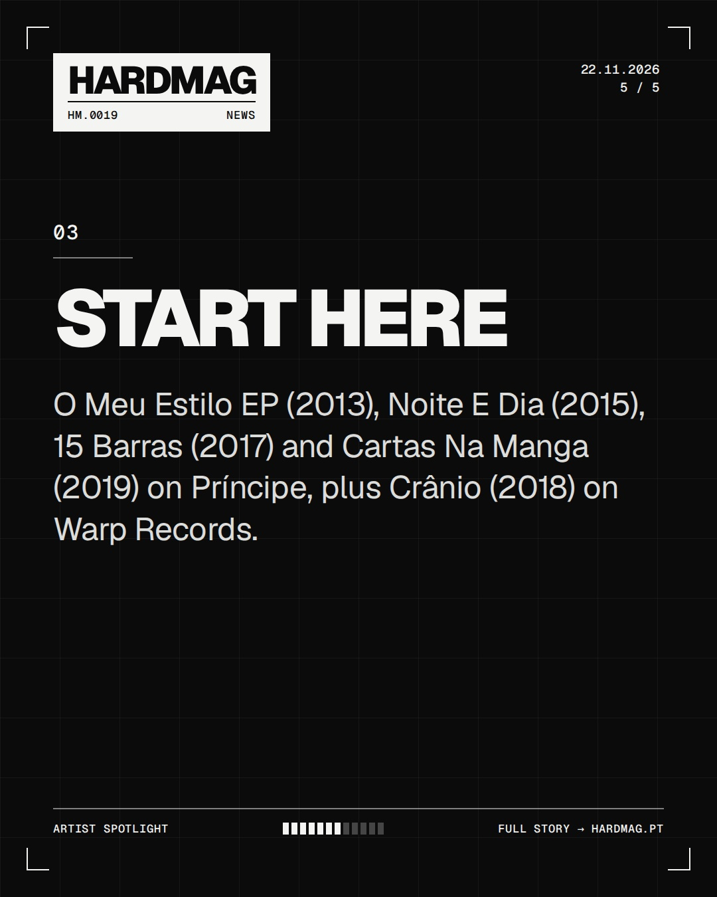

<details><summary>Legenda</summary>

```
In 2015 Thom Yorke put @djnigga.fox's "Weed" on his listening list next to Bernard Parmegiani.

Since Príncipe started releasing his music in 2011, Rogério Brandão Luís has bent kuduro, batida and tarraxinha into experimental polyrhythms, playing from @luxfragil, @musicboxlisboa and Porto's Hard Club to Berghain and WWW in Tokyo. He has also released on Warp Records, from "LUMI" on CARGAA 1 (2014) to Crânio (2018). Swipe for "Sons do Gueto", the Pedro Costa soundtrack and where to start.

Which DJ Nigga Fox record would you hand to someone new to Príncipe? 👇

Full story → hardmag.pt/news/2026-11-22-dj-nigga-fox-and-principes-disorienting-polyrhythm/ (link in bio)

#djniggafox #principediscos #batida #kuduro #lisbonclubculture #afrohouse
```
</details>

Verificado: caption ok (747 chars, 6 hashtags, 3 mentions) · 5 slide(s) online · story online · website article ok · Instagram accepted the post · Instagram accepted the story · [ver no Instagram](https://www.instagram.com/hardmag.news/)

### domingo, 22/11, 08:59 · Notícias PT · 📤 publicado
**From eMule to MoMA PS1: DJ Marfox and Lisbon's batida** (spotlight)

  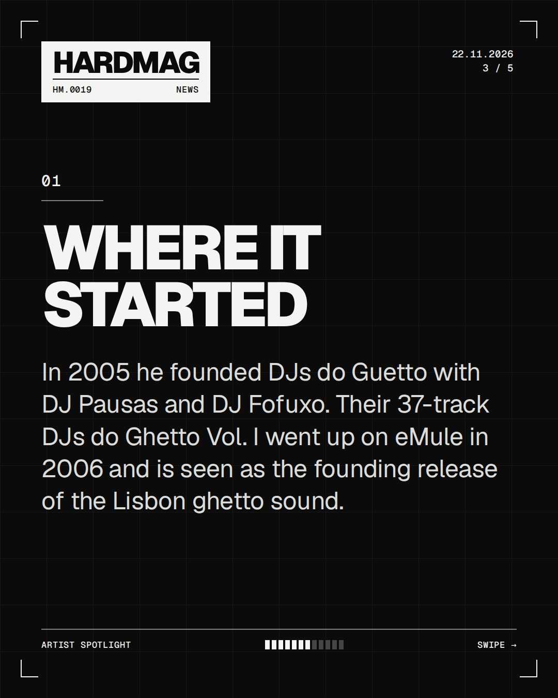 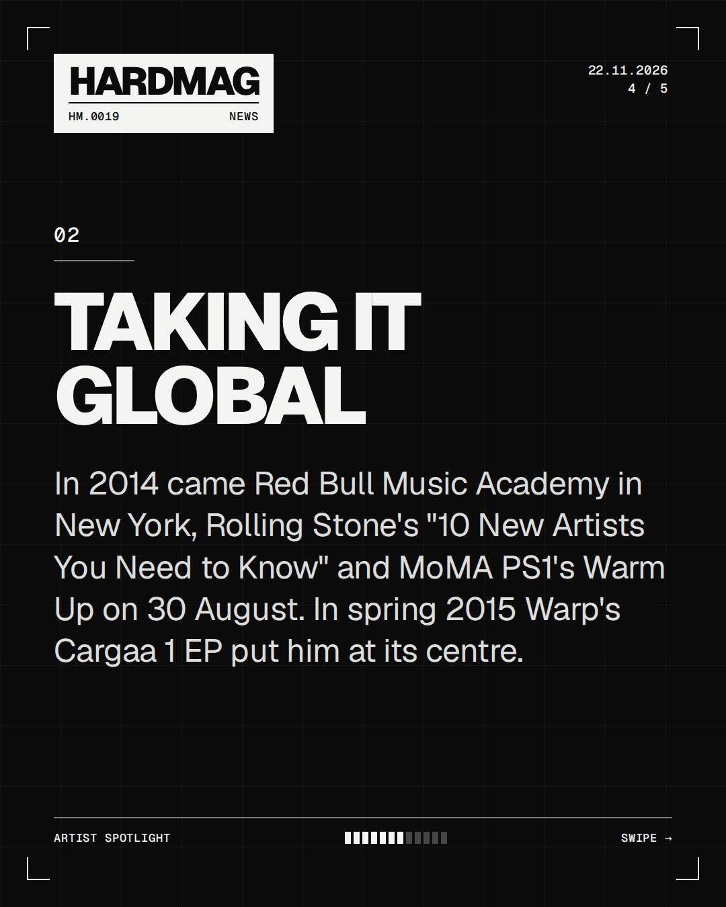 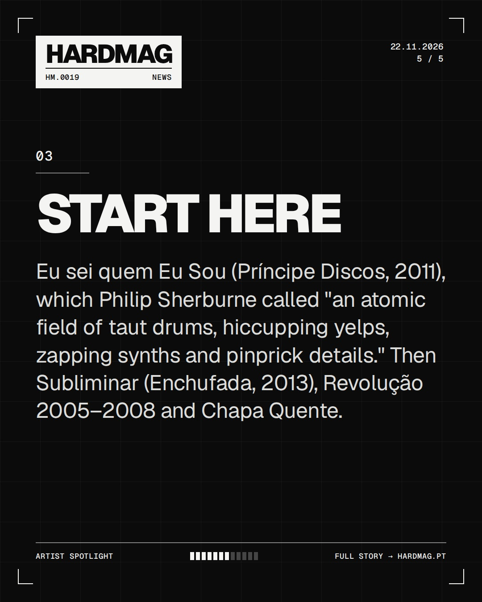

<details><summary>Legenda</summary>

```
In 2006, 37 tracks went up on eMule.

That compilation is now seen as the founding release of Lisbon's ghetto sound. It came from DJs do Guetto, the crew @djmarfox founded in 2005 with DJ Pausas and DJ Fofuxo, and Príncipe Discos has since reissued it as a free download. His records went on to Enchufada, with Subliminar in 2013, and to Warp, whose 2015 Cargaa 1 EP had him at its centre.

Príncipe, Enchufada or the old eMule rips: where did you first hear batida? 👇

Full story → hardmag.pt/news/2026-11-22-from-emule-to-moma-ps1-dj-marfox-and-lisbons-batid/ (link in bio)

#djmarfox #batida #principediscos #lisbon #kuduro #clubmusic
```
</details>

Verificado: caption ok (638 chars, 6 hashtags, 1 mentions) · 5 slide(s) online · story online · website article ok · Instagram accepted the post · Instagram accepted the story · [ver no Instagram](https://www.instagram.com/hardmag.news/)

### sábado, 21/11, 19:54 · Cena · 📤 publicado
**Tresor condemns Helsing AI military event at Kraftwerk** (news)

 

<details><summary>Legenda</summary>

```
Tresor speaks out against a Helsing AI military event at Kraftwerk Berlin.

The Berlin institution issued a statement condemning the event. In its words, such an event "has no place in the spaces our community has built".

Should club communities have a say in who else uses their venues? 👇

Full story → hardmag.pt/news/2026-11-21-tresor-condemns-helsing-ai-military-event-at-kraft/ (link in bio)

Source: @djmagofficial
📸 via @djmagofficial

#tresor #berlin #techno #clubculture #ai
```
</details>

Verificado: caption ok (486 chars, 5 hashtags, 2 mentions) · 2 slide(s) online · website article ok · Instagram accepted the post · [ver no Instagram](https://www.instagram.com/hardmag.news/)

### sábado, 21/11, 13:30 · Artistas · ⏭️ pulado
**Arca, Justice and Fcukers land on the GTA VI album (publicado à mão)** (news)


<details><summary>Legenda</summary>

```

```
</details>

Verificado: –

