# HARDMAG: fila de posts

Atualizado sexta, 27/11, 14:44 (hora de Lisboa). Cada post é escrito, revisado pelo editor-chefe, renderizado e testado na API do Instagram até 2 dias antes do horário. No horário, só é publicado.

**Prontos:** 3 · **Horários ainda sem post (próximas 24 h):** sexta, 27/11, 22:29 Noite, sábado, 28/11, 09:00 Notícias PT, sábado, 28/11, 11:55 Almoço, sábado, 28/11, 14:53 Artistas, sábado, 28/11, 19:32 Cena, sábado, 28/11, 22:33 Noite

## Próximos
### sexta, 27/11, 13:30 · Noite · ✅ pronto
**This weekend in Lisbon & Porto, 27–29 Nov** (agenda)

> Erro: Instagram 17841452523490693/media: {"message":"Invalid user id","code":110,"type":"OAuthException","error_subcode":2207018,"is_transient":false,"error_user_msg":"Os seguintes usuários não podem ser acessados: folamour_fhuo","error_user_title":"Não é possível carregar um usuário com um perfil privado

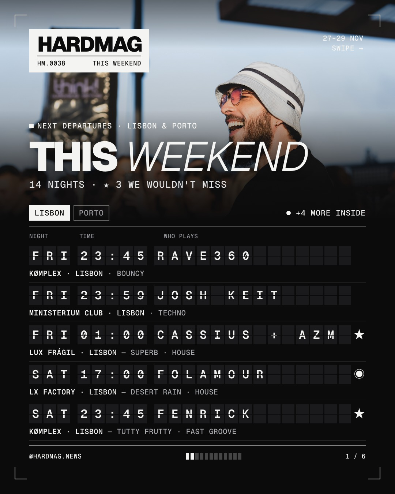  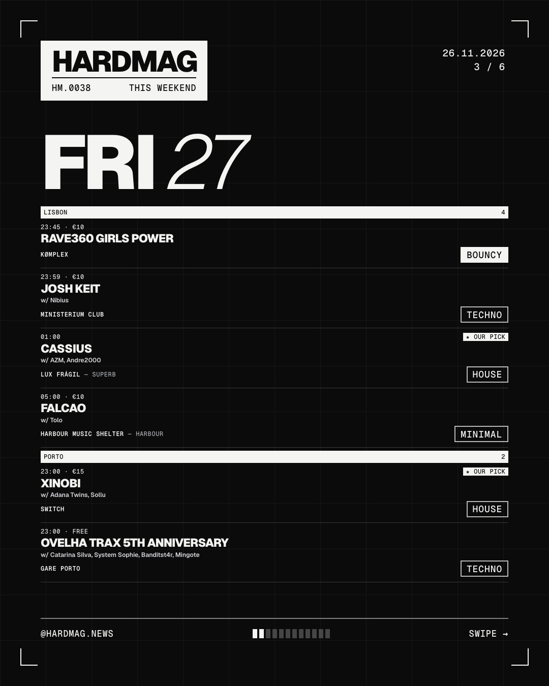  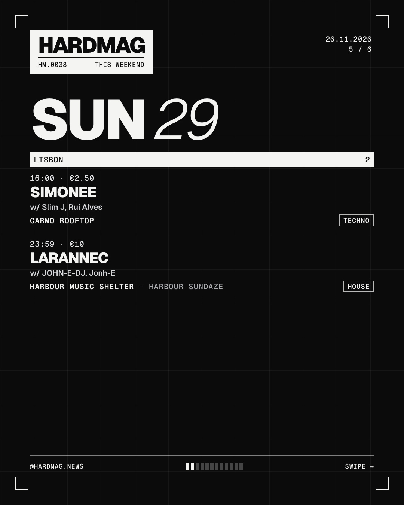 

<details><summary>Legenda</summary>

```
Cassius at Lux, hard groove at KØMPLEX and Xinobi in Porto, all in one weekend. Your legs won't get much rest. Friday, Cassius plays with AZM and Andre2000 at Superb, the most famous name on the board. Saturday, Fenrick brings the hard groove to Tutty Frutty with Gaddam and GTH, €10 plus an after party. Up north, Xinobi and Adana Twins take over Switch on Friday, the safest bet in Porto for a pista that stays full until close.

On the cover: Folamour, SAT 28 at LX Factory (Folamour).

FRI 27
LISBON
23:45 · Rave360 Girls Power @ KØMPLEX · bouncy (€10) @disturbtechno @komplexlisbon
23:59 · Josh Keit w/ Nibius @ Ministerium Club · techno (€10) @ministeriumclub
★ 01:00 · Cassius w/ AZM, Andre2000 (Superb) @ Lux Frágil · house @luxfragil
05:00 · Falcao w/ Tolo (Harbour) @ Harbour Music Shelter · minimal (€10) @harbourlisboa
PORTO
★ 23:00 · Xinobi w/ Adana Twins, Sollu @ Switch · house (€15) @xinobi @adanatwins
23:00 · Ovelha Trax 5th Anniversary w/ Catarina Silva, System Sophie, Banditst4r, Mingote @ Gare Porto · techno (Free) @gareporto @___catarinasilva

SAT 28
LISBON
17:00 · Folamour w/ SHUGI, LaMarie, Ari Girao (Desert Rain) @ LX Factory · house (€15) @desert.rain.agency @folamour_fhuo
★ 23:45 · Fenrick w/ GADDAM, GTH, PAISANA, ANÍBAL (Tutty Frutty) @ KØMPLEX · fast groove (€10) @komplexlisbon @gaddam.mode
01:00 · Andhim w/ HNRQ, Rafael da Cruz (Visceral) @ Lux Frágil · house
PORTO
23:00 · Club Kitten 25º Aniversário w/ DJ Kitten, Perel @ Pérola Negra · house (€15)
23:00 · Deriva_01 @ Canelas Creative House · house (€10)
23:59 · Lumberjacks21 w/ Saken, Bong (Mætrix 05) @ Era Uma Vez no Porto · techno (€8)

SUN 29
LISBON
16:00 · Simonee w/ Slim J, Rui Alves @ Carmo Rooftop · techno (€2.50)
23:59 · Larannec w/ JOHN-E-DJ, Jonh-E (Harbour Sundaze) @ Harbour Music Shelter · house (€10)

★ = our picks. Save this and send it to whoever you're going with 📌

Lux, KØMPLEX or Porto: where are you ending up at 6am this weekend? 👇

Tickets on Shotgun.
📸 Originalcat, CC BY-SA 4.0, via Wikimedia Commons

@luxfragil @komplexlisbon

#hardmag #lisbon #porto #lisbonnightlife #portonightlife #hardgroove
```
</details>

Verificado: caption ok (2122 chars, 6 hashtags, 15 mentions) · 6 slide(s) online · video online · story online · 4 animated stories online · website article ok · re-queued for Friday 13:30 after the night trigger was missed; videos without the old loop

### sexta, 27/11, 15:14 · Artistas · ✅ pronto
**What BPM actually feels right on the floor?** (poll)

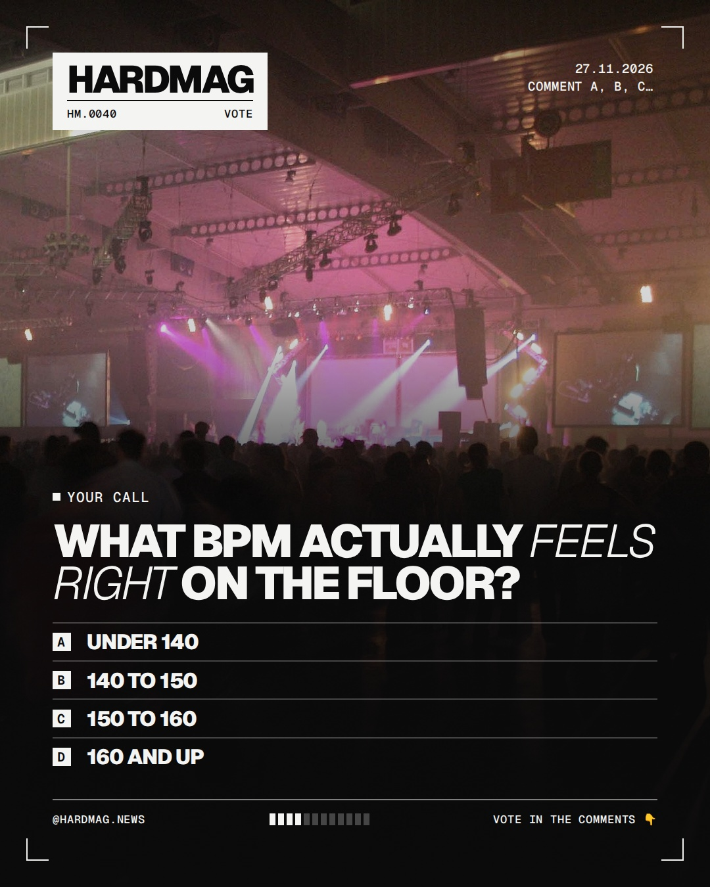

<details><summary>Legenda</summary>

```
The BPM arms race isn't slowing down, but your legs at 6am might have other ideas. Every crowd has a tempo where it stops thinking and just moves. Some of you want the groove to breathe, some of you only wake up once the kicks start racing. No wrong answers here, just the number where the pista clicks for you. Vote, then tell us in the comments: which set in Portugal this year hit your perfect tempo, and did the DJ push it too far or keep it right where it should be?

A: Under 140
B: 140 to 150
C: 150 to 160
D: 160 and up

Vote with the letter in the comments 👇

📸 photochino, CC BY 2.0, via Wikimedia Commons

#hardmag #fastgroove #bouncy #hardtechno #techno #house
```
</details>

Verificado: caption ok (674 chars, 6 hashtags, 0 mentions) · 1 slide(s) online · story online · website article ok · Instagram accepted the post · Instagram accepted the story

### sexta, 27/11, 19:38 · Cena · ✅ pronto
**Fast groove or bouncy: which owns your pista?** (poll)


<details><summary>Legenda</summary>

```
Two sounds, one dancefloor, and a lot of opinions in the smoking area. On one side you've got the rolling, percussive fast groove that keeps you locked in for hours. On the other, the bouncy hard house and hard groove wave that turns the whole room into one big jump. We cover both every day, so we want to know where the malta in Portugal actually stands. Vote, then tell us in the comments: which track or set sold you on your side, and where in Lisbon, Porto or beyond did you hear it? Tag the friend who always argues for the other one.

A: Fast groove
B: Bouncy
C: Both, same night
D: Depends on the hour

Vote with the letter in the comments 👇

📸 photochino, CC BY 2.0, via Wikimedia Commons

#fastgroove #bouncy #hardgroove #hardhouse #techno #lisboa
```
</details>

Verificado: caption ok (759 chars, 6 hashtags, 0 mentions) · 1 slide(s) online · story online · website article ok · Instagram accepted the post · Instagram accepted the story


## Recentes
### sexta, 27/11, 15:14 · Artistas · ❌ falhou
**Berlin NYE: Villalobos meets Akingbehin at Zenner** (news)

> Erro: caption contains a template error

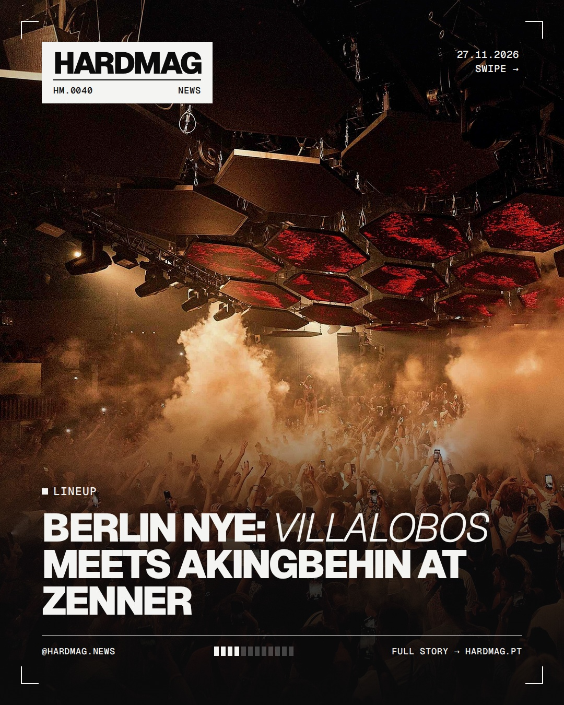   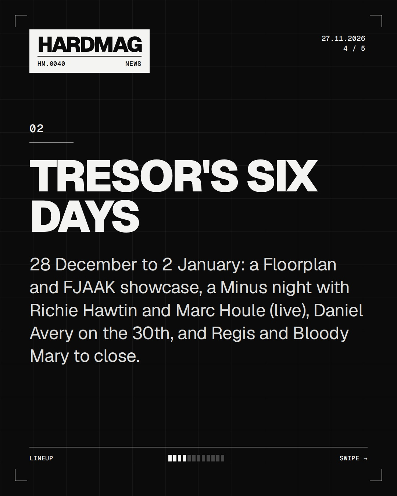 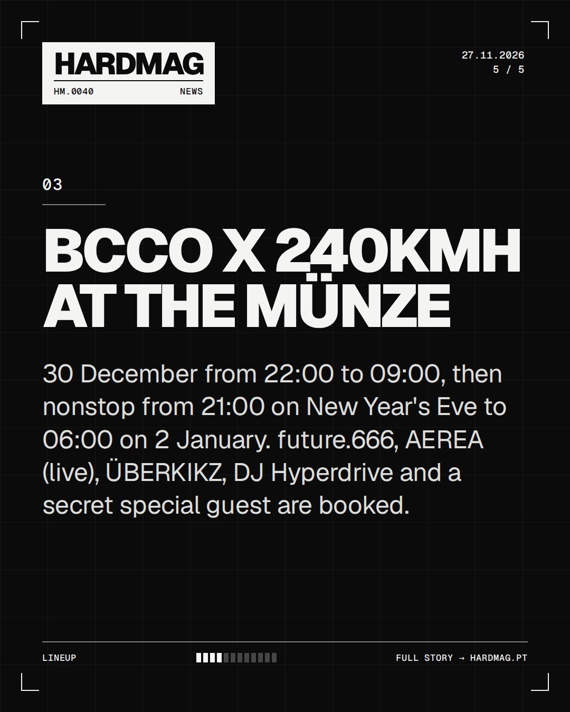

<details><summary>Legenda</summary>

```
Berghain still won't say who's playing at New Year. Most of Berlin has already shown its hand.

Ricardo Villalobos and Richard Akingbehin share a lineup for the first time at Zenner on 1 January. RSO.BERLIN says more names are coming for its 82-hour NULL RESET, Renate has filled five floors with Skee Mask and DJ Fett Burger, and out in Spandau Climate of Fear, an official RA Pick, runs 27 hours at Backsteinboot on 1 and 2 January.

HARDMAG's take: with this many parties starting on 1 January, midnight looks more like the warm-up than the main event.

Which Berlin New Year marathon would you fly in for, and why that one? 👇

Full story → hardmag.pt/news/2026-11-27-berlin-nye-villalobos-meets-akingbehin-at-zenner/ (link in bio)

Source: GROOVE
📸 via GROOVE

#berlintechno #newyearseve #ricardovillalobos #rsoberlin #tresor #clubculture
```
</details>

Verificado: –

### sexta, 27/11, 12:19 · Almoço · 📤 publicado
**Lisbon coffee rave brings shelter dogs to the floor** (news)

 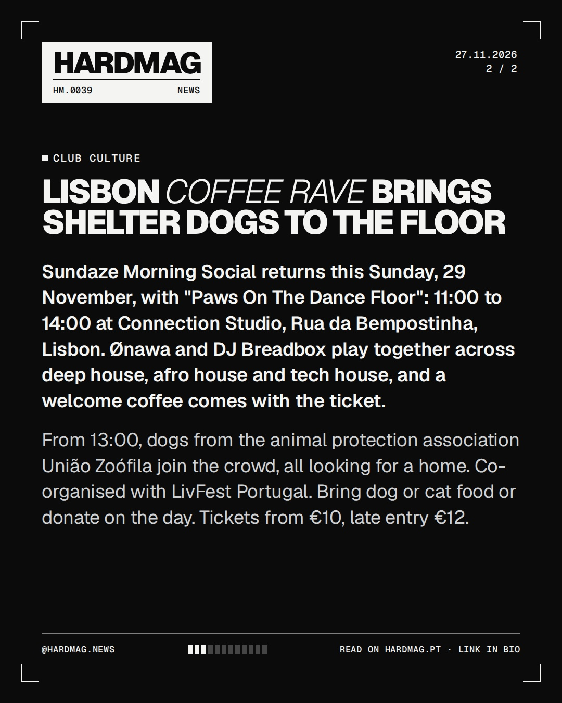

<details><summary>Legenda</summary>

```
Three hours of house, home in time for lunch, and the dancefloor has a few extra paws this time.

Sundaze Morning Social is back this Sunday, 29 November, at Connection Studio in Lisbon (11:00–14:00), with Ønawa and DJ Breadbox playing together through deep, afro and tech house. From 13:00, shelter dogs from União Zoófila join the pista, all looking for a family. It's co-organised with LivFest Portugal, and you can bring pet food or donate on the day. Tickets from €10.

HARDMAG's take: this is the one rave where it's fine if you leave with a new best friend who isn't from the smoking area.

What's the best daytime party you've been to in Lisbon, and who was behind the decks? 👇

Full story → hardmag.pt/news/2026-11-27-lisbon-coffee-rave-brings-shelter-dogs-to-the-floo/ (link in bio)

Source: NiT
📸 via NiT

#lisbon #coffeerave #daytimeparty #deephouse #afrohouse #lisboa
```
</details>

Verificado: caption ok (882 chars, 6 hashtags, 0 mentions) · 2 slide(s) online · video online · story online · website article ok · Instagram accepted the post (with motion cover) · Instagram accepted the story · [ver no Instagram](https://www.instagram.com/hardmag.news/)

### sexta, 27/11, 08:41 · Notícias PT · 📤 publicado
**Viseu techno night gives all profits to firefighters** (news)

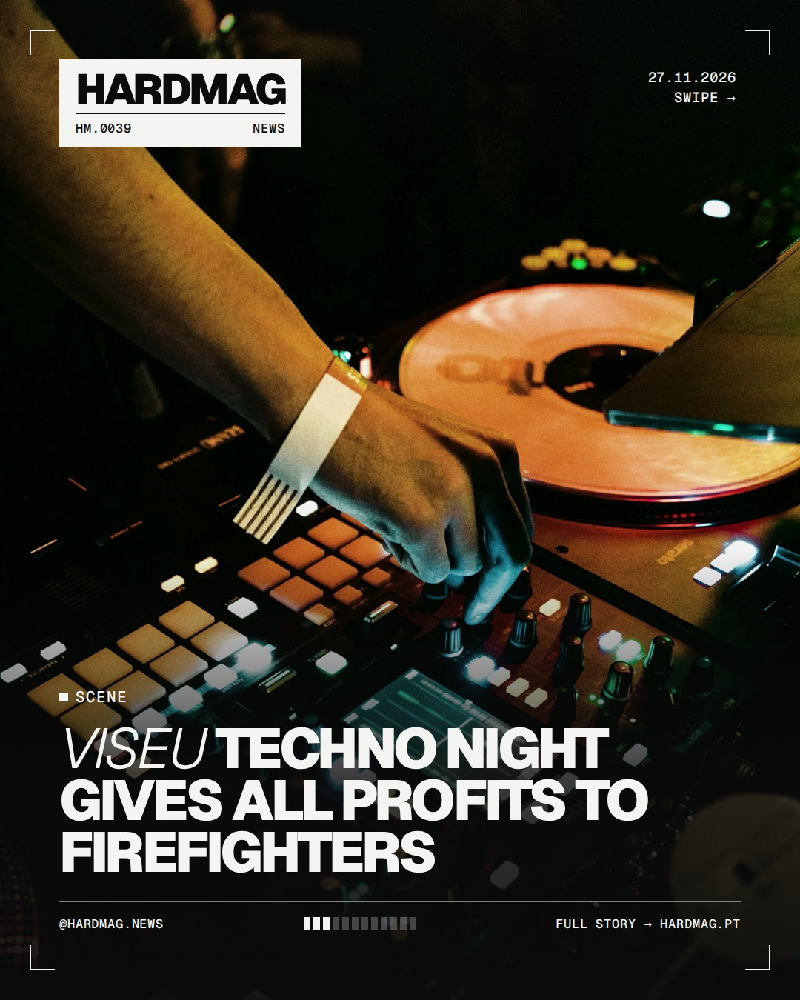  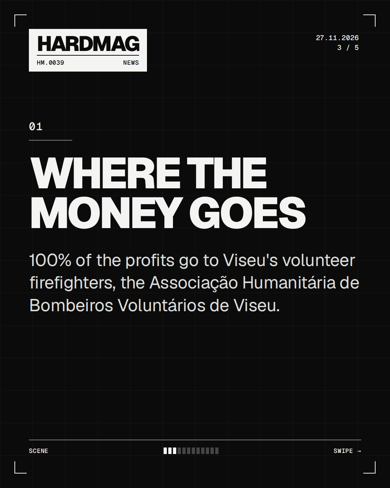 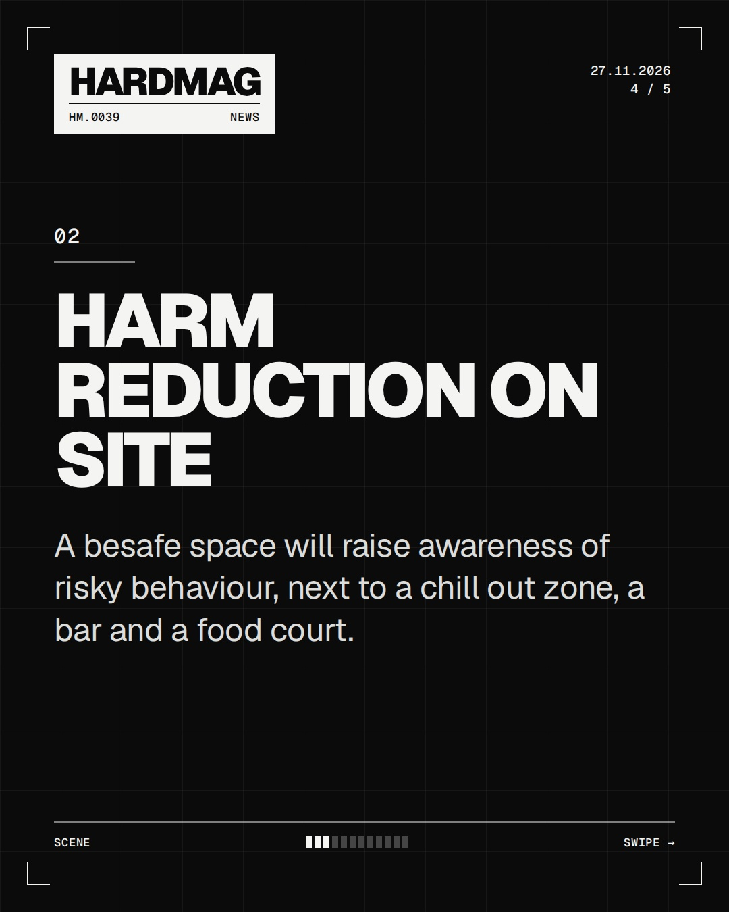 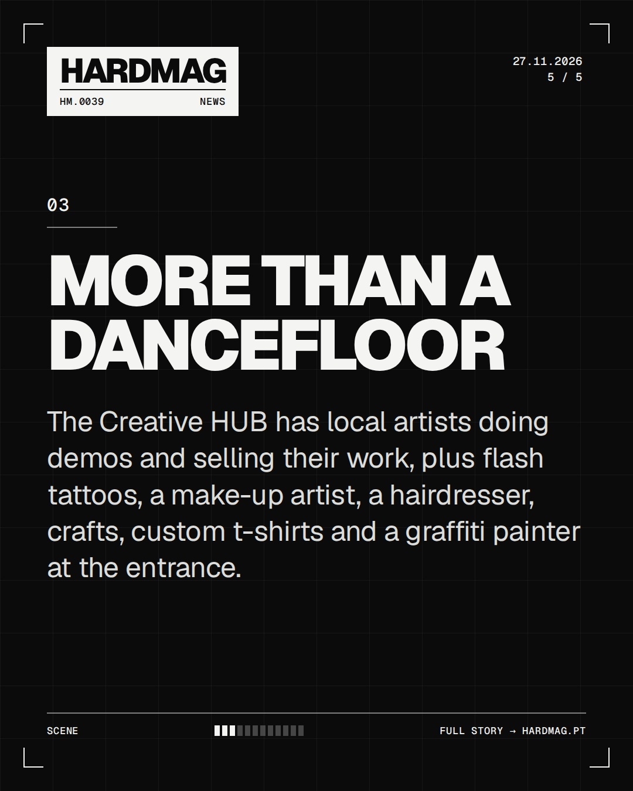

<details><summary>Legenda</summary>

```
100% of the profits from this Saturday's techno party in Viseu go to the local firefighters.

Electronic Beira Sounds, put on by Dark Waves, brings Cravo b2b Vil, Du/art, Frank Maurel, Valody and Tryängle b2b VASQ to the Pavilhão Multiusos de Viseu. Besides the pista you get a besafe harm-reduction space, a chill out zone and a Creative HUB full of local artists, with flash tattoos thrown in. The Município de Viseu is backing it through its Eixo Cultura programme.

Our take: techno doesn't stop at the A1. When a city hall supports a rave and the bombeiros get the profits, the interior is building its own scene.

Which city outside Lisbon and Porto has the best techno noite you've been to? 👇

Full story → hardmag.pt/news/2026-11-27-viseu-techno-night-gives-all-profits-to-firefighte/ (link in bio)

Source: Diário de Viseu
📸 via Diário de Viseu

#techno #viseu #portugaltechno #electronicbeirasounds #harmreduction
```
</details>

Verificado: caption ok (925 chars, 5 hashtags, 0 mentions) · 5 slide(s) online · video online · story online · website article ok · Instagram accepted the post (with motion cover) · Instagram accepted the story · [ver no Instagram](https://www.instagram.com/hardmag.news/)

### quinta, 26/11, 19:34 · Cena · 📤 publicado
**Most underrated DJ in Portugal right now?** (poll)


<details><summary>Legenda</summary>

```
Every scene has one. They play the warm-up, the 5am slot or the after nobody posted about, and the pista loses it anyway. Their name still isn't on the big posters.

We're a small account and we want to hear about the DJs you rate before everyone else does. Fast groove, bouncy, hard techno, techno, house, any sound and any city: Lisbon, Porto, Braga, Coimbra, the Algarve, wherever you dance.

Tag your pick in the comments and tell us why: the set, the track, the moment. Then tag the friend from your crew who'll say you've got it wrong. Most tags wins a feature on HARDMAG.

So, malta: who's the DJ you'd take your friends to hear before the rest of the country catches on?

Tag your pick in the comments and tell us why 👇

📸 s_t_d, CC BY-SA 3.0, via Wikimedia Commons

#hardmag #underrateddj #djportugal #technoportugal #lisbontechno #portotechno
```
</details>

Verificado: caption ok (854 chars, 6 hashtags, 0 mentions) · 1 slide(s) online · story online · website article ok · Instagram accepted the post · Instagram accepted the story · [ver no Instagram](https://www.instagram.com/hardmag.news/)

### quinta, 26/11, 15:04 · Artistas · 📤 publicado
**Hannah Laing: from dental nurse to the doof** (spotlight)

 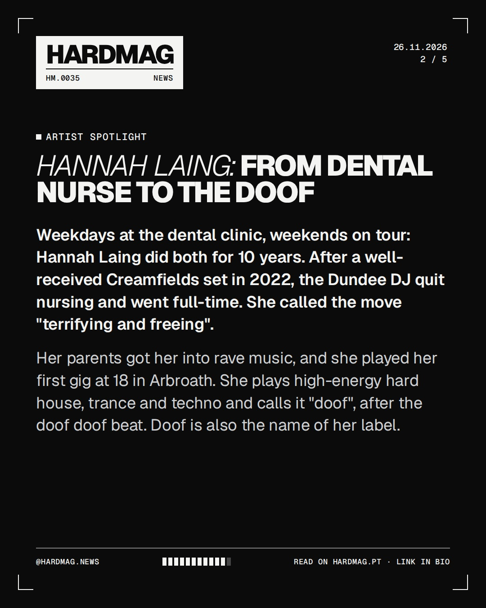 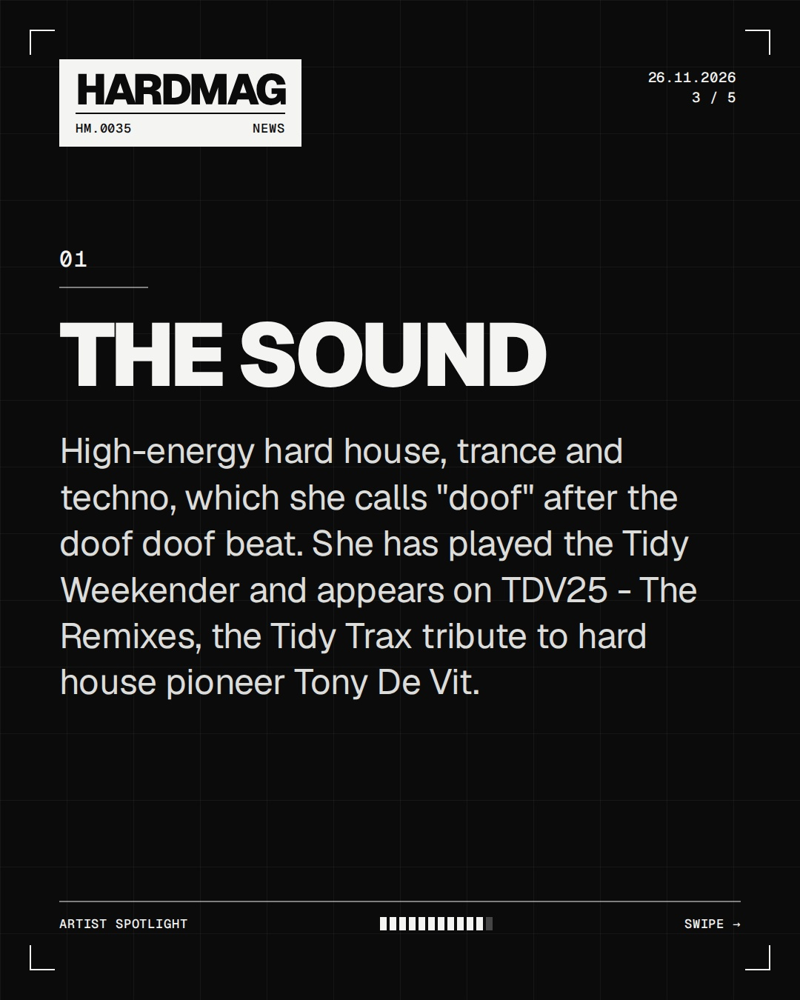 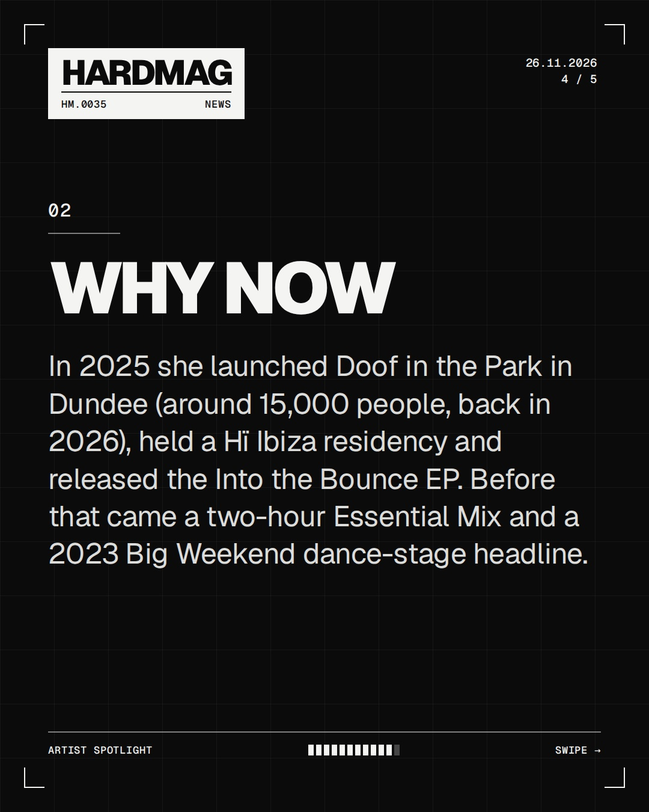 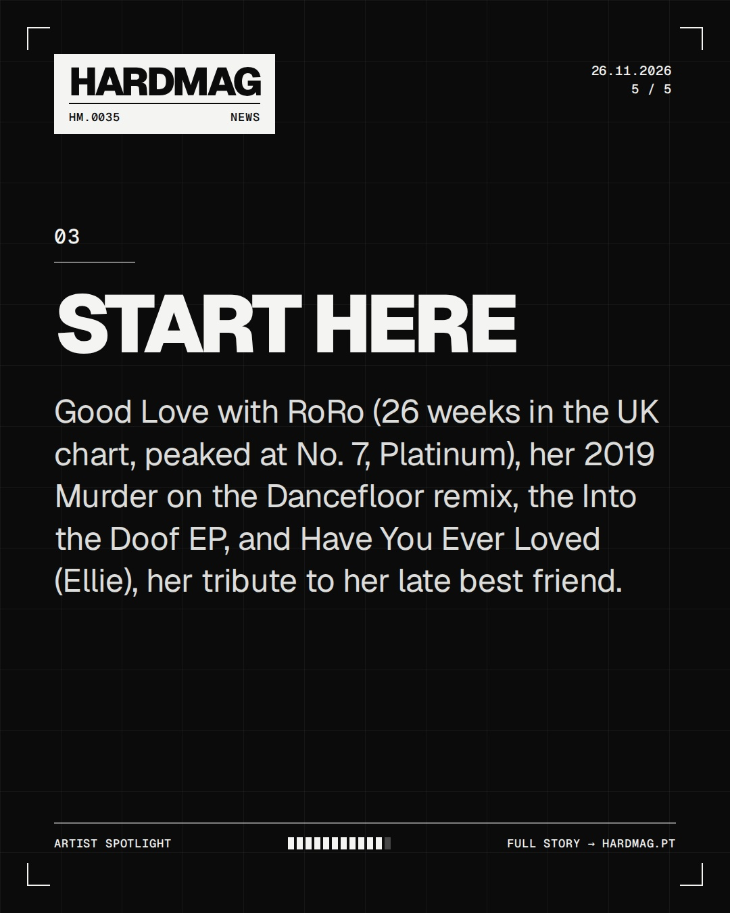

<details><summary>Legenda</summary>

```
Ten years as a dental nurse on weekdays, touring at weekends. After Creamfields 2022, she quit.

@hannahlaingdj called going full-time "terrifying and freeing". Since then the Dundee DJ has headlined the dance stage at BBC Radio 1's Big Weekend, held a residency at Hï Ibiza, and launched Doof in the Park, which drew around 15,000 people in her home city. Her single Good Love with RoRo also spent 26 weeks in the UK chart.

Our take: she was raised on her parents' rave records and now has her own label and a 15,000-person festival at home. Not a bad trade for the dentist's chair.

Which Hannah Laing track would you want as the 6am closer on your pista? 👇

Full story → hardmag.pt/news/2026-11-26-hannah-laing-from-dental-nurse-to-the-doof/ (link in bio)

📸 KeyKing666, CC BY-SA 4.0, via Wikimedia Commons

#hardhouse #hannahlaing #doof #trance #dundee #bouncy
```
</details>

Verificado: caption ok (867 chars, 6 hashtags, 1 mentions) · 5 slide(s) online · video online · story online · website article ok · Instagram accepted the post (with motion cover) · Instagram accepted the story · [ver no Instagram](https://www.instagram.com/hardmag.news/)

### quinta, 26/11, 12:12 · Almoço · 📤 publicado
**DJ Marfox took his name from Star Fox** (spotlight)

 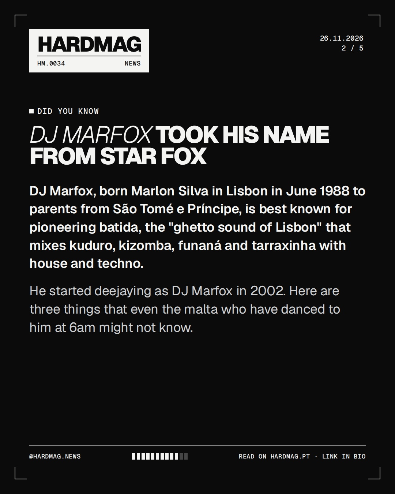  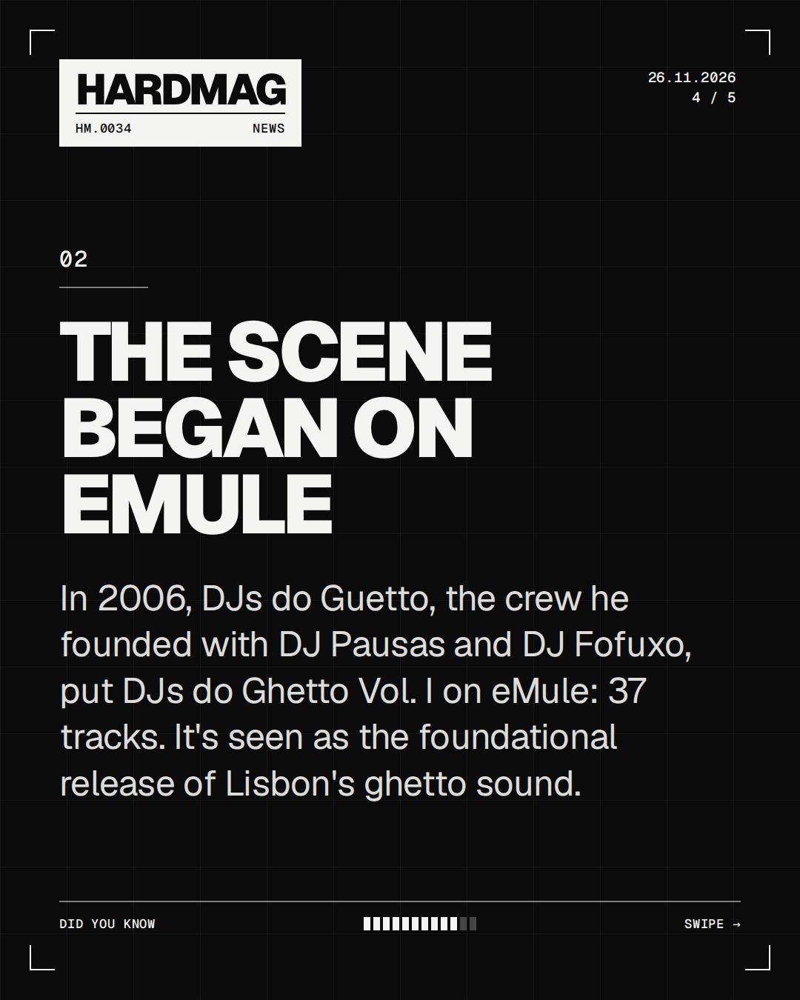 

<details><summary>Legenda</summary>

```
The man who pioneered Lisbon's batida took his name from a Nintendo game.

@djmarfox, born Marlon Silva, joined "Marl" with Star Fox, the character he played as a teenager. In 2006 his crew with DJ Pausas and DJ Fofuxo put 37 tracks on eMule, and that compilation is now seen as the foundational release of the ghetto sound of Lisbon. Later came Príncipe Discos, Lit City Trax, WARP and MoMA PS1.

Our take: if anyone tells you batida is a niche, remind them it started as a file-sharing download and ended up in New York.

Which of these three surprised you most, or when did a DJ Marfox set first get you? 👇

Full story → hardmag.pt/news/2026-11-26-dj-marfox-took-his-name-from-star-fox/ (link in bio)

📸 DJ Marfox, CC BY-SA 4.0, via Wikimedia Commons

#djmarfox #batida #principediscos #lisbon #ghettosoundoflisbon #kuduro
```
</details>

Verificado: caption ok (827 chars, 6 hashtags, 1 mentions) · 5 slide(s) online · video online · story online · website article ok · Instagram accepted the post (with motion cover) · Instagram accepted the story · [ver no Instagram](https://www.instagram.com/hardmag.news/)

### quinta, 26/11, 09:03 · Notícias PT · 📤 publicado
**Disclosure remixer RIVO opens Sodade's new Lisbon series** (news)

 

<details><summary>Legenda</summary>

```
He remixed Disclosure's 'You & Me' and went viral with a fadista. Now RIVO opens a new Lisbon series.

Sodade launches please do not disturb on 19 December at LX Factory. RIVO, who shared the stage with fadista Bia Caboz at Nómadas, headlines alongside Braga duo Mayze x Faria, France's Max Arthur and Portuguese DJ JÖAH. The motto is "disconnect to connect", and each edition is built around its venue, from the lighting to the visuals.

Our take: any night that asks you to put the phone away and watch the booth gets a nod from us.

Which Lisbon night got you so locked into the music that you forgot to check your phone? 👇

Full story → hardmag.pt/news/2026-11-26-disclosure-remixer-rivo-opens-sodades-new-lisbon-s/ (link in bio)

Source: musicfest.pt
📸 via musicfest.pt

#lisbon #lxfactory #housemusic #portugalnightlife #rivo
```
</details>

Verificado: caption ok (833 chars, 5 hashtags, 0 mentions) · 2 slide(s) online · video online · story online · website article ok · Instagram accepted the post (with motion cover) · Instagram accepted the story · [ver no Instagram](https://www.instagram.com/hardmag.news/)

### quarta, 25/11, 22:41 · Noite · 📤 publicado
**Lisbon's Joe Delon steps up for DJ Mag's Recognise** (news)

 

<details><summary>Legenda</summary>

```
Two hours, decades of house, 20 years behind the decks, and it's all coming out of Lisbon.

Joe Delon, the Lisbon-based DJ who founded Welt Discos, has recorded episode 121 of @djmagofficial's Recognise series. In the interview that comes with it, he talks to Michael McKinney about putting feelings first, why ambiguity matters in a set, pushing back on narrow definitions of queer dance music, and jigsaw puzzles.

Our take: a Lisbon selector getting two full hours on a global platform is good news for the whole pista.

Which Lisbon DJ would you put forward for the next big international mix series? 👇

Full story → hardmag.pt/news/2026-11-25-lisbons-joe-delon-steps-up-for-dj-mags-recognise/ (link in bio)

Source: @djmagofficial
📸 WILL POWER, CC BY 2.0, via Wikimedia Commons

#joedelon #weltdiscos #housemusic #lisbon #djmix #recognise
```
</details>

Verificado: caption ok (845 chars, 6 hashtags, 2 mentions) · 2 slide(s) online · video online · story online · website article ok · Instagram accepted the post (with motion cover) · Instagram accepted the story · [ver no Instagram](https://www.instagram.com/hardmag.news/)

