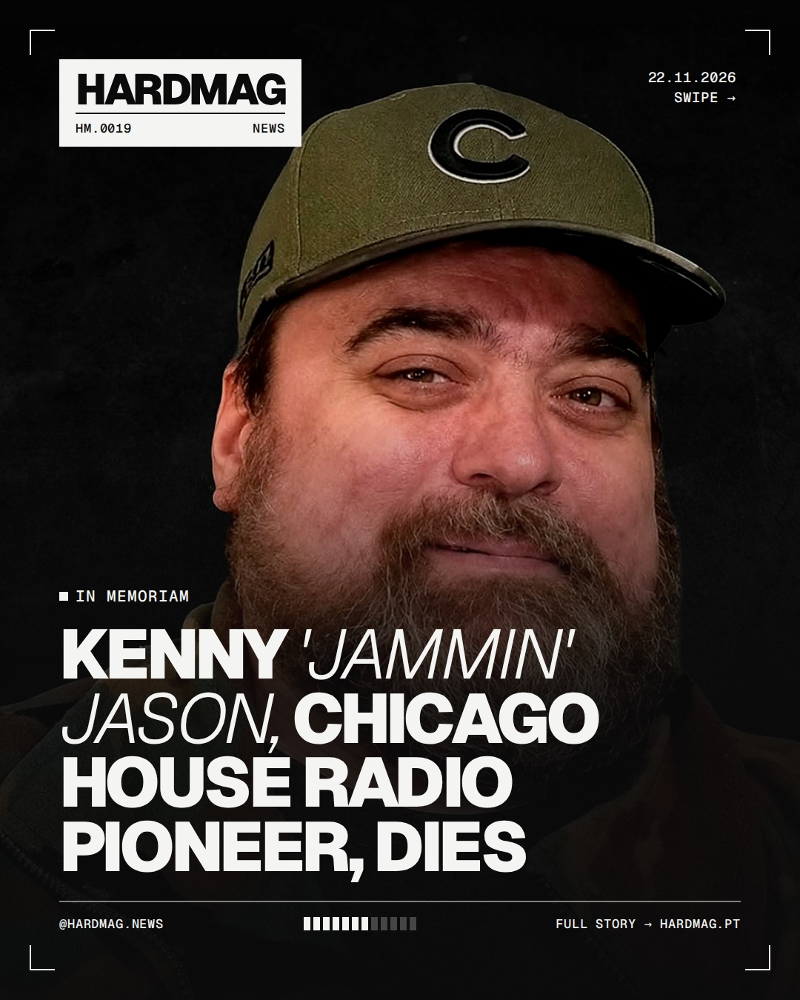
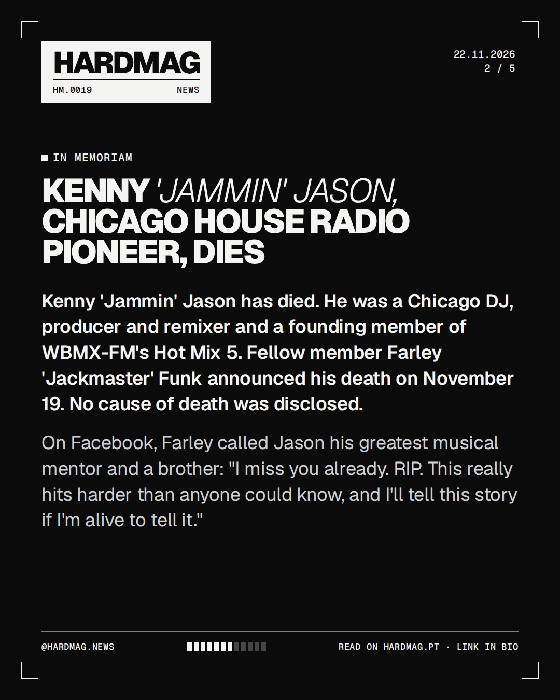
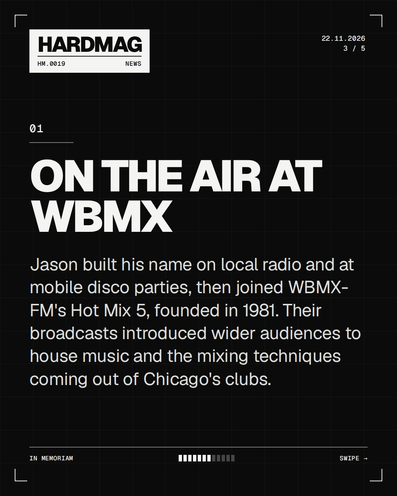
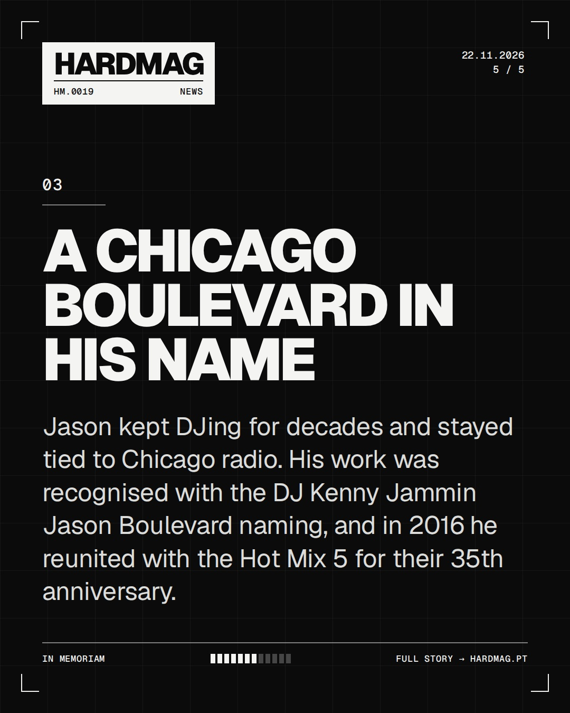

# HARDMAG: fila de posts

Atualizado sábado, 21/11, 20:37 (hora de Lisboa). Cada post é escrito, revisado pelo editor-chefe, renderizado e testado na API do Instagram até 2 dias antes do horário. No horário, só é publicado.

**Prontos:** 2 · **Horários ainda sem post (próximas 24 h):** domingo, 22/11, 13:36 Artistas

## Próximos
### domingo, 22/11, 08:59 · Notícias PT · ✅ pronto
**Kenny 'Jammin' Jason, Chicago house radio pioneer, dies** (news)

    

<details><summary>Legenda</summary>

```
'I miss you already': Farley 'Jackmaster' Funk on his greatest musical mentor, Kenny 'Jammin' Jason.

Jason, a founding member of Chicago's Hot Mix 5 alongside Farley 'Jackmaster' Funk, Mickey 'Mixin' Oliver, Ralphi Rosario and Scott 'Smokin' Silz, has died. From 1981, the Hot Mix 5's WBMX-FM broadcasts introduced wider audiences to house music and the mixing techniques coming out of Chicago's clubs. In 1985 he released the 'Jam Tracks' EP, and he made 'Can U Dance' with Fast Eddie.

How did Hot Mix 5 tapes or Chicago jack tracks first reach you here in Portugal? 👇

Full story → hardmag.pt/news/2026-11-22-kenny-jammin-jason-chicago-house-radio-pioneer-die/ (link in bio)

Source: @electronicgroove
📸 via @electronicgroove

#chicagohouse #housemusic #hotmix5 #wbmx #inmemoriam
```
</details>

Verificado: caption ok (785 chars, 5 hashtags, 2 mentions) · 5 slide(s) online · video online · story online · website article ok · Instagram accepted the post (with motion cover) · Instagram accepted the story

### domingo, 22/11, 19:48 · Cena · ✅ pronto
**Which Lisbon club owns your weekend?** (poll)


<details><summary>Legenda</summary>

```
Lisbon has rooms for every tempo, from hard techno to house to everything in between, and every raver has the one they keep going back to. We want to know where yours is. Vote, then tell us in the comments why: the sound system, the crowd, the door, the residents, or that one night you still talk about.

A: KØMPLEX
B: Lux Frágil
C: Ministerium
D: Planeta Manas
E: Musicbox Lisboa

Vote with the letter in the comments 👇

@komplexlisbon @luxfragil @ministeriumclub @planetamanas @musicboxlisboa

#hardmag #lisboa #lisbon #techno #house #hardtechno
```
</details>

Verificado: caption ok (549 chars, 6 hashtags, 5 mentions) · 1 slide(s) online · story online · website article ok · Instagram accepted the post · Instagram accepted the story


## Recentes
### sábado, 21/11, 19:54 · Cena · 📤 publicado
**Tresor condemns Helsing AI military event at Kraftwerk** (news)

 

<details><summary>Legenda</summary>

```
Tresor speaks out against a Helsing AI military event at Kraftwerk Berlin.

The Berlin institution issued a statement condemning the event. In its words, such an event "has no place in the spaces our community has built".

Should club communities have a say in who else uses their venues? 👇

Full story → hardmag.pt/news/2026-11-21-tresor-condemns-helsing-ai-military-event-at-kraft/ (link in bio)

Source: @djmagofficial
📸 via @djmagofficial

#tresor #berlin #techno #clubculture #ai
```
</details>

Verificado: caption ok (486 chars, 5 hashtags, 2 mentions) · 2 slide(s) online · website article ok · Instagram accepted the post · [ver no Instagram](https://www.instagram.com/hardmag.news/)

### sábado, 21/11, 13:30 · Artistas · ⏭️ pulado
**Arca, Justice and Fcukers land on the GTA VI album (publicado à mão)** (news)


<details><summary>Legenda</summary>

```

```
</details>

Verificado: –

### sábado, 21/11, 08:50 · Notícias PT · ⏭️ pulado
**(sem post: pausa)** (news)


<details><summary>Legenda</summary>

```

```
</details>

Verificado: –

