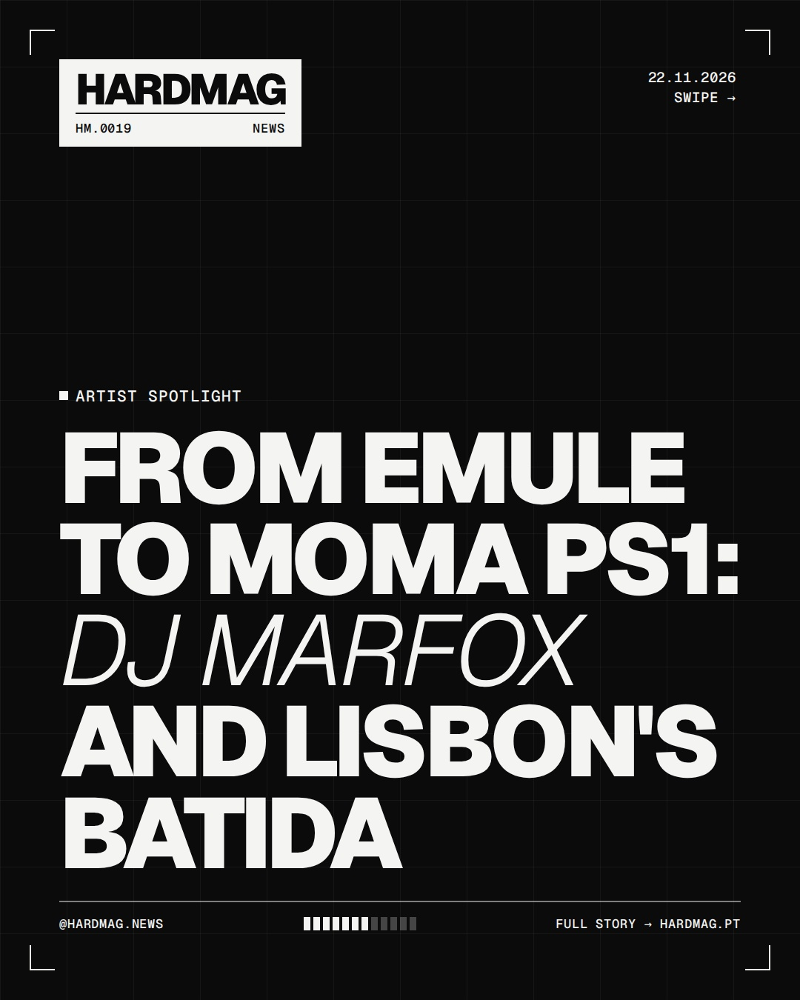
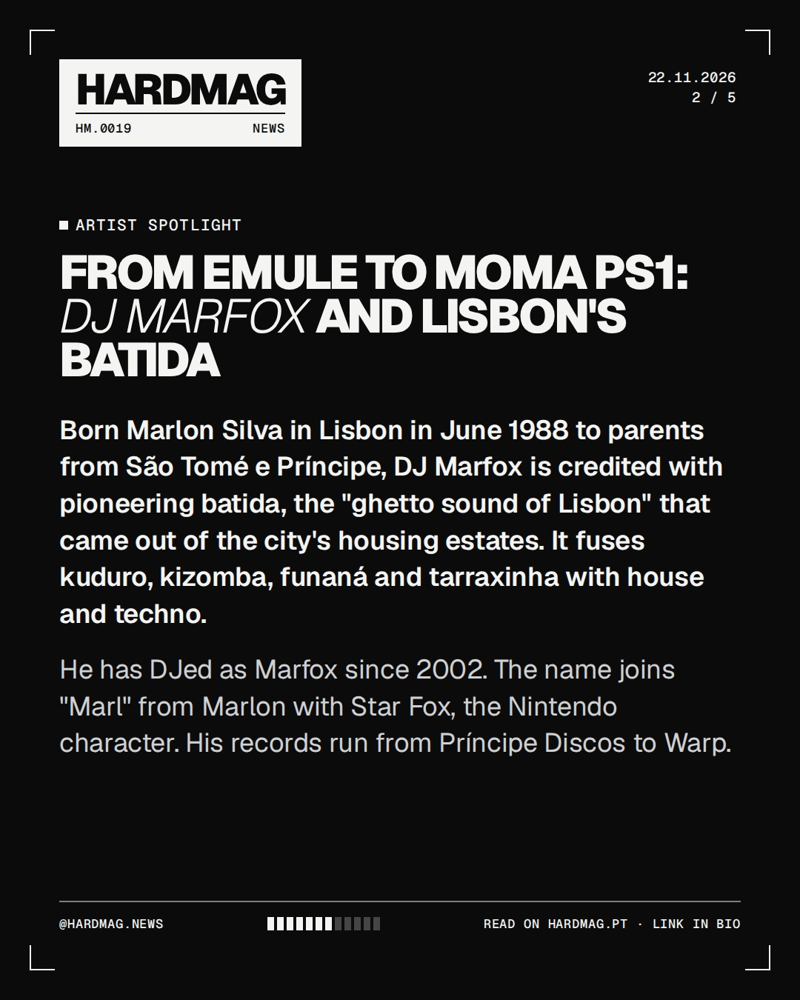
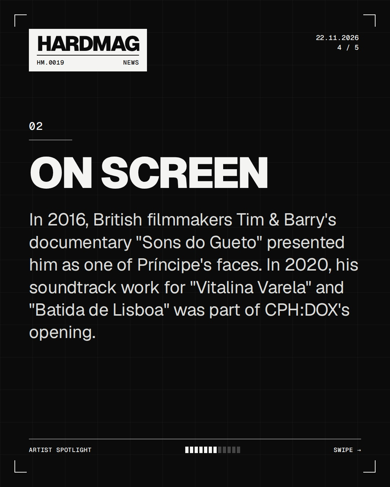
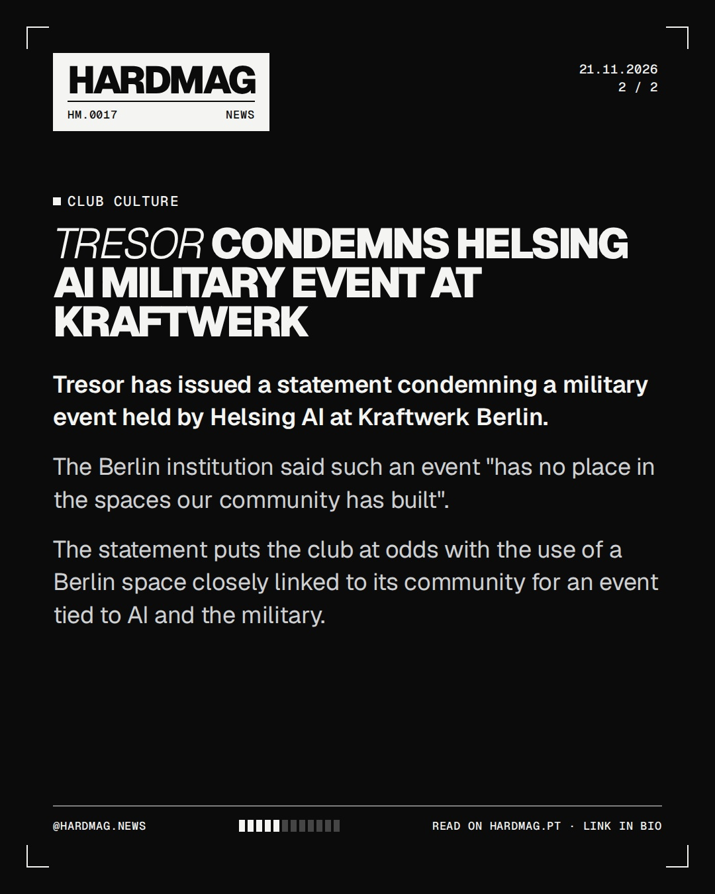

# HARDMAG: fila de posts

Atualizado sábado, 21/11, 20:59 (hora de Lisboa). Cada post é escrito, revisado pelo editor-chefe, renderizado e testado na API do Instagram até 2 dias antes do horário. No horário, só é publicado.

**Prontos:** 3 · **Horários ainda sem post (próximas 24 h):** nenhum

## Próximos
### domingo, 22/11, 08:59 · Notícias PT · ✅ pronto
**From eMule to MoMA PS1: DJ Marfox and Lisbon's batida** (spotlight)

    

<details><summary>Legenda</summary>

```
In 2006, 37 tracks went up on eMule.

That compilation is now seen as the founding release of Lisbon's ghetto sound. It came from DJs do Guetto, the crew @djmarfox founded in 2005 with DJ Pausas and DJ Fofuxo, and Príncipe Discos has since reissued it as a free download. His records went on to Enchufada, with Subliminar in 2013, and to Warp, whose 2015 Cargaa 1 EP had him at its centre.

Príncipe, Enchufada or the old eMule rips: where did you first hear batida? 👇

Full story → hardmag.pt/news/2026-11-22-from-emule-to-moma-ps1-dj-marfox-and-lisbons-batid/ (link in bio)

#djmarfox #batida #principediscos #lisbon #kuduro #clubmusic
```
</details>

Verificado: caption ok (638 chars, 6 hashtags, 1 mentions) · 5 slide(s) online · story online · website article ok · Instagram accepted the post · Instagram accepted the story

### domingo, 22/11, 13:36 · Artistas · ✅ pronto
**DJ Nigga Fox and Príncipe's disorienting polyrhythms** (spotlight)

    

<details><summary>Legenda</summary>

```
In 2015 Thom Yorke put @djnigga.fox's "Weed" on his listening list next to Bernard Parmegiani.

Since Príncipe started releasing his music in 2011, Rogério Brandão Luís has bent kuduro, batida and tarraxinha into experimental polyrhythms, playing from @luxfragil, @musicboxlisboa and Porto's Hard Club to Berghain and WWW in Tokyo. He has also released on Warp Records, from "LUMI" on CARGAA 1 (2014) to Crânio (2018). Swipe for "Sons do Gueto", the Pedro Costa soundtrack and where to start.

Which DJ Nigga Fox record would you hand to someone new to Príncipe? 👇

Full story → hardmag.pt/news/2026-11-22-dj-nigga-fox-and-principes-disorienting-polyrhythm/ (link in bio)

#djniggafox #principediscos #batida #kuduro #lisbonclubculture #afrohouse
```
</details>

Verificado: caption ok (747 chars, 6 hashtags, 3 mentions) · 5 slide(s) online · story online · website article ok · Instagram accepted the post · Instagram accepted the story

### domingo, 22/11, 19:48 · Cena · ✅ pronto
**Peak time: what BPM feels right?** (poll)


<details><summary>Legenda</summary>

```
Tempos keep climbing on dancefloors from Lisbon to Porto. Fast groove, bouncy and hard techno all hit a different spot, and some ravers still say slower hits harder. So when the room is full and the night is at its peak, what tempo does it for you? Vote, then tell us in the comments where the line is between groove and too fast, and which Portuguese dancefloor got the tempo just right for you.

A: Under 140 BPM
B: 140–148 BPM
C: 149–155 BPM
D: 156 BPM and up

Vote with the letter in the comments 👇

#hardmag #fastgroove #bouncy #hardtechno #techno #bpm
```
</details>

Verificado: caption ok (558 chars, 6 hashtags, 0 mentions) · 1 slide(s) online · story online · website article ok · Instagram accepted the post · Instagram accepted the story


## Recentes
### sábado, 21/11, 19:54 · Cena · 📤 publicado
**Tresor condemns Helsing AI military event at Kraftwerk** (news)

 

<details><summary>Legenda</summary>

```
Tresor speaks out against a Helsing AI military event at Kraftwerk Berlin.

The Berlin institution issued a statement condemning the event. In its words, such an event "has no place in the spaces our community has built".

Should club communities have a say in who else uses their venues? 👇

Full story → hardmag.pt/news/2026-11-21-tresor-condemns-helsing-ai-military-event-at-kraft/ (link in bio)

Source: @djmagofficial
📸 via @djmagofficial

#tresor #berlin #techno #clubculture #ai
```
</details>

Verificado: caption ok (486 chars, 5 hashtags, 2 mentions) · 2 slide(s) online · website article ok · Instagram accepted the post · [ver no Instagram](https://www.instagram.com/hardmag.news/)

### sábado, 21/11, 13:30 · Artistas · ⏭️ pulado
**Arca, Justice and Fcukers land on the GTA VI album (publicado à mão)** (news)


<details><summary>Legenda</summary>

```

```
</details>

Verificado: –

### sábado, 21/11, 08:50 · Notícias PT · ⏭️ pulado
**(sem post: pausa)** (news)


<details><summary>Legenda</summary>

```

```
</details>

Verificado: –

