# HARDMAG: fila de posts

Atualizado sábado, 21/11, 19:25 (hora de Lisboa). Cada post é escrito, revisado pelo editor-chefe, renderizado e testado na API do Instagram até 2 dias antes do horário. No horário, só é publicado.

**Prontos:** 6 · **Horários ainda sem post (próximas 24 h):** nenhum

## Próximos
### sábado, 21/11, 19:54 · Cena · ✅ pronto
**Tresor condemns Helsing AI military event at Kraftwerk** (news)

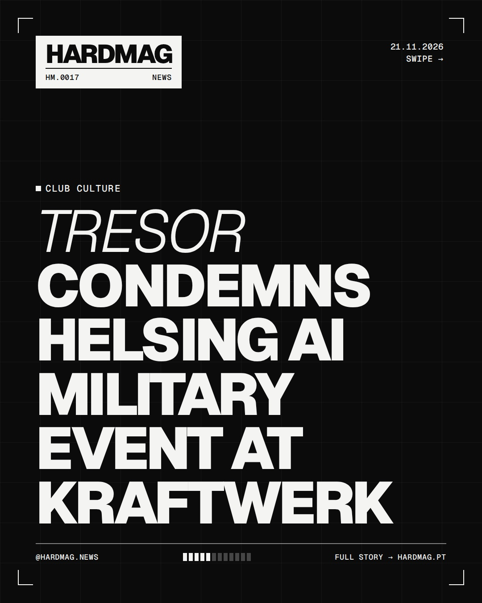 

<details><summary>Legenda</summary>

```
Tresor speaks out against a Helsing AI military event at Kraftwerk Berlin.

The Berlin institution issued a statement condemning the event. In its words, such an event "has no place in the spaces our community has built".

Should club communities have a say in who else uses their venues? 👇

Full story → hardmag.pt/news/2026-11-21-tresor-condemns-helsing-ai-military-event-at-kraft/ (link in bio)

Source: @djmagofficial
📸 via @djmagofficial

#tresor #berlin #techno #clubculture #ai
```
</details>

Verificado: caption ok (486 chars, 5 hashtags, 2 mentions) · 2 slide(s) online · website article ok · Instagram accepted the post

### domingo, 22/11, 08:59 · Notícias PT · ✅ pronto
**Hot Mix 5 co-founder Kenny 'Jammin' Jason has died** (news)

  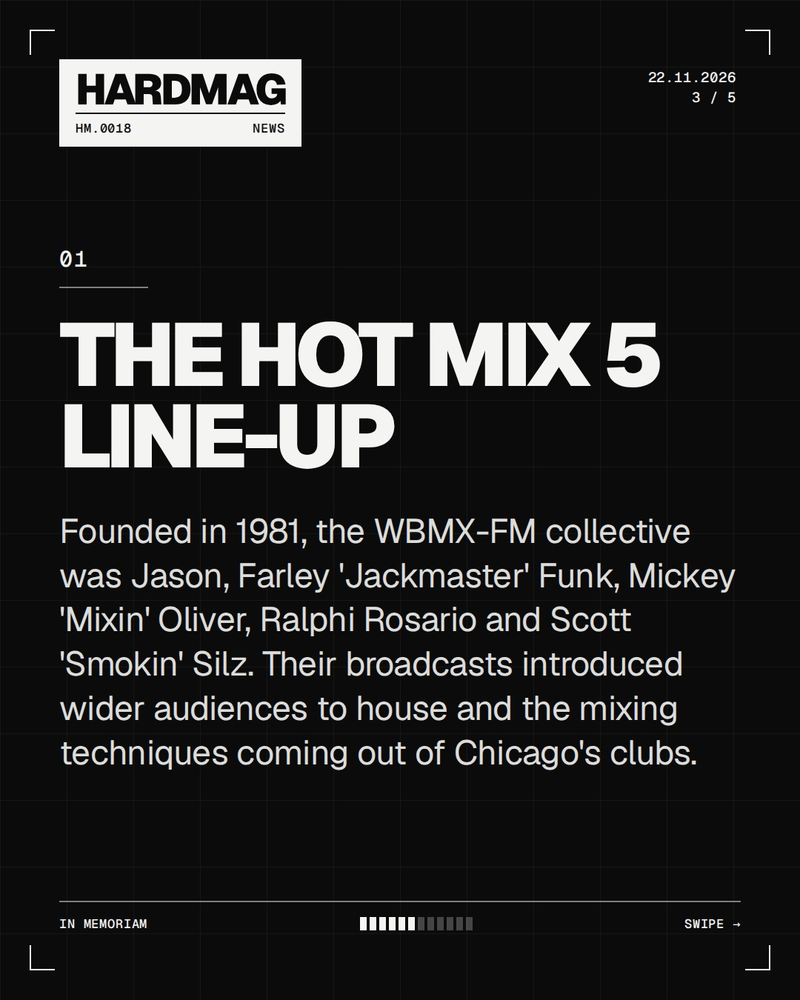  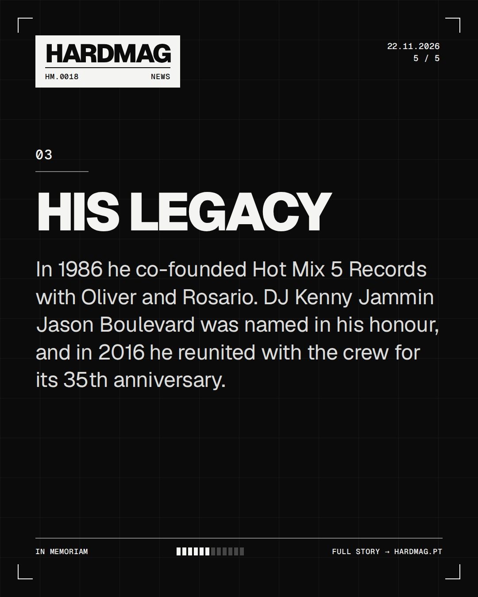

<details><summary>Legenda</summary>

```
Kenny 'Jammin' Jason, a founding member of the Hot Mix 5, has died. "I miss you already."

Farley 'Jackmaster' Funk announced his death on 19 November. No cause was disclosed. Jason released the six-track instrumental EP 'Jam Tracks' in 1985 and co-founded Hot Mix 5 Records in 1986, and DJ Kenny Jammin Jason Boulevard was named in his honour.

Which Hot Mix 5-era Chicago record still gets played in your sets? 👇

Full story → hardmag.pt/news/2026-11-22-hot-mix-5-co-founder-kenny-jammin-jason-has-died/ (link in bio)

Source: @electronicgroove
📸 via @electronicgroove

#chicagohouse #housemusic #hotmix5 #wbmx #inmemoriam
```
</details>

Verificado: caption ok (626 chars, 5 hashtags, 2 mentions) · 5 slide(s) online · video online · story online · website article ok · Instagram accepted the post (with motion cover) · Instagram accepted the story

### domingo, 22/11, 13:36 · Artistas · ✅ pronto
**Indira Paganotto remixes Depeche Mode for vinyl box set** (news)

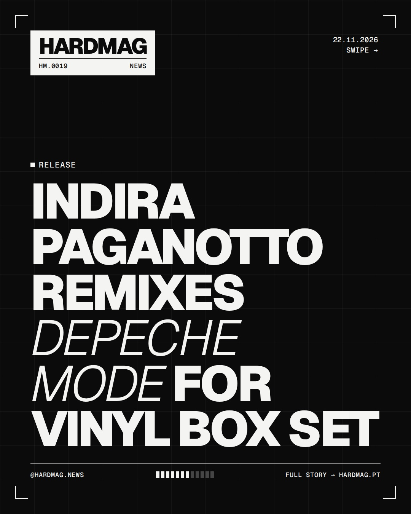 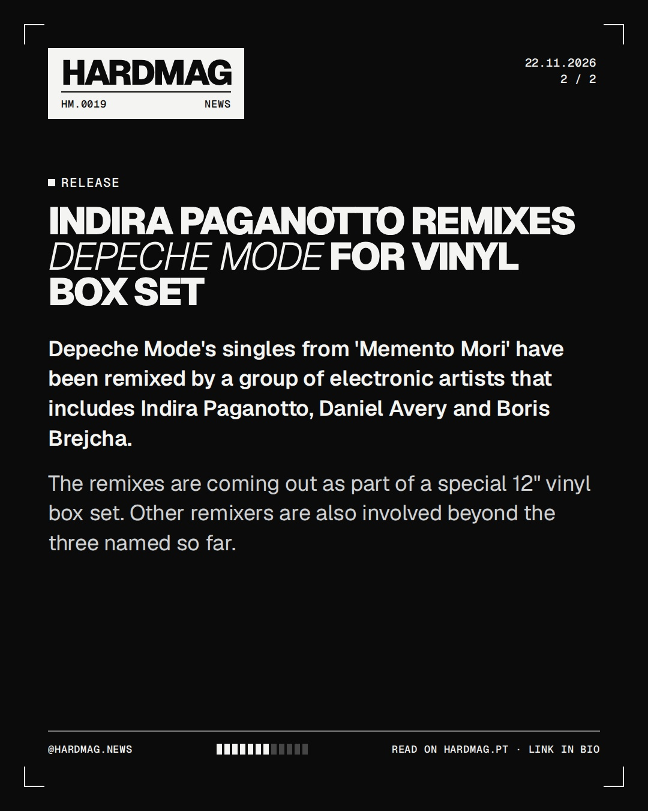

<details><summary>Legenda</summary>

```
@indirapaganotto, Daniel Avery and Boris Brejcha take on Depeche Mode's 'Memento Mori' singles.

The remixes are coming out as part of a special 12" vinyl box set. More artists are also on the remix roster.

Which Depeche Mode track would you most want to hear reworked for a club floor? 👇

Full story → hardmag.pt/news/2026-11-22-indira-paganotto-remixes-depeche-mode-for-vinyl-bo/ (link in bio)

Source: @djmagofficial
📸 via @djmagofficial

#depechemode #indirapaganotto #remix #vinyl #techno
```
</details>

Verificado: caption ok (496 chars, 5 hashtags, 3 mentions) · 2 slide(s) online · story online · website article ok · Instagram accepted the post · Instagram accepted the story

### domingo, 22/11, 19:48 · Cena · ✅ pronto
**Which Lisbon club owns your weekend?** (poll)


<details><summary>Legenda</summary>

```
Lisbon has rooms for every tempo, from hard techno to house to everything in between, and every raver has the one they keep going back to. We want to know where yours is. Vote, then tell us in the comments why: the sound system, the crowd, the door, the residents, or that one night you still talk about.

A: KØMPLEX
B: Lux Frágil
C: Ministerium
D: Planeta Manas
E: Musicbox Lisboa

Vote with the letter in the comments 👇

@komplexlisbon @luxfragil @ministeriumclub @planetamanas @musicboxlisboa

#hardmag #lisboa #lisbon #techno #house #hardtechno
```
</details>

Verificado: caption ok (549 chars, 6 hashtags, 5 mentions) · 1 slide(s) online · story online · website article ok · Instagram accepted the post · Instagram accepted the story

### segunda, 23/11, 08:37 · Notícias PT · ✅ pronto
**'You don't belong here': how Rane met the Steelworkerz** (news)

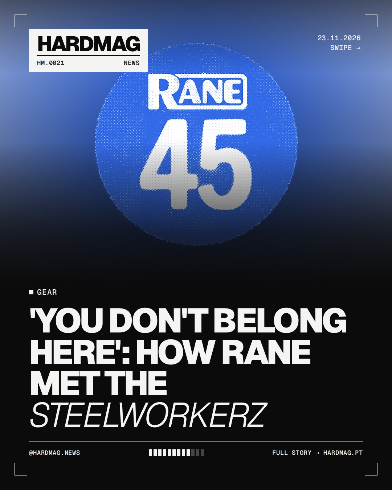 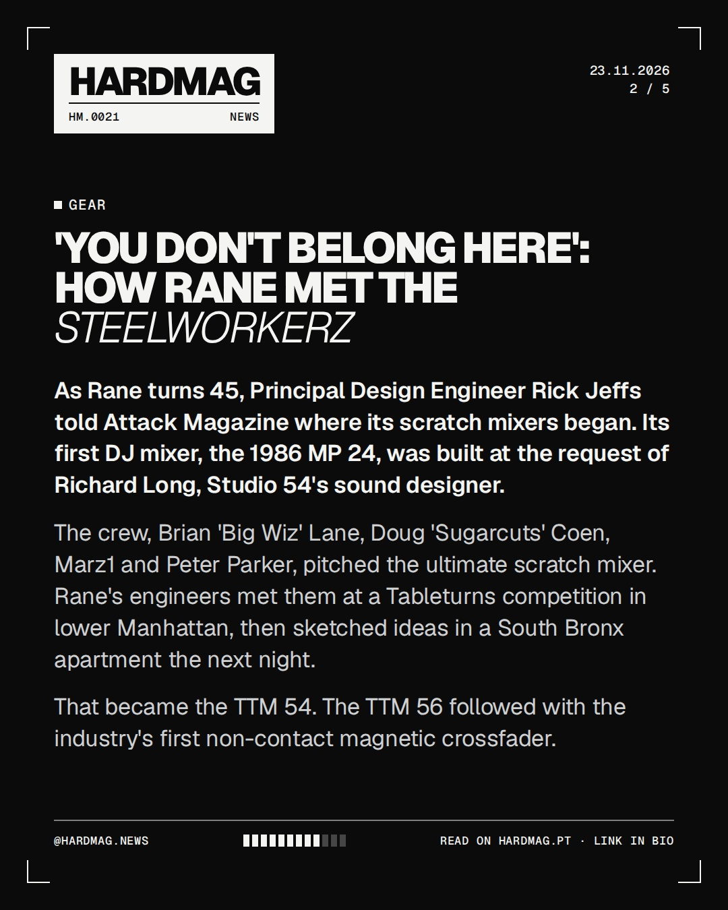 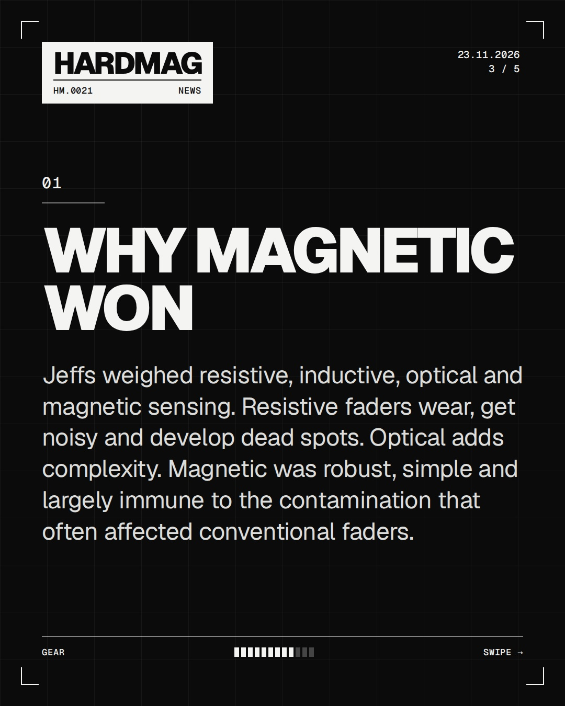  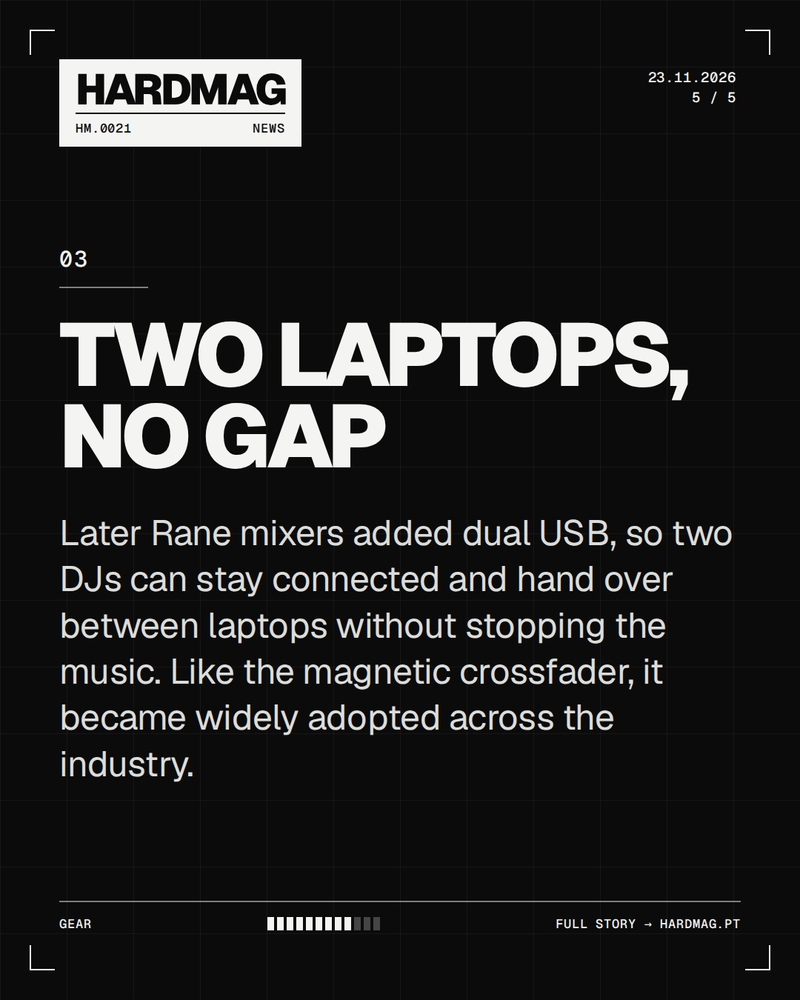

<details><summary>Legenda</summary>

```
A bouncer behind a steel door in a Manhattan alley told Rane's engineers they didn't belong.

When they said the Steelworkerz had invited them, his expression changed and they were let in. Inside, Rick Jeffs got his first look at true performance scratch mixing: DJs using turntables as musical instruments. The mixers those DJs had back then often lacked the features they wanted and struggled to hold up in competition, and that was the gap Rane set out to fill.

Magnetic or old-school contact crossfader: what difference do you actually feel when you cut? 👇

Full story → hardmag.pt/news/2026-11-23-you-dont-belong-here-how-rane-met-the-steelworkerz/ (link in bio)

Source: @attackmag
📸 via @attackmag

#rane #turntablism #scratchdj #djmixer #djgear #djhistory
```
</details>

Verificado: caption ok (766 chars, 6 hashtags, 2 mentions) · 5 slide(s) online · video online · story online · website article ok · Instagram accepted the post (with motion cover) · Instagram accepted the story

### segunda, 23/11, 13:15 · Artistas · ✅ pronto
**Innerbloom leaves the dancefloor in Hans Zimmer's hands** (news)

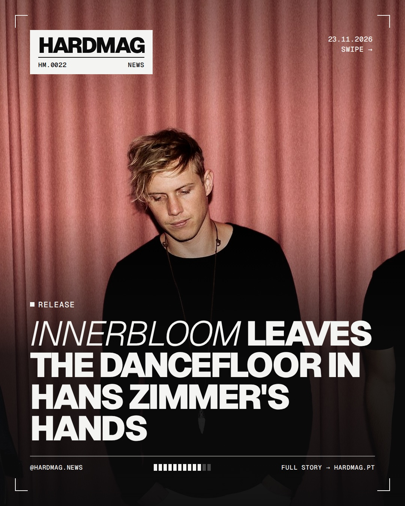 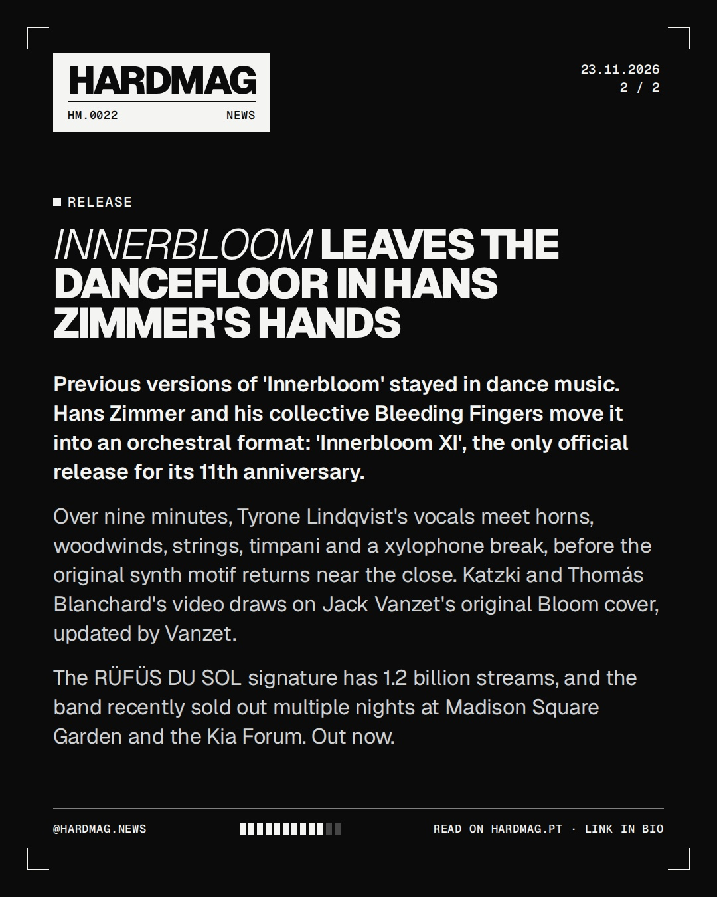

<details><summary>Legenda</summary>

```
Eleven years on, 'Innerbloom' trades the synths for timpani, until the motif comes back.

Every earlier version of RÜFÜS DU SOL's signature track stayed in dance music. 'Innerbloom XI' leaves it: Hans Zimmer and Bleeding Fingers rebuilt it as a nine-minute orchestral piece, and it is the only official release for the anniversary. The video is by Katzki and Thomás Blanchard, based on Jack Vanzet's Bloom artwork, which he updated for the release.

Do orchestral reworks of dance classics add something, or should these tracks stay on the dancefloor? 👇

Full story → hardmag.pt/news/2026-11-23-innerbloom-leaves-the-dancefloor-in-hans-zimmers-h/ (link in bio)

Source: @electronicgroove
📸 via @electronicgroove

#rufusdusol #hanszimmer #innerbloom #orchestral #melodichouse
```
</details>

Verificado: caption ok (776 chars, 5 hashtags, 2 mentions) · 2 slide(s) online · video online · story online · website article ok · Instagram accepted the post (with motion cover) · Instagram accepted the story


## Recentes
### sábado, 21/11, 13:30 · Artistas · ⏭️ pulado
**Arca, Justice and Fcukers land on the GTA VI album (publicado à mão)** (news)


<details><summary>Legenda</summary>

```

```
</details>

Verificado: –

### sábado, 21/11, 08:50 · Notícias PT · ⏭️ pulado
**(sem post: pausa)** (news)


<details><summary>Legenda</summary>

```

```
</details>

Verificado: –

