# HARDMAG: fila de posts

Atualizado sábado, 28/11, 17:11 (hora de Lisboa). Cada post é escrito, revisado pelo editor-chefe, renderizado e testado na API do Instagram até 2 dias antes do horário. No horário, só é publicado.

**Prontos:** 2 · **Horários ainda sem post (próximas 24 h):** domingo, 29/11, 08:38 Notícias PT, domingo, 29/11, 12:02 Almoço, domingo, 29/11, 15:13 Artistas, domingo, 29/11, 19:26 Cena, domingo, 29/11, 22:27 Noite

## Próximos
### sábado, 28/11, 19:32 · Cena · ✅ pronto
**Bouncy: guilty pleasure or the future?** (poll)

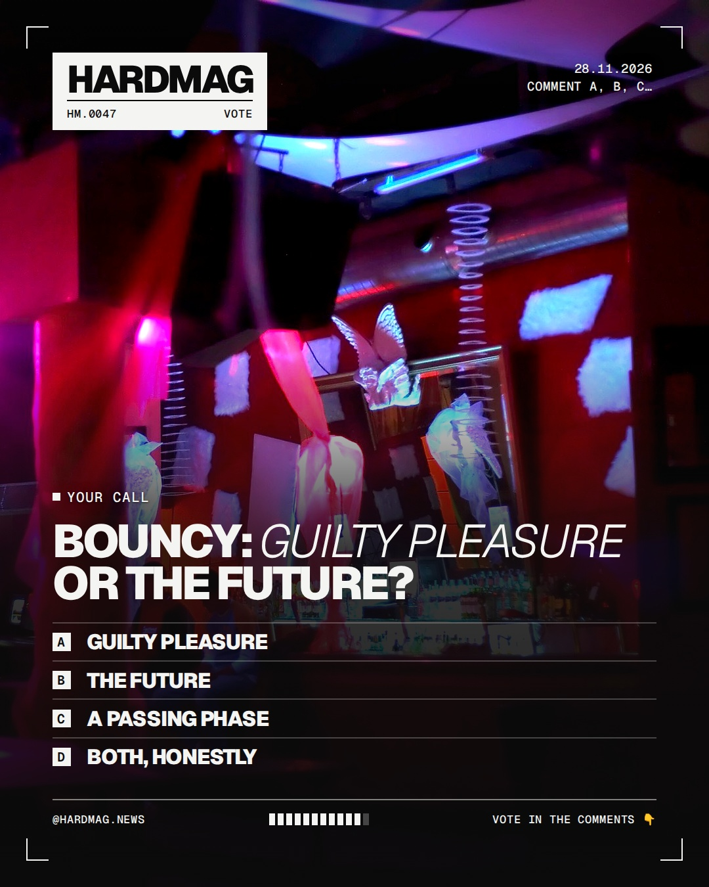

<details><summary>Legenda</summary>

```
Some people put on the bouncy track and look round to check nobody saw. Others queue at 2am just to hear it. Hard house kicks, those big hoovers, a groove that makes the whole pista jump at once. The sound is turning up in more and more sets, and the malta can't agree on what it is. Is it the cheeky detour you'd never admit to in the smoking area? The sound every warehouse party plays next year? Or something we'll laugh about in two summers? Vote, then tell us in the comments: which bouncy track turned you, or which one made you head for the bar? And in your city, Lisbon, Porto or wherever you dance, do the crowds go for it?

A: Guilty pleasure
B: The future
C: A passing phase
D: Both, honestly

Vote with the letter in the comments 👇

📸 Ricardo Liberato, CC BY-SA 2.0, via Wikimedia Commons

#hardmag #bouncy #hardhouse #hardgroove #fastgroove #lisboa
```
</details>

Verificado: caption ok (863 chars, 6 hashtags, 0 mentions) · 1 slide(s) online · story online · website article ok · Instagram accepted the post · Instagram accepted the story

### sábado, 28/11, 22:33 · Noite · ✅ pronto
**What ruins a night out fastest?** (poll)

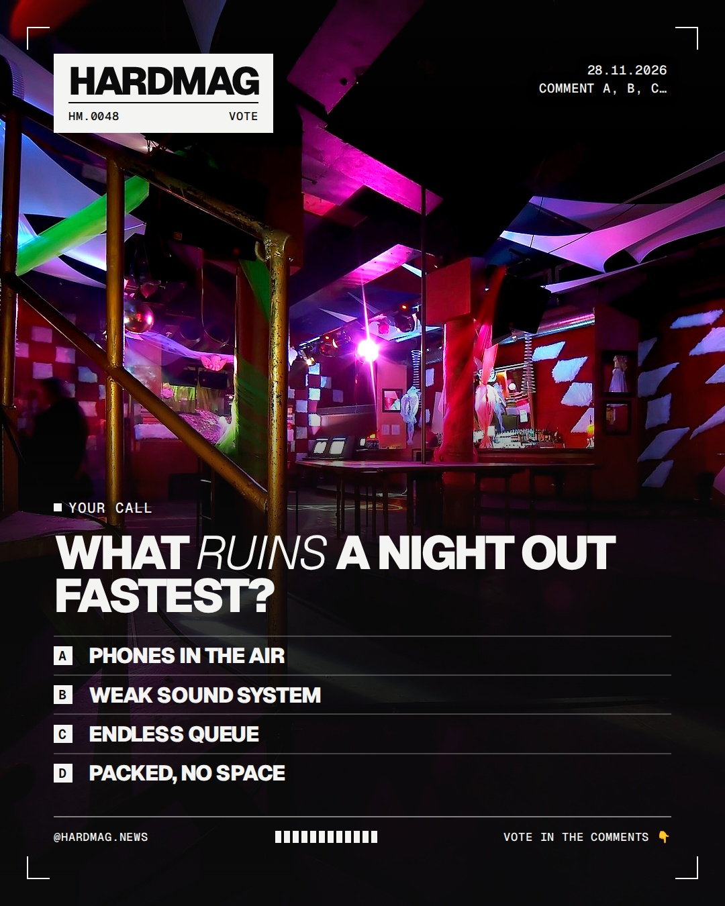

<details><summary>Legenda</summary>

```
You've waited all week, the lineup's good, your crew showed up on time for once. And then one thing goes wrong and kills the whole noite. We all have that one thing, and it's rarely the DJ. Whether you're into fast groove, bouncy, hard techno or a long house set, this one's for everyone who's been on a pista in Lisbon, Porto or anywhere else. Vote, then tell us in the comments about the night that got ruined, where it happened (no names needed if you'd rather not) and what the club could have done differently. Bonus points if you've got a fix nobody's tried yet. Tag the friend who was there with you.

A: Phones in the air
B: Weak sound system
C: Endless queue
D: Packed, no space

Vote with the letter in the comments 👇

📸 Ricardo Liberato, CC BY-SA 2.0, via Wikimedia Commons

#hardmag #clubculture #lisbonnightlife #portonightlife #techno #hardtechno
```
</details>

Verificado: caption ok (862 chars, 6 hashtags, 0 mentions) · 1 slide(s) online · story online · website article ok · Instagram accepted the post · Instagram accepted the story


## Recentes
### sábado, 28/11, 14:53 · Artistas · 📤 publicado
**Diego Miranda: from Ericeira to the Ushuaia booth** (spotlight)

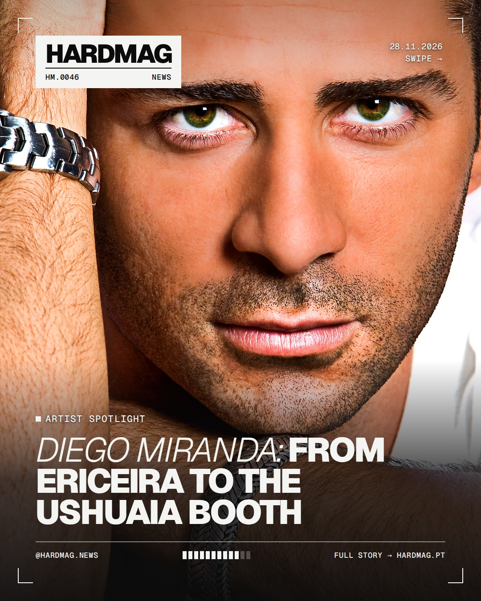  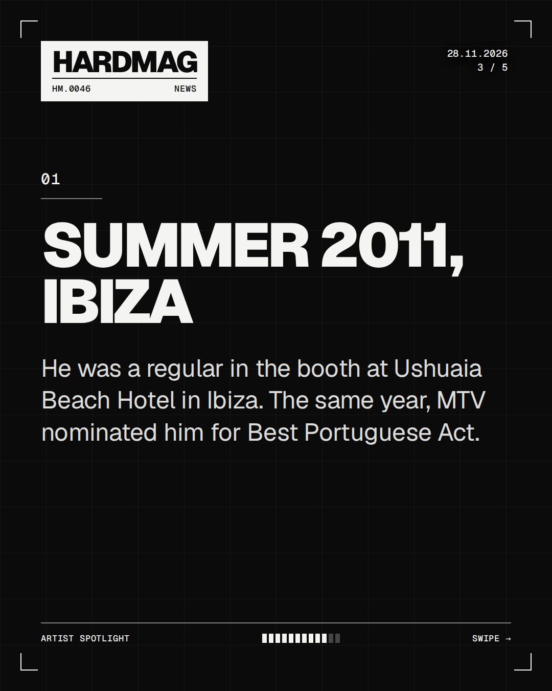 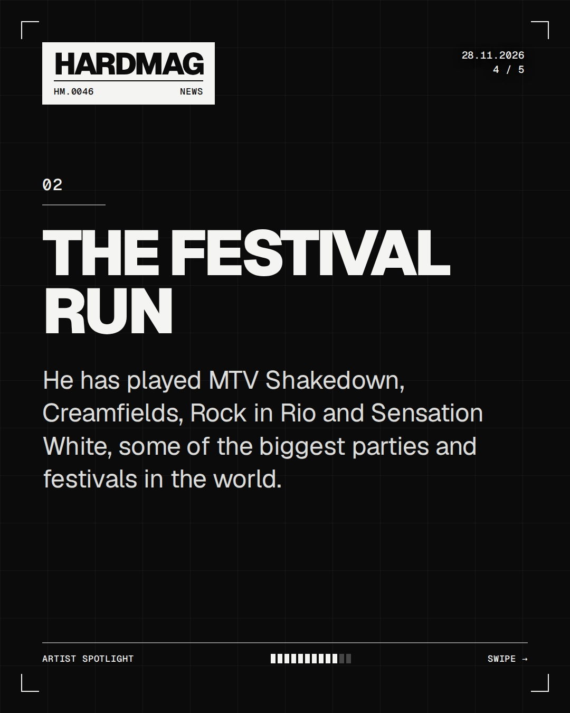 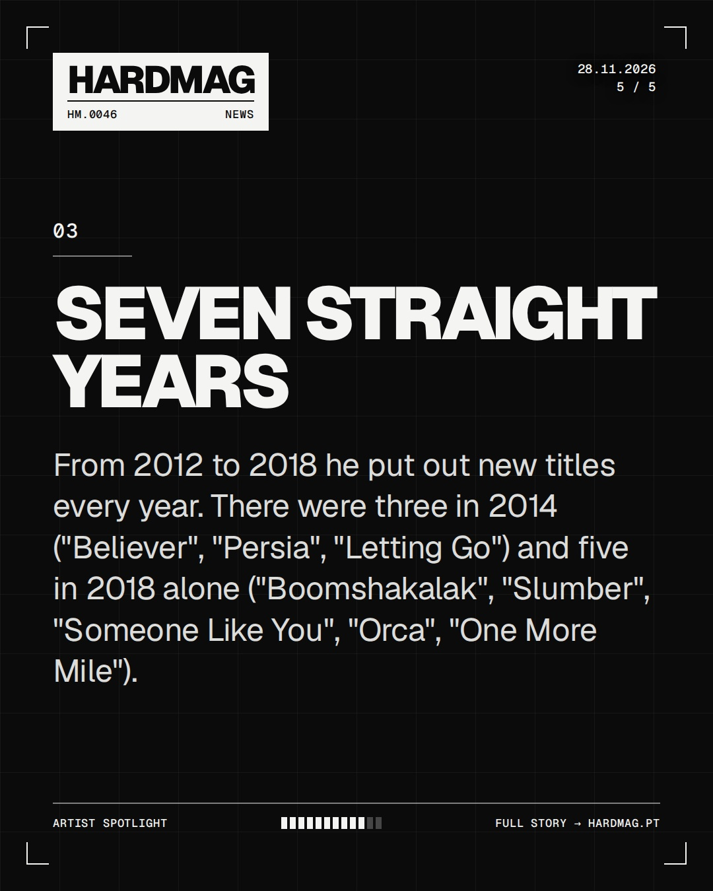

<details><summary>Legenda</summary>

```
Summer 2011, Ushuaia Beach Hotel, Ibiza: one of the regulars in the booth was born in Ericeira.

@djdiegomiranda broke through internationally in 2009 with "Ibiza for Dreams", and in 2011 MTV nominated him for Best Portuguese Act. He has played MTV Shakedown, Creamfields, Rock in Rio and Sensation White, and he put out new titles every year from 2012 to 2018.

HARDMAG's take: a producer from Ericeira named a track after the island, then got a regular slot in one of its booths. That's how you manifest a booking.

Which Portuguese DJ do you think made the biggest mark abroad? 👇

Full story → hardmag.pt/news/2026-11-28-diego-miranda-from-ericeira-to-the-ushuaia-booth/ (link in bio)

📸 DjDiegoMiranda, CC BY-SA 3.0, via Wikimedia Commons

#diegomiranda #portuguesedj #ericeira #ibiza #ushuaiaibiza
```
</details>

Verificado: caption ok (804 chars, 5 hashtags, 1 mentions) · 5 slide(s) online · video online · story online · website article ok · Instagram accepted the post (with motion cover) · Instagram accepted the story · [ver no Instagram](https://www.instagram.com/hardmag.news/)

### sábado, 28/11, 11:55 · Almoço · 📤 publicado
**Mamdani names Rachael Pazdan NYC's first Director of Music** (news)

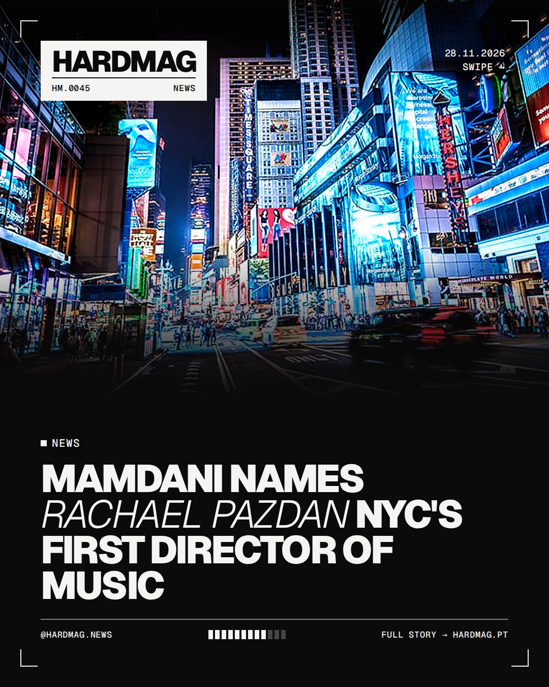 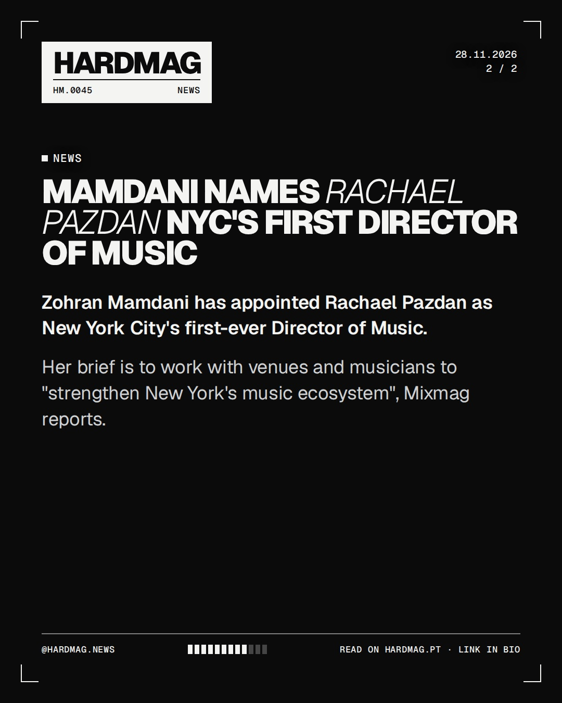

<details><summary>Legenda</summary>

```
Here's a job title Lisbon and Porto could borrow: Director of Music.

Zohran Mamdani has appointed Rachael Pazdan as New York City's first-ever Director of Music. Her brief, per Mixmag, is to work with venues and musicians to "strengthen New York's music ecosystem".

HARDMAG's take: it's a general music job, not a club job. But venues are in her brief, which means the clubs are too, and we'd happily see someone do that job here.

If Lisbon or Porto had a Director of Music, what would you want fixed first? 👇

Full story → hardmag.pt/news/2026-11-28-mamdani-names-rachael-pazdan-nycs-first-director-o/ (link in bio)

Source: @mixmag
📸 via @mixmag

#newyork #musicpolicy #musicvenues #clubculture #lisboa
```
</details>

Verificado: caption ok (709 chars, 5 hashtags, 2 mentions) · 2 slide(s) online · video online · story online · website article ok · Instagram accepted the post (with motion cover) · Instagram accepted the story · [ver no Instagram](https://www.instagram.com/hardmag.news/)

### sábado, 28/11, 09:00 · Notícias PT · 📤 publicado
**RIP Kenny 'Jammin' Jason, Delano Smith, Jamaica Suk** (news)

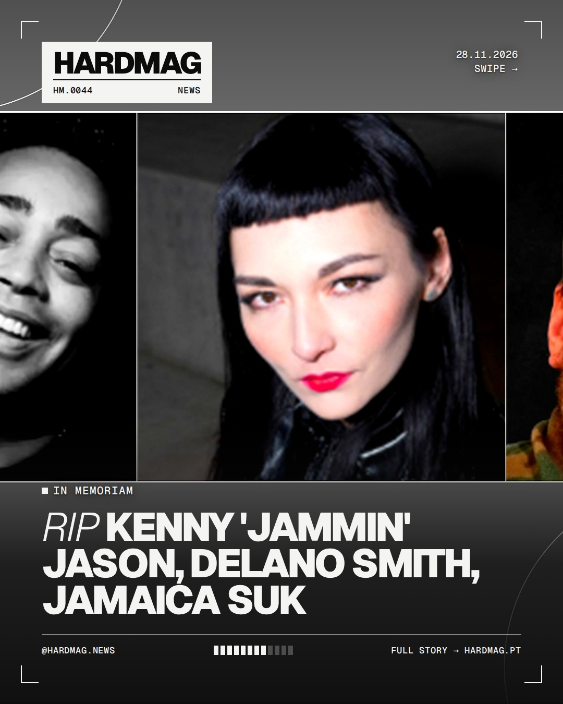 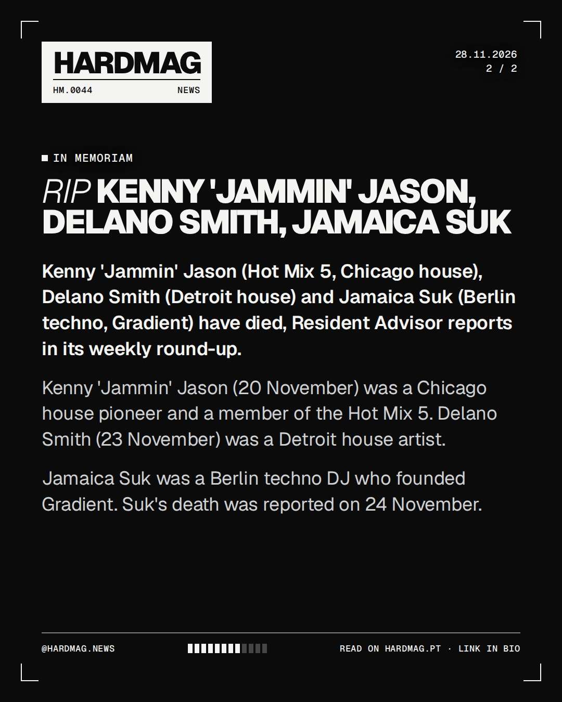

<details><summary>Legenda</summary>

```
One week, three names: Kenny 'Jammin' Jason, Delano Smith, Jamaica Suk.

Chicago house lost one of its pioneers, a member of the Hot Mix 5. Detroit house lost Delano Smith. Berlin techno lost Jamaica Suk, the DJ who founded Gradient.

Our take: there's no clever line for a week like this. The records say it better than we can.

Which record or set from any of these three stayed with you? 👇

Full story → hardmag.pt/news/2026-11-28-rip-kenny-jammin-jason-delano-smith-jamaica-suk/ (link in bio)

Source: Resident Advisor
📸 via Resident Advisor

#inmemoriam #chicagohouse #detroithouse #berlintechno #housemusic
```
</details>

Verificado: caption ok (614 chars, 5 hashtags, 0 mentions) · 2 slide(s) online · video online · story online · website article ok · Instagram accepted the post (with motion cover) · Instagram accepted the story · [ver no Instagram](https://www.instagram.com/hardmag.news/)

### sexta, 27/11, 22:29 · Noite · 📤 publicado
**Kavinsky's family breaks silence: "keep his music alive"** (news)

 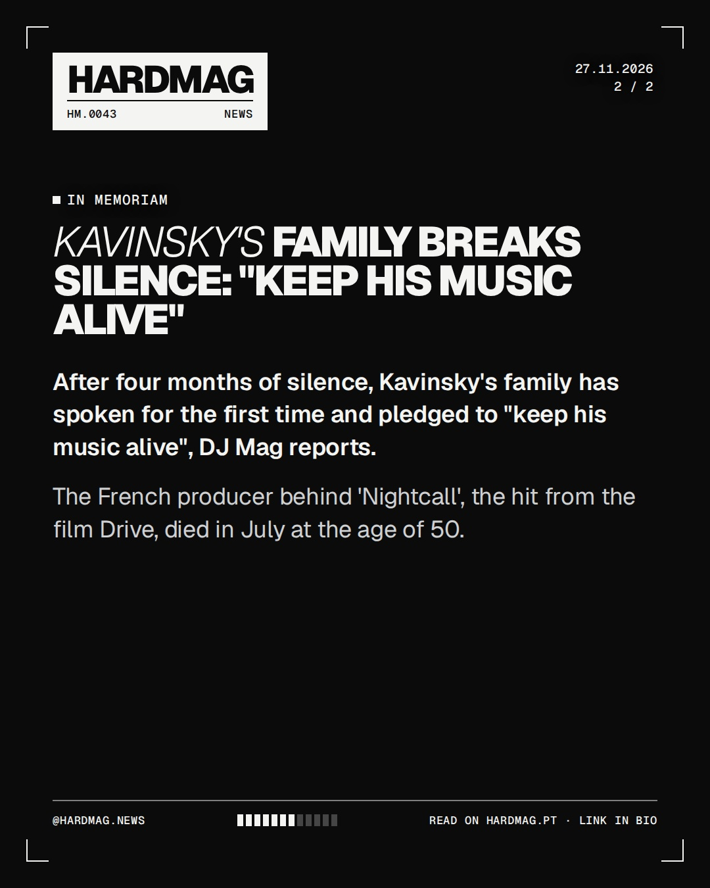

<details><summary>Legenda</summary>

```
Four months of silence, then one promise: "keep his music alive".

Kavinsky's family has broken its silence, DJ Mag reports. The French producer died in July aged 50. For most people his name means one track: 'Nightcall', the hit that soundtracked Drive and made him known well beyond the clubs.

HARDMAG's take (opinion): 'Nightcall' was never a peak-time record. It's the slow drive home with the windows down, that late-night synth sound that crossed over from the cinema to the pista, and it doesn't need anyone's help to stay alive.

Where were you the first time 'Nightcall' stopped you in your tracks? 👇

Full story → hardmag.pt/news/2026-11-27-kavinskys-family-breaks-silence-keep-his-music-ali/ (link in bio)

Source: @djmagofficial
📸 photochino, CC BY 2.0, via Wikimedia Commons

#kavinsky #nightcall #drive #electronicmusic #inmemoriam
```
</details>

Verificado: caption ok (848 chars, 5 hashtags, 1 mentions) · 2 slide(s) online · video online · story online · website article ok · Instagram accepted the post (with motion cover) · Instagram accepted the story · [ver no Instagram](https://www.instagram.com/hardmag.news/)

### sexta, 27/11, 22:29 · Noite · ❌ falhou
**Four months on, Kavinsky's family breaks its silence** (news)

> Erro: rejected on Telegram

 

<details><summary>Legenda</summary>

```
Four months after Kavinsky's death, his family has finally spoken.

The French producer died in July at 50, and his family's first public words are a promise to "keep his music alive".

Our take: a slow, brooding synth record that reached far beyond the pista, carried by a film, into the lives of people who never set foot in a club. Music like that has a way of staying alive on its own.

Where were you the first time you heard 'Nightcall'? 👇

Full story → hardmag.pt/news/2026-11-27-four-months-on-kavinskys-family-breaks-its-silence/ (link in bio)

Source: @djmagofficial
📸 photochino, CC BY 2.0, via Wikimedia Commons

#kavinsky #nightcall #drive #synthwave #inmemoriam
```
</details>

Verificado: caption ok (677 chars, 5 hashtags, 1 mentions) · 2 slide(s) online · video online · story online · website article ok · Instagram accepted the post (with motion cover) · Instagram accepted the story

### sexta, 27/11, 19:38 · Cena · 📤 publicado
**Fast groove or hard techno: what wins your night?** (poll)

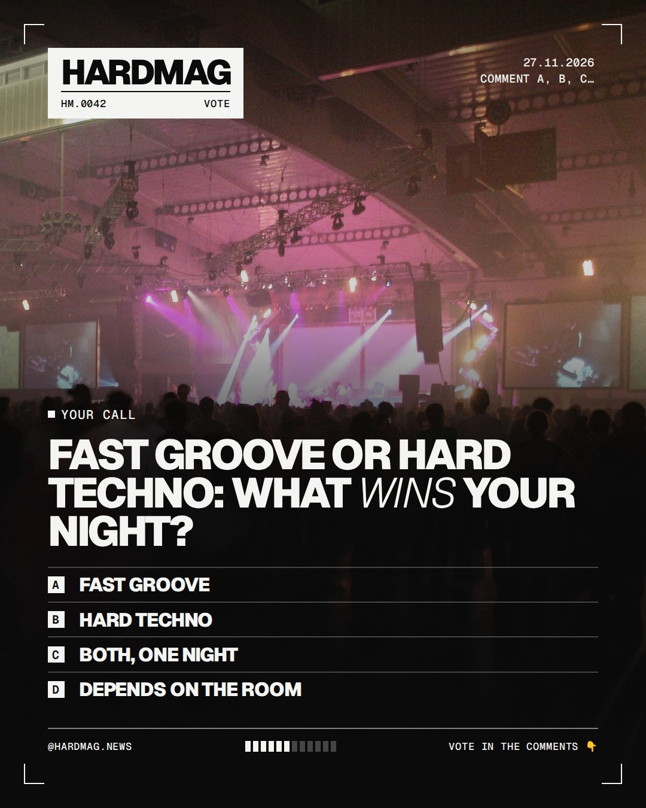

<details><summary>Legenda</summary>

```
It's 4am and the DJ has two ways to go. One keeps the percussion rolling, swinging and groovy so your hips do the work. The other goes heavy, all kicks, and your whole body does the work. Same BPM territory, two very different nights.

We're asking because the malta in Portugal splits on this all the time, at the bar, in the smoking area and in the group chat the day after. We want to know where the pista really stands.

Vote, then tell us in the comments: which set made you pick a side? Bonus points if you name the city and the club where it happened.

A: Fast groove
B: Hard techno
C: Both, one night
D: Depends on the room

Vote with the letter in the comments 👇

📸 photochino, CC BY 2.0, via Wikimedia Commons

#fastgroove #hardtechno #techno #lisbon #porto #portugal
```
</details>

Verificado: caption ok (779 chars, 6 hashtags, 0 mentions) · 1 slide(s) online · story online · website article ok · Instagram accepted the post · Instagram accepted the story · [ver no Instagram](https://www.instagram.com/hardmag.news/)

### sexta, 27/11, 19:38 · Cena · ❌ falhou
**Fast groove or bouncy: which owns your pista?** (poll)

> Erro: rejected on Telegram


<details><summary>Legenda</summary>

```
Two sounds, one dancefloor, and a lot of opinions in the smoking area. On one side you've got the rolling, percussive fast groove that keeps you locked in for hours. On the other, the bouncy hard house and hard groove wave that turns the whole room into one big jump. We cover both every day, so we want to know where the malta in Portugal actually stands. Vote, then tell us in the comments: which track or set sold you on your side, and where in Lisbon, Porto or beyond did you hear it? Tag the friend who always argues for the other one.

A: Fast groove
B: Bouncy
C: Both, same night
D: Depends on the hour

Vote with the letter in the comments 👇

📸 photochino, CC BY 2.0, via Wikimedia Commons

#fastgroove #bouncy #hardgroove #hardhouse #techno #lisboa
```
</details>

Verificado: caption ok (759 chars, 6 hashtags, 0 mentions) · 1 slide(s) online · story online · website article ok · Instagram accepted the post · Instagram accepted the story

### sexta, 27/11, 15:14 · Artistas · 📤 publicado
**What BPM actually feels right on the floor?** (poll)


<details><summary>Legenda</summary>

```
The BPM arms race isn't slowing down, but your legs at 6am might have other ideas. Every crowd has a tempo where it stops thinking and just moves. Some of you want the groove to breathe, some of you only wake up once the kicks start racing. No wrong answers here, just the number where the pista clicks for you. Vote, then tell us in the comments: which set in Portugal this year hit your perfect tempo, and did the DJ push it too far or keep it right where it should be?

A: Under 140
B: 140 to 150
C: 150 to 160
D: 160 and up

Vote with the letter in the comments 👇

📸 photochino, CC BY 2.0, via Wikimedia Commons

#hardmag #fastgroove #bouncy #hardtechno #techno #house
```
</details>

Verificado: caption ok (674 chars, 6 hashtags, 0 mentions) · 1 slide(s) online · story online · website article ok · Instagram accepted the post · Instagram accepted the story · [ver no Instagram](https://www.instagram.com/hardmag.news/)

