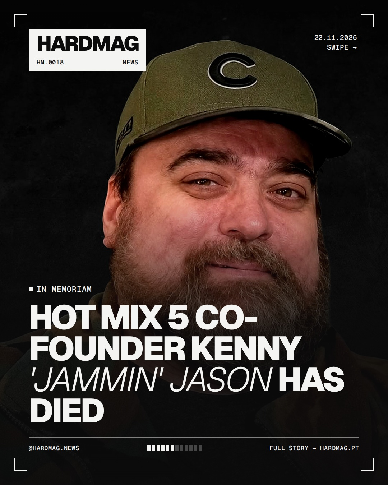
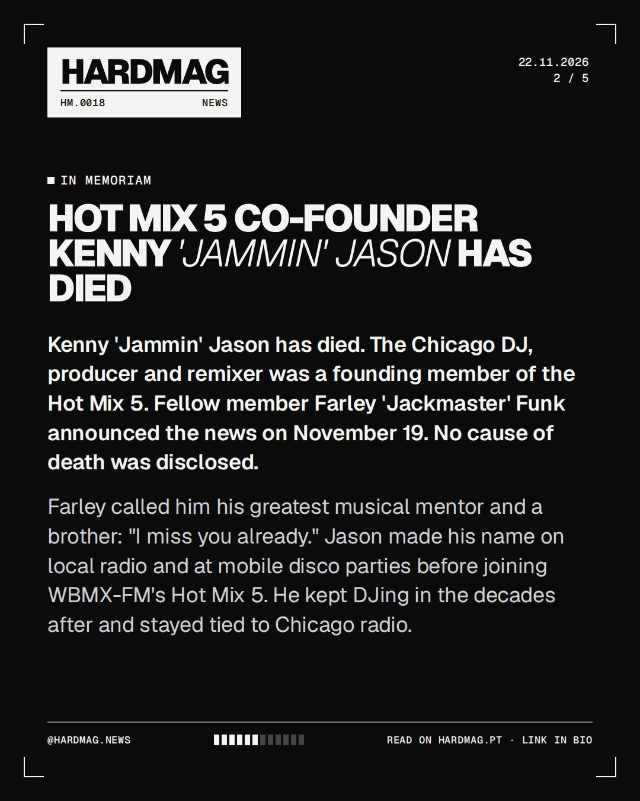

# HARDMAG: fila de posts

Atualizado sábado, 21/11, 18:01 (hora de Lisboa). Cada post é escrito, revisado pelo editor-chefe, renderizado e testado na API do Instagram até 2 dias antes do horário. No horário, só é publicado.

**Prontos:** 2 · **Horários ainda sem post (próximas 24 h):** domingo, 22/11, 13:36 Artistas, domingo, 22/11, 19:48 Cena

## Próximos
### sábado, 21/11, 19:54 · Cena · ✅ pronto
**Tresor condemns Helsing AI military event at Kraftwerk** (news)

 

<details><summary>Legenda</summary>

```
Tresor speaks out against a Helsing AI military event at Kraftwerk Berlin.

The Berlin institution issued a statement condemning the event. In its words, such an event "has no place in the spaces our community has built".

Should club communities have a say in who else uses their venues? 👇

Full story → hardmag.pt/news/2026-11-21-tresor-condemns-helsing-ai-military-event-at-kraft/ (link in bio)

Source: @djmagofficial
📸 via @djmagofficial

#tresor #berlin #techno #clubculture #ai
```
</details>

Verificado: caption ok (486 chars, 5 hashtags, 2 mentions) · 2 slide(s) online · website article ok · Instagram accepted the post

### domingo, 22/11, 08:59 · Notícias PT · ✅ pronto
**Hot Mix 5 co-founder Kenny 'Jammin' Jason has died** (news)

    

<details><summary>Legenda</summary>

```
Kenny 'Jammin' Jason, a founding member of the Hot Mix 5, has died. "I miss you already."

Farley 'Jackmaster' Funk announced his death on 19 November. No cause was disclosed. Jason released the six-track instrumental EP 'Jam Tracks' in 1985 and co-founded Hot Mix 5 Records in 1986, and DJ Kenny Jammin Jason Boulevard was named in his honour.

Which Hot Mix 5-era Chicago record still gets played in your sets? 👇

Full story → hardmag.pt/news/2026-11-22-hot-mix-5-co-founder-kenny-jammin-jason-has-died/ (link in bio)

Source: @electronicgroove
📸 via @electronicgroove

#chicagohouse #housemusic #hotmix5 #wbmx #inmemoriam
```
</details>

Verificado: caption ok (626 chars, 5 hashtags, 2 mentions) · 5 slide(s) online · video online · story online · website article ok · Instagram accepted the post (with motion cover) · Instagram accepted the story


## Recentes
### sábado, 21/11, 13:30 · Artistas · ⏭️ pulado
**Arca, Justice and Fcukers land on the GTA VI album (publicado à mão)** (news)


<details><summary>Legenda</summary>

```

```
</details>

Verificado: –

### sábado, 21/11, 08:50 · Notícias PT · ⏭️ pulado
**(sem post: pausa)** (news)


<details><summary>Legenda</summary>

```

```
</details>

Verificado: –

